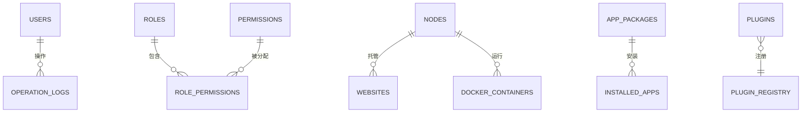
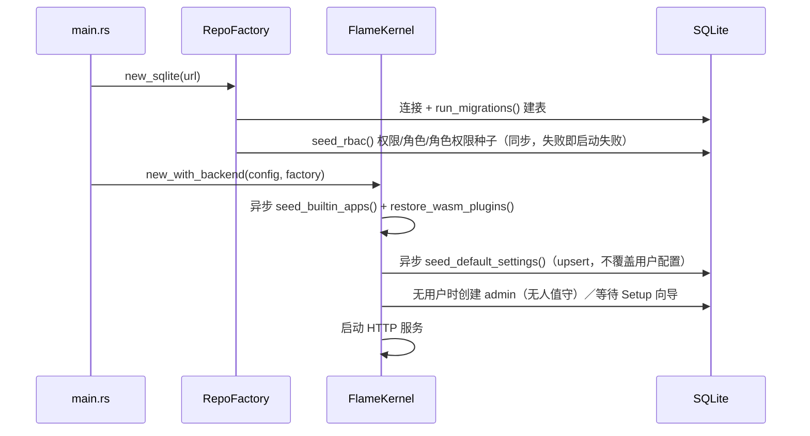

# 03 · 数据库设计

> FlamePanel SQLite 表结构、字段说明、实体关系与迁移机制

## 1. 概览

- **数据库引擎**：SQLite（`sqlx` 0.9 + `runtime-tokio`）
- **双模式**：InMemory（默认开发/测试）与 SQLite（生产）
- **迁移机制**：`infrastructure/sqlite.rs` 的 `run_migrations()` 在启动时自动执行 `CREATE TABLE IF NOT EXISTS`，幂等无副作用
- **时区**：`created_at` / `updated_at` 存储为 UTC 时间字符串

### 1.1 存储模式切换

| 场景 | `OP_DATABASE_URL` | 存储 |
|------|-------------------|------|
| 开发/测试默认 | `sqlite://data/app.db` | InMemory |
| 生产（install.sh） | `sqlite:/opt/flamepanel/data/flamepanel.db?mode=rwc` | SQLite |
| 手动指定 | 任意非默认 URL | SQLite |

> `main.rs` 判断：`config.database.url != "sqlite://data/app.db"` 时启用 SQLite。

## 2. 表结构总览

| 表 | 说明 | 创建位置 |
|----|------|----------|
| `users` | 用户 | sqlite.rs |
| `nodes` | 服务器节点 | sqlite.rs |
| `websites` | 网站 | sqlite.rs |
| `web_servers` | Web 服务器实例 | sqlite.rs |
| `operation_logs` | 操作审计日志 | sqlite.rs |
| `permissions` | 权限定义 | sqlite.rs |
| `roles` | 角色 | sqlite.rs |
| `role_permissions` | 角色-权限关联 | sqlite.rs |
| `logs` | 系统日志 | sqlite.rs |
| `databases` | 数据库实例（MySQL/Redis/PostgreSQL） | sqlite.rs |
| `panel_settings` | 面板 Key-Value 设置 | sqlite.rs |
| `firewall_rules` | 防火墙规则 | sqlite.rs |
| `app_packages` | 应用商店应用包 | sqlite.rs |
| `app_sources` | 远程应用源（M-A Issue 1.1） | sqlite.rs |
| `backup_accounts` | 备份账号（M-A 收尾 · Doc/20 §6.5） | sqlite.rs |
| `backup_jobs` | 备份任务/调度（M-A 收尾 Stage 3 · Doc/20 §6.5） | sqlite.rs |
| `runtimes` | 运行时（M-B 主线二 Stage A-1 · Doc/20 §5.2） | sqlite.rs |
| `projects` | 用户项目（M-B 主线二 Stage A-1 · Doc/20 §5.2） | sqlite.rs |
| `project_db_links` | 项目数据库联链（Stage A-10 · Doc/20 §5.8 ⑤） | sqlite.rs |
| `certificates` | SSL 证书记录（主线三 §6.1 Stage 1） | sqlite.rs |
| `dns_provider_accounts` | DNS 厂商账号（主线三 §6.1 Stage 4） | sqlite.rs |
| `waf_rules` | WAF 规则（主线三 §6.2） | sqlite.rs |
| `waf_logs` | WAF 拦截日志（主线三 §6.2） | sqlite.rs |
| `agent_principals` | MCP 接入凭证（M-AI-1 · Doc/34） | sqlite/mod.rs |
| `agent_sessions` | MCP 会话（M-AI-1） | sqlite/mod.rs |
| `tool_calls` | MCP 工具调用审计（M-AI-1） | sqlite/mod.rs |
| `tool_approvals` | MCP 写操作审批单（M-AI-2） | sqlite/mod.rs |
| `user_two_factor` | 用户 TOTP 两步验证（Doc/33） | sqlite/mod.rs |
| `installed_apps` | 已安装应用 | sqlite.rs |
| `plugins` | WASM 插件（持久化） | sqlite.rs |
| `outbox_events` | 事件 Outbox（Stage 9，事件落库可重试） | sqlite.rs |
| `scheduled_tasks` | 定时任务 | sqlite.rs |
| `memos` | 备忘录 / TODO | sqlite.rs |
| `tasks` | 统一任务状态机持久化（TaskTracker） | sqlite.rs |

## 3. 表结构详解

### 3.1 `users` — 用户

| 字段 | 类型 | 约束 | 说明 |
|------|------|------|------|
| id | INTEGER | PK AUTOINCREMENT | 主键 |
| username | TEXT | NOT NULL UNIQUE | 用户名 |
| password_hash | TEXT | NOT NULL | bcrypt 密码哈希 |
| role | TEXT | NOT NULL DEFAULT 'user' | 角色名（admin/operator/viewer） |
| created_at | TEXT | NOT NULL | 创建时间 |

### 3.2 `nodes` — 服务器节点

| 字段 | 类型 | 约束 | 说明 |
|------|------|------|------|
| id | INTEGER | PK AUTOINCREMENT | 主键 |
| name | TEXT | NOT NULL | 节点名称 |
| hostname | TEXT | NOT NULL | 主机名 |
| ip_address | TEXT | NOT NULL | IP 地址 |
| status | TEXT | NOT NULL DEFAULT 'unknown' | 状态（online/offline/unknown） |
| created_at | TEXT | NOT NULL | 创建时间 |

### 3.3 `websites` — 网站

| 字段 | 类型 | 约束 | 说明 |
|------|------|------|------|
| id | INTEGER | PK AUTOINCREMENT | 主键 |
| name | TEXT | NOT NULL | 网站名称 |
| domain | TEXT | NOT NULL UNIQUE | 域名（唯一） |
| root_path | TEXT | NOT NULL | 站点根目录 |
| status | TEXT | NOT NULL DEFAULT 'active' | 状态 |
| node_id | INTEGER | NOT NULL DEFAULT 0 | 所属节点 |
| engine | TEXT | NOT NULL DEFAULT 'nginx' | Web 引擎 |
| ssl_enabled | INTEGER | NOT NULL DEFAULT 0 | 是否启用 SSL |
| proxy_enabled | INTEGER | NOT NULL DEFAULT 0 | 是否启用反向代理 |
| proxy_pass | TEXT | 可空 | 代理目标地址 |
| site_type | TEXT | NOT NULL DEFAULT 'static' | 站点类型（runtime_php/reverse_proxy/static/container_app，M-B Stage A-6） |
| runtime_id | INTEGER | 可空 | 绑定的运行时（runtime_php 场景） |
| project_id | INTEGER | 可空 | 绑定的项目（reverse_proxy + 项目场景） |
| rewrite_preset | TEXT | 可空 | 已套用的伪静态模板名（wordpress/discuz/typecho/laravel/thinkphp/springboot；NULL = 未套用；Doc/20 §5.5 收口） |
| created_at | TEXT | NOT NULL | 创建时间 |
| resource_version | INTEGER | NOT NULL DEFAULT 0 | 乐观并发版本号 |

> 索引：`idx_websites_site_type`（site_type）。各列均经幂等迁移 `add_column_if_missing` 补齐，老库升级安全。
> `rewrite_preset` 为**生效配置的持久化载体**：站点配置每次重生成（套用/清除/证书绑定/引擎切换）
> 都会按该名注入对应引擎语法的规则块——套用状态不因配置重写而丢失。

### 3.4 `web_servers` — Web 服务器实例

| 字段 | 类型 | 约束 | 说明 |
|------|------|------|------|
| id | INTEGER | PK AUTOINCREMENT | 主键 |
| engine | TEXT | NOT NULL | 引擎（nginx/apache/…） |
| version | TEXT | 可空 | 版本 |
| status | TEXT | NOT NULL DEFAULT 'stopped' | 状态 |
| config_path | TEXT | NOT NULL DEFAULT '' | 配置文件路径 |
| binary_path | TEXT | 可空 | 二进制路径 |
| port | INTEGER | NOT NULL DEFAULT 80 | 监听端口 |
| created_at | TEXT | NOT NULL | 创建时间 |

### 3.5 `operation_logs` — 操作审计日志

| 字段 | 类型 | 约束 | 说明 |
|------|------|------|------|
| id | INTEGER | PK AUTOINCREMENT | 主键 |
| username | TEXT | NOT NULL | 操作人 |
| action | TEXT | NOT NULL | 动作（如 file_write） |
| target | TEXT | 可空 | 操作目标 |
| ip | TEXT | 可空 | 来源 IP |
| created_at | TEXT | NOT NULL | 时间 |

### 3.6 `permissions` — 权限定义

| 字段 | 类型 | 约束 | 说明 |
|------|------|------|------|
| id | INTEGER | PK AUTOINCREMENT | 主键 |
| resource | TEXT | NOT NULL | 资源（user/node/docker/…） |
| action | TEXT | NOT NULL | 动作（read/create/update/delete/…） |
| description | TEXT | NOT NULL DEFAULT '' | 描述 |
| — | — | UNIQUE(resource, action) | 业务主键（`idx_permissions_resource_action`）：种子 upsert 的冲突目标，同时阻止同资源同动作重复定义 |

> **索引迁移**：唯一索引由 `run_migrations()` 幂等补建；补建前先做一次幂等去重
> （保留最小 id 行，先清理指向被裁行的映射与孤儿映射，再裁权限行，避免撞主键/外键），
> 覆盖曾手工改库的实例。

### 3.7 `roles` — 角色

| 字段 | 类型 | 约束 | 说明 |
|------|------|------|------|
| id | INTEGER | PK AUTOINCREMENT | 主键 |
| name | TEXT | NOT NULL UNIQUE | 角色名 |
| description | TEXT | NOT NULL DEFAULT '' | 描述 |

### 3.8 `role_permissions` — 角色-权限关联

| 字段 | 类型 | 约束 | 说明 |
|------|------|------|------|
| role_id | INTEGER | NOT NULL, PK 复合 | 角色 ID |
| permission_id | INTEGER | NOT NULL, PK 复合 | 权限 ID |
| 外键 | — | role_id → roles(id), permission_id → permissions(id) | — |

> **种子（SQLite 模式）**：三张 RBAC 表的**唯一写入路径**是启动期
> `infrastructure/sqlite.rs::seed_rbac()`（由 `RepoFactory::new_sqlite()` 在迁移后同步调用）。
> `permissions` / `roles` 走 upsert（只更新描述）；`role_permissions` **仅在角色尚无任何映射时**
> 写入默认集合——已有映射（经角色管理定制的授权）保持不动。详见 [07-权限体系设计 §5.1](./07-权限体系设计.md)。
> 历史缺陷：该函数曾缺失，导致 SQLite 模式三表恒空、admin 全站 403（见 CHANGELOG）。

### 3.9 `logs` — 系统日志

| 字段 | 类型 | 约束 | 说明 |
|------|------|------|------|
| id | INTEGER | PK AUTOINCREMENT | 主键 |
| source | TEXT | NOT NULL | 来源（system/plugin/…） |
| level | TEXT | NOT NULL | 级别（info/warn/error/…） |
| message | TEXT | NOT NULL | 日志内容 |
| metadata | TEXT | 可空 | 元数据（JSON） |
| created_at | TEXT | NOT NULL | 时间 |

### 3.10 `databases` — 数据库实例

| 字段 | 类型 | 约束 | 说明 |
|------|------|------|------|
| id | INTEGER | PK AUTOINCREMENT | 主键 |
| db_type | TEXT | NOT NULL | 类型（mysql/mariadb/redis/postgres） |
| name | TEXT | NOT NULL | 实例名称 |
| version | TEXT | NOT NULL DEFAULT '' | 版本 |
| port | INTEGER | NOT NULL DEFAULT 3306 | 端口 |
| status | TEXT | NOT NULL DEFAULT 'stopped' | 状态 |
| install_path | TEXT | NOT NULL DEFAULT '' | 安装路径 |
| data_dir | TEXT | NOT NULL DEFAULT '' | 数据目录 |
| config_file | TEXT | NOT NULL DEFAULT '' | 配置文件 |
| root_user | TEXT | NOT NULL DEFAULT 'root' | 管理员账号 |
| created_at / updated_at | TEXT | NOT NULL | 创建/更新时间 |

### 3.11 `panel_settings` — 面板设置

| 字段 | 类型 | 约束 | 说明 |
|------|------|------|------|
| key | TEXT | PK | 设置键 |
| value | TEXT | NOT NULL DEFAULT '' | 值 |
| description | TEXT | NOT NULL DEFAULT '' | 描述 |
| updated_at | TEXT | NOT NULL | 更新时间 |

**内置设置项**（`domain/entity/system.rs` 的 `default_settings()`）：

| key | 默认值 | 说明 |
|-----|--------|------|
| panel_name | FlamePanel | 面板名称 |
| theme | light | 主题 |
| language | zh-CN | 界面语言 |
| panel_port | 8080 | 面板端口 |
| session_timeout_minutes | 1440 | 会话超时 |
| log_level | info | 日志级别 |
| log_retention_days | 30 | 日志保留天数 |
| two_factor_enabled | false | **强制**所有用户启用 TOTP 两步验证（`true` 时未绑定的用户只能访问绑定相关端点，见 Doc/02 §1.4 `TWO_FACTOR_SETUP_REQUIRED`）；关闭时 2FA 仍可由用户自愿启用。写入即刷新运行时策略 |
| app_signature_policy | optional | 应用包验签策略（M-A 1.3）：optional 源配公钥才验签 / required 远程包强制验签。经 `GET/PUT /api/app-store/security` 可视化读写（§4.2 收口） |
| appstore_registry_whitelist | （空） | 应用商店镜像仓库白名单追加项（逗号分隔，与内置白名单合并去重；条目仅接受 `host[:port]` 形态，上限 50 项） |

### 3.12 `firewall_rules` — 防火墙规则

| 字段 | 类型 | 约束 | 说明 |
|------|------|------|------|
| id | INTEGER | PK AUTOINCREMENT | 主键 |
| name | TEXT | NOT NULL | 规则名称 |
| description | TEXT | 可空 | 描述 |
| protocol | TEXT | NOT NULL DEFAULT 'any' | 协议（tcp/udp/any） |
| port | TEXT | 可空 | 端口/端口范围 |
| source | TEXT | DEFAULT '0.0.0.0/0' | 来源 |
| destination | TEXT | 可空 | 目标 |
| action | TEXT | NOT NULL DEFAULT 'allow' | 动作（allow/deny） |
| enabled | INTEGER | NOT NULL DEFAULT 1 | 是否启用 |
| priority | INTEGER | NOT NULL DEFAULT 50 | 优先级（小者优先） |
| direction | TEXT | NOT NULL DEFAULT 'in' | 方向（in/out） |
| created_at / updated_at | TEXT | NOT NULL | 创建/更新时间 |

**默认规则**（`default_firewall_rules()`）：SSH(22)、HTTP(80)、HTTPS(443)、面板(8080) 放行 + 拒绝所有入站兜底。

### 3.13 `app_packages` — 应用商店应用包

| 字段 | 类型 | 约束 | 说明 |
|------|------|------|------|
| id | INTEGER | PK AUTOINCREMENT | 主键 |
| key | TEXT | NOT NULL UNIQUE | 应用唯一键 |
| name | TEXT | NOT NULL | 应用名称 |
| category | TEXT | NOT NULL DEFAULT '' | 分类 |
| format | TEXT | NOT NULL | 格式（flame/onepanel/baota） |
| description | TEXT | NOT NULL DEFAULT '' | 描述 |
| logo | TEXT | 可空 | Logo |
| metadata_json | TEXT | NOT NULL | AppMetadata JSON |
| source_path | TEXT | 可空 | 源路径 |
| source | TEXT | NOT NULL DEFAULT 'local' | 包来源（local 本地导入 / git / http） |
| source_url | TEXT | 可空 | 来源地址（本地包为 NULL） |
| synced_at | DATETIME | 可空 | 远程同步到本地时刻（本地包为 NULL） |
| created_at / updated_at | TEXT | NOT NULL | 创建/更新时间 |

### 3.14 `app_sources` — 远程应用源（M-A Issue 1.1）

| 字段 | 类型 | 约束 | 说明 |
|------|------|------|------|
| id | INTEGER | PK AUTOINCREMENT | 主键 |
| name | TEXT | NOT NULL | 源显示名称 |
| source_type | TEXT | NOT NULL | 源类型（git / http） |
| url | TEXT | NOT NULL UNIQUE | 源地址（重复添加被拒绝） |
| enabled | INTEGER | NOT NULL DEFAULT 1 | 是否启用 |
| public_key | TEXT | 可空 | Ed25519 公钥（应用包验签，Doc/20 §4.2） |
| last_synced_at | DATETIME | 可空 | 最近一次索引同步时刻 |
| created_at / updated_at | TEXT | NOT NULL | 创建/更新时间 |

**索引**：`idx_app_sources_enabled ON app_sources(enabled)`（启用状态过滤）、`idx_app_packages_source ON app_packages(source)`（按源过滤应用列表）

> 远程源同步（M-A Issue 1.2）：索引同步经 `RemoteAppSource` 端口拉取后以 `create_many` 幂等落库（已存在 key 跳过），成功后触达 `last_synced_at`；同步任务记录复用统一任务中心 `tasks` 表。
>
> 包签名验签（M-A Issue 1.3）：源配置 `public_key` 后，同步阶段（git 源包体就地验证）与安装阶段（按包来源 url 关联源）强制校验包根 `signature.sig`（Ed25519 对包内容摘要的签名，base64）。settings `app_signature_policy=required` 时未配公钥的源拒绝同步/安装其远程包。

### 3.14a `backup_accounts` — 备份账号（M-A 收尾 Stage 1 · Doc/20 §6.5）

| 字段 | 类型 | 约束 | 说明 |
|------|------|------|------|
| id | INTEGER | PK AUTOINCREMENT | 主键 |
| name | TEXT | NOT NULL UNIQUE | 账号显示名称（重复命名被拒绝） |
| account_type | TEXT | NOT NULL | 账号类型（s3 / sftp / local） |
| config_json | TEXT | NOT NULL DEFAULT '{}' | 后端连接配置（JSON，由对应 BackupBackend 实现自解析）。**落库前经 AES-256-GCM 加密**为 `enc:v1:` 前缀密文（空 `{}` 不加密） |
| enabled | INTEGER | NOT NULL DEFAULT 1 | 是否启用 |
| last_test_status | TEXT | 可空 | 最近一次连通性测试：ok / failed |
| last_test_at | DATETIME | 可空 | 最近一次连通性测试时刻 |
| created_at / updated_at | TEXT | NOT NULL | 创建/更新时间 |

**索引**：`idx_backup_accounts_enabled ON backup_accounts(enabled)`（启用状态过滤）

> Stage 1 交付数据层与账号 CRUD/连通性测试登记（`/api/backup-accounts`）。
> Stage 2（已落地）：`BackupBackend` trait 三实现——`LocalBackend`（本地目录）/ `SftpBackend`（ssh2，密码或私钥）/ `S3Backend`（object_store，S3 兼容：AWS S3 / MinIO / OSS / COS / R2）；连通性测试升级为真实探测（连接 + 认证 + 写探针）；备份编排按账号路由（upload/download/list/delete 远端对象，REST 见 Doc/02 §16.1）。
> 凭据加密（Doc/20 §6.5 收尾）：`config_json` 含 SFTP 密码 / S3 secretKey 等敏感字段，写库前统一 AES-256-GCM 加密（HKDF-SHA256 派生密钥，主密钥持久化于 `data/secret_encryption.key`，首次启动生成，权限 0600）；读取时透明解密，**历史明文行静默兼容**（首次编辑后写回即完成迁移）。密钥文件丢失则历史密文不可解，需重建备份账号。

### 3.14b `backup_jobs` — 备份任务（M-A 收尾 Stage 3 · Doc/20 §6.5）

| 字段 | 类型 | 约束 | 说明 |
|------|------|------|------|
| id | INTEGER | PK AUTOINCREMENT | 主键 |
| name | TEXT | NOT NULL UNIQUE | 任务显示名称（重复命名被拒绝） |
| scope | TEXT | NOT NULL DEFAULT 'panel' | 备份范围：panel（面板库）/ app（应用目录） |
| scope_key | TEXT | 可空 | 范围内具体对象：panel 恒空；app 为应用 key |
| schedule | TEXT | NOT NULL DEFAULT '0 3 * * *' | 标准 5 字段 cron 表达式 |
| target_account_id | INTEGER | NOT NULL DEFAULT 0 | 目标备份账号（backup_accounts.id，服务层校验存在性） |
| retention | INTEGER | NOT NULL DEFAULT 7 | 远端备份保留份数（超出删最旧；0 = 用默认 7） |
| enabled | INTEGER | NOT NULL DEFAULT 1 | 是否启用 |
| last_status | TEXT | NOT NULL DEFAULT 'never' | 最近一次执行：success / failed（never = 从未执行） |
| last_message | TEXT | 可空 | 最近一次失败原因（成功为空） |
| last_remote_key | TEXT | 可空 | 最近一次成功执行的远端对象 key |
| last_run_at | DATETIME | 可空 | 最近一次执行时刻 |
| next_run_at | DATETIME | 可空 | 下一次计划执行时刻 |
| created_at / updated_at | TEXT | NOT NULL | 创建/更新时间 |

**索引**：`idx_backup_jobs_enabled ON backup_jobs(enabled)`（启用状态过滤，调度筛选）

> Stage 3 交付：计划备份任务 CRUD + 调度 tick（后台 Supervisor 每 30s，同任务防重叠）+
> 执行编排（panel 复用 VACUUM INTO 快照；app 目录 tar.gz 打包上传后清理本地临时包）+
> 远端保留策略 + 云端恢复（`/api/backup-jobs/restore-cloud`）+
> Outbox `BackupSucceeded`/`BackupFailed` 通知。REST 见 Doc/02 §16.2。

### 3.14c `runtimes` — 运行时（M-B 主线二 Stage A-1 · Doc/20 §5.2）

| 字段 | 类型 | 约束 | 说明 |
|------|------|------|------|
| id | INTEGER | PK AUTOINCREMENT | 主键 |
| kind | TEXT | NOT NULL，UNIQUE(kind, version) | 语言种类：php / java / node / python / go / tomcat |
| version | TEXT | NOT NULL | 版本号：8.2 / 21 / 20.11 ... |
| install_path | TEXT | NOT NULL DEFAULT '' | 安装路径：/opt/flamepanel/runtimes/<kind>/<version> |
| status | TEXT | NOT NULL DEFAULT 'not_installed' | not_installed / installing / installed / running / error |
| is_default | INTEGER | NOT NULL DEFAULT 0 | 同 kind 唯一默认版本（仓储层事务内先清后设） |
| metadata_json | TEXT | 可空 | 扩展元数据 JSON（扩展列表、端口、env 等） |
| created_at / updated_at | TEXT | NOT NULL | 创建/更新时间 |

**索引**：`idx_runtimes_kind ON runtimes(kind)`（语言 Tab 过滤 + 可用版本清单）

> **Stage B-2 增量说明（Doc/20 §5.3）**：`kind` 白名单新增 `tomcat`
> （Java WAR 容器运行时，与 JDK 分离以支持多版本并存）；表结构无变更。
> 目录式安装（Node tar.xz / Python 源码编译 / Tomcat tar.gz）落
> `install_path`，不新增数据库列。

### 3.14d `projects` — 用户项目（M-B 主线二 Stage A-1 · Doc/20 §5.2）

| 字段 | 类型 | 约束 | 说明 |
|------|------|------|------|
| id | INTEGER | PK AUTOINCREMENT | 主键 |
| name | TEXT | NOT NULL UNIQUE | 项目名（重复命名被拒绝） |
| runtime_id | INTEGER | 可空 | 绑定运行时（runtimes.id；static 项目为空，服务层校验存在性） |
| kind | TEXT | NOT NULL DEFAULT 'static' | php / jar / war / node / python / go / static |
| source | TEXT | NOT NULL DEFAULT 'local_path' | local_path / git |
| source_url | TEXT | 可空 | git 仓库地址（source = git 时必填，服务层校验） |
| deploy_path | TEXT | NOT NULL DEFAULT '' | 部署路径：/opt/flamepanel/projects/<name> |
| run_command | TEXT | 可空 | 启动命令（模板变量 $RUNTIME / $DEPLOY） |
| port | INTEGER | 可空 | 监听端口 |
| domain | TEXT | 可空 | 可选绑定网站域名 |
| status | TEXT | NOT NULL DEFAULT 'stopped' | building / running / stopped / error |
| process_unit | TEXT | 可空 | systemd unit 名（flame-proj-<id>.service） |
| deploy_type | TEXT | NOT NULL DEFAULT 'manual' | 部署方式：manual / webhook（Stage A-7 · Doc/20 §5.8） |
| auto_deploy | INTEGER | NOT NULL DEFAULT 0 | webhook 自动部署开关（webhook 通道必须开启） |
| webhook_token | TEXT | NOT NULL DEFAULT '' | Webhook 部署令牌（API 响应不回显，enable 时一次性返回） |
| procfile_json | TEXT | 可空 | Procfile 进程类型声明 JSON（Stage A-8 · Doc/20 §5.8 ③） |
| build_type | TEXT | NOT NULL DEFAULT 'runtime' | 构建器协商结果：dockerfile / buildpacks / runtime（Stage A-8 · Doc/20 §5.8 ②） |
| health_check_path | TEXT | NOT NULL DEFAULT '' | 健康检查路径（空 = 未启用；Stage A-9 · Doc/20 §5.8 ④） |
| deploy_strategy | TEXT | NOT NULL DEFAULT 'restart' | 切换策略：restart（直接重启）/ rolling（健康检查零停机） |
| created_at / updated_at | TEXT | NOT NULL | 创建/更新时间 |

**索引**：`idx_projects_status ON projects(status)`（项目列表/部署任务筛选）、
`idx_projects_runtime_id ON projects(runtime_id)`（运行时关联查询）

> Stage A-9 交付：`projects` 幂等加列 `health_check_path`（默认空 = 未启用）/
> `deploy_strategy`（默认 restart，老库升级安全）——零停机切换数据面：rolling 策略重启时
> 轮询 `http://127.0.0.1:{port}{health_check_path}`，通过即切换、失败回滚旧实例并发
> `ProjectZeroDowntimeFailed` 事件告警；REST `POST /api/projects/:id/health-check`。
>
> Stage A-7 交付：`projects` 幂等加列 `deploy_type`/`auto_deploy`/`webhook_token`
> （老库升级安全），REST `/api/projects/:id/webhook[/enable|/disable]` 三端点，
> webhook 端点免 JWT 但经令牌守卫（中间件集中校验，常量时间比较）。

> Stage A-8 交付：`projects` 幂等加列 `procfile_json`（③）与 `build_type`（②），
> 老库升级安全；构建器自动协商顺序 Dockerfile → pack-cli → Runtime。

> Stage A-1 交付：数据层全链路——幂等迁移 + domain 实体（白名单校验）+ Repository trait +
> Sqlite/InMemory 双仓储 + RepoFactory 注册。REST / 进程守护见后续 Stage。
>
> Stage A-2 交付：`RuntimeService` 安装编排——安装/卸载/设默认/可用版本清单，
> 经 `RuntimeInstaller` 端口按 kind 路由（PHP 发行版包路径先行），安装失败落
> `error` 状态保留记录，error/not_installed 允许重试，已安装拒绝重复安装。

#### 3.14.x `project_db_links` — 项目数据库联链（Stage A-10 · Doc/20 §5.8 ⑤）

Dokku link 模式：一条记录 = 项目 ↔ 数据库实例的一次关联。**连接串不落库**——由
服务层在项目启动/部署时按 `db_type` 现场生成注入（凭据仅内存流转）。

| 字段 | 类型 | 约束 | 说明 |
|------|------|------|------|
| id | INTEGER | PRIMARY KEY AUTOINCREMENT | 联链 ID |
| project_id | INTEGER | NOT NULL | 项目 ID（引用 projects.id，服务层校验） |
| db_instance_id | INTEGER | NOT NULL | 数据库实例 ID（引用 database_instances.id，服务层校验） |
| env_name | TEXT | NOT NULL | 注入的环境变量名（DATABASE_URL / MYSQL_URL / REDIS_URL 或自定义） |
| created_at | TEXT | NOT NULL DEFAULT (datetime('now')) | 创建时间 |

**约束**：`UNIQUE(project_id, env_name)`（同项目内变量名唯一）、
`UNIQUE(project_id, db_instance_id)`（同项目同一实例不重复关联）。

**索引**：`idx_project_db_links_project ON project_db_links(project_id)`
（启动/部署编排按项目查询联链的高频路径）。

> Stage A-10 交付：联链 REST `GET/POST /api/projects/:id/links`、
> `GET .../links/available`、`DELETE .../links/:linkId`；连接串生成经
> `DbLinkProvider` 端口（infrastructure 组合根注入 NativeDbLinkProvider），
> 主机恒为 127.0.0.1、URL 特殊字符 percent-encode、凭据不落日志；项目删除
> 级联清理联链记录（幂等）。

### 3.14y `certificates` — SSL 证书记录（主线三 §6.1 · Stage 1 数据层）

SSL 证书自动化数据层：一条记录 = 一次签发/上传的证书（SAN 列表维度唯一）。
ACME 账户私钥不落本表——持久化在 `data/acme/account.key`（0600，首次启动生成，
重启复用；`AcmeAccountKeyStore`）；DNS 厂商 API 凭据复用 `SecretCipher` 加密语义。

| 字段 | 类型 | 约束 | 说明 |
|------|------|------|------|
| id | INTEGER | PRIMARY KEY AUTOINCREMENT | 证书 ID |
| domains | TEXT | NOT NULL UNIQUE | SAN 列表 JSON（主域名 + 备用/泛域名，如 `["example.com","*.example.com"]`） |
| source | TEXT | NOT NULL DEFAULT 'letsencrypt' | 证书来源：letsencrypt / zerossl / self_signed / uploaded |
| dns_provider | TEXT | NULL | DNS-01 厂商：cloudflare / aliyun / tencent / huawei（HTTP-01 为 NULL） |
| auto_renew | INTEGER | NOT NULL DEFAULT 1 | 是否自动续签（到期前 30 天窗口） |
| cert_path | TEXT | NULL | 证书文件路径（PEM 全链） |
| key_path | TEXT | NULL | 私钥文件路径（0600） |
| expires_at | DATETIME | NULL | 到期时刻（PEM 解析得来） |
| last_renewed_at | DATETIME | NULL | 最近一次签发/续签时刻 |
| website_id | INTEGER | NULL | 关联网站 ID（解除绑定不删除记录） |
| created_at | TEXT | NOT NULL DEFAULT (datetime('now')) | 创建时间 |
| updated_at | TEXT | NOT NULL DEFAULT (datetime('now')) | 更新时间 |

**约束**：`UNIQUE(domains)`——同域名集合视为同一证书，重复签发请求落同一条记录。

**索引**：`idx_certificates_expires ON certificates(expires_at)`（续签扫描按到期
时间过滤）、`idx_certificates_website ON certificates(website_id)`（站点维度查询）。

> Stage 1 交付：数据层（Certificate 实体 + CertificateRepository trait +
> Sqlite/InMemory 双仓储）与 ACME 账户密钥持久化。实体内聚 `validate_domains`
> 域名白名单校验与 `needs_renewal` 续签窗口判定。
>
> Stage 2 交付：ACME v2 签发链路（自研最小客户端 `infrastructure/acme/client.rs`，
> JWS ES256 经 ring；HTTP-01/DNS-01 质询 `challenge.rs` + `DnsProvider` 端口）、
> 签发编排 `application/certificate_service.rs`（同域名集合幂等续签回写）、
> 站点绑定（SAN 覆盖校验 + 引擎 443 配置原子改写 + ssl_enabled 回写）与
> REST `/api/certificates*`（certificate 资源组权限）。证书/私钥落
> `data/certs/<主域名>/`（fullchain.pem + privkey.pem 0600）。续签后台任务
>（renewer tick）属 Stage 3。

### 3.14z `dns_provider_accounts` — DNS 厂商账号（主线三 §6.1 · Stage 4）

DNS-01 验证的厂商 API 凭据托管：面板替用户向厂商写 `_acme-challenge` TXT 记录，
是泛域名（`*.example.com`）签发与无人值守续签的前置。`credentials_json` 为各厂商
各自的凭据结构（Cloudflare API Token / 阿里云 AccessKey 对等）序列化，落库前经
`SecretCipher`（AES-256-GCM）加密为 `enc:v1:` 密文（对齐备份账号语义），使用时
透明解密，历史明文行静默兼容。

| 字段 | 类型 | 约束 | 说明 |
|------|------|------|------|
| id | INTEGER | PRIMARY KEY AUTOINCREMENT | 账号 ID |
| name | TEXT | NOT NULL UNIQUE | 展示名称 |
| provider_type | TEXT | NOT NULL | 厂商标识：cloudflare / aliyun / tencent / huawei |
| credentials_json | TEXT | NOT NULL DEFAULT '{}' | 厂商凭据（JSON，落库前加密） |
| enabled | INTEGER | NOT NULL DEFAULT 1 | 是否启用 |
| last_test_status | TEXT | NULL | 最近一次连通性测试：ok / failed |
| last_test_at | DATETIME | NULL | 最近一次测试时刻 |
| created_at | TEXT | NOT NULL DEFAULT (datetime('now')) | 创建时间 |
| updated_at | TEXT | NOT NULL DEFAULT (datetime('now')) | 更新时间 |

**索引**：`idx_dns_provider_accounts_enabled ON dns_provider_accounts(enabled)`
（账号列表开关 + 续签调度筛选）。

> Stage 4 交付：数据层（DnsProviderAccount 实体 + Repository trait +
> Sqlite/InMemory 双仓储）、Service（CRUD + 凭据加密 + 凭据结构级连通性探测）
> 与 REST `/api/dns-providers*`（dns_provider 资源组权限）。响应不回显
> credentials_json。

### 3.15 `waf_rules` / `waf_logs` — WAF 基础防护（主线三 §6.2）

WAF 规则与拦截日志（对标 1Panel 社区版/宝塔免费层）。规则评估为面板进程内
引擎（`webserver/waf.rs`，与具体 Web 服务器适配解耦），首期规则集：CC 频率
限制（固定窗口计数）、SQL 注入 / XSS 特征（OWASP CRS 精选子集）、IP / UA
黑白名单、路径封禁。默认动作 `log` 仅告警（观察期优先可观测），白名单优先级
最高。

`waf_rules`：

| 字段 | 类型 | 约束 | 说明 |
|------|------|------|------|
| id | INTEGER | PRIMARY KEY AUTOINCREMENT | 规则 ID |
| name | TEXT | NOT NULL | 规则名称 |
| rule_type | TEXT | NOT NULL | cc / sql_injection / xss / ip_blacklist / ip_whitelist / ua_blacklist / ua_whitelist / path_block |
| website_id | INTEGER | NOT NULL DEFAULT 0 | 作用网站（0 = 全局规则） |
| pattern | TEXT | NOT NULL DEFAULT '' | 匹配值（IP/CIDR、UA 子串、路径前缀；特征类可空） |
| config_json | TEXT | NOT NULL DEFAULT '{}' | 类型参数（cc：threshold / window_secs） |
| action | TEXT | NOT NULL DEFAULT 'log' | 命中动作：log / block |
| enabled | INTEGER | NOT NULL DEFAULT 1 | 是否启用 |
| created_at / updated_at | TEXT | NOT NULL | 时间戳 |

**索引**：`idx_waf_rules_website`（站点维度过滤）、`idx_waf_rules_enabled`
（引擎评估拉取启用规则）。

`waf_logs`：id / website_id / rule_id / rule_name（名称快照，删规则后可读）/
rule_type / action / client_ip / request_summary（方法+路径，超长截断）/
user_agent（超长截断）/ created_at。**敏感请求头与 body 不落库**。

**索引**：`idx_waf_logs_website`（站点过滤）、`idx_waf_logs_created`
（时间倒序分页 + 保留清理）。

**保留策略**：`waf_logs` 保留 30 天，由组合根每日 `data-retention-cleanup`
后台任务经 `WafService::cleanup_logs_older_than` 触达 `delete_older_than`
清理（与系统日志 `logs` 同级保留，F-12 数据保留策略对齐）。
>
> Stage 5 交付（Plan Step 2）：真实厂商 API——`infrastructure/acme/dns_real.rs`
> 落地 Cloudflare（API Token）与阿里云（RPC HMAC-SHA1 签名）两家 Provider：
> TXT 记录幂等写入/清理（泛域名 `*.` 归一化到 `_acme-challenge.<主域>`）、
> 零副作用连通性探测（Token verify / DescribeDomains）。签发与续签编排按证书
> `dns_provider` 声明在启用账号中解析、`open_credentials` 透明解密构造 Provider，
> 泛域名无人值守续签闭环打通；`POST /api/certificates/issue/acme` 新增
> `dns_provider_account_id` 请求字段。
>
> Step 3 交付：tencent（TC3-HMAC-SHA256 签名，DNSPod API 3.0）与 huawei
> （IAM token 认证 + DNS v2 recordsets，token 缓存 1 小时）Provider 补齐，
> 四家厂商真实 API 全覆盖（`build_provider` 组合根路由），连通性探测全部
> 升级为真实 API 零副作用验证；前端新增设置页「DNS 厂商」Tab 与 ACME
> 签发表单厂商账号下拉。

### 3.15 `installed_apps` — 已安装应用

| 字段 | 类型 | 约束 | 说明 |
|------|------|------|------|
| id | INTEGER | PK AUTOINCREMENT | 主键 |
| package_key | TEXT | NOT NULL | 应用键 |
| name | TEXT | NOT NULL | 实例名称 |
| version | TEXT | NOT NULL | 版本 |
| mode | TEXT | NOT NULL DEFAULT 'container' | 安装模式（container/native/wasm） |
| status | TEXT | NOT NULL DEFAULT 'stopped' | 状态 |
| access_url | TEXT | 可空 | 访问地址 |
| install_path | TEXT | NOT NULL DEFAULT '' | 安装路径 |
| container_name | TEXT | 可空 | 容器名 |
| port | INTEGER | 可空 | 端口 |
| params_json | TEXT | NOT NULL DEFAULT '{}' | 安装参数（JSON） |
| created_at / updated_at | TEXT | NOT NULL | 创建/更新时间 |

**索引**：`idx_installed_apps_key ON installed_apps(package_key)`

### 3.15a `agent_principals` / `agent_sessions` / `tool_calls` — MCP 接入（M-AI-1 · Doc/34）

启动时幂等建表（`infrastructure/sqlite/mod.rs`，`SqliteMcpRepository`）。

`agent_principals`（凭证）：id / name / user_id（签发者，工具按其**当前**角色鉴权）/
token_prefix（展示用前 12 位）/ token_hash（SHA-256，UNIQUE；明文 `fpk_` 令牌只在签发响应返回一次）/
created_at / last_used_at / expires_at（可空 = 永不过期）/ revoked_at（可空）/
allow_write（INTEGER，默认 0；M-AI-2 起由 `add_column_if_missing` 为老库补列，存量凭证保持只读）。

`agent_sessions`（会话）：id（TEXT，即 `Mcp-Session-Id`）/ principal_id / client_name / client_version /
protocol_version / created_at / last_seen_at / closed_at。**索引**：`idx_agent_sessions_seen`。

`tool_calls`（调用审计）：id / principal_id / session_id / tool / arguments（脱敏后 JSON）/ ok / error /
duration_ms / created_at。**索引**：`idx_tool_calls_principal`、`idx_tool_calls_session`。
**保留策略**：只保留最近 1 万条（`McpService::record_call` 每写入 200 条裁剪一次）。

`tool_approvals`（M-AI-2 写操作审批单）：id / principal_id / session_id / tool / risk（`write` / `destructive`）/
arguments（脱敏后 JSON，≤ 2 KiB，对外展示）/ raw_arguments（执行用原始参数，**不经 API 返回**）/ preview（dry-run 描述）/
status（`pending` / `executing` / `succeeded` / `failed` / `rejected` / `expired`）/ requested_at / expires_at（+30 min）/
decided_by / decided_at / reason / result（≤ 8 KiB）/ finished_at。状态迁移以 `UPDATE … WHERE status = ?` 比较并设置，
过期在读取与创建时惰性执行。**索引**：`idx_tool_approvals_status`、`idx_tool_approvals_principal`。

### 3.15b `user_two_factor` — TOTP 两步验证（Doc/33）

每用户至多一行；用户删除时由 handler 一并清除。

| 字段 | 类型 | 约束 | 说明 |
|------|------|------|------|
| user_id | INTEGER | PK | 用户 ID |
| secret | TEXT | NOT NULL DEFAULT '' | 已启用的 base32 密钥，`SecretCipher` 加密（`enc:v1:`）；未启用为空 |
| enabled | INTEGER | NOT NULL DEFAULT 0 | 是否已启用 |
| pending_secret | TEXT | 可空 | 待验证的新密钥（加密）；验证通过才替换 `secret`，更换认证器期间旧密钥继续有效 |
| last_step | INTEGER | 可空 | 最近一次成功使用的 TOTP 步号；`UPDATE … WHERE last_step < ?` 原子推进防重放 |
| recovery_hashes | TEXT | NOT NULL DEFAULT '[]' | 未使用恢复码的 SHA-256（JSON 数组）；以旧值为条件 CAS 消费 |
| enabled_at | TEXT | 可空 | 启用时间（RFC 3339） |
| updated_at | TEXT | NOT NULL | 更新时间 |

### 3.16 `plugins` — WASM 插件

| 字段 | 类型 | 约束 | 说明 |
|------|------|------|------|
| id | TEXT | PK | 插件 ID |
| name | TEXT | NOT NULL | 名称 |
| version | TEXT | NOT NULL DEFAULT '1.0.0' | 版本 |
| author | TEXT | NOT NULL DEFAULT '' | 作者 |
| description | TEXT | NOT NULL DEFAULT '' | 描述 |
| wasm_base64 | TEXT | NOT NULL | WASM 字节码（base64） |
| wasm_hash | TEXT | NOT NULL | SHA-256 哈希 |
| enabled | INTEGER | NOT NULL DEFAULT 0 | 是否启用 |
| homepage | TEXT | 可空 | 主页 |
| license | TEXT | 可空 | 许可证 |
| tags | TEXT | NOT NULL DEFAULT '[]' | 标签（JSON 数组） |
| config_schema | TEXT | 可空 | 配置 Schema |
| created_at / updated_at | TEXT | NOT NULL | 创建/更新时间 |

### 3.17 `outbox_events` — 事件 Outbox（Stage 9）

| 字段 | 类型 | 约束 | 说明 |
|------|------|------|------|
| id | INTEGER | PK AUTOINCREMENT | 主键 |
| event_type | TEXT | NOT NULL | 事件类型 |
| payload | TEXT | NOT NULL DEFAULT '{}' | 事件负载（JSON） |
| published | INTEGER | NOT NULL DEFAULT 0 | 是否已投递 |
| created_at | TEXT | NOT NULL | 创建时间 |

> 索引：`idx_outbox_events_type(event_type)`。`OutboxService::record_event` 落库失败自动重试（指数退避，最多 3 次），保证关键审计不丢失（Stage 9）。

### 3.18 `scheduled_tasks` — 定时任务

| 字段 | 类型 | 约束 | 说明 |
|------|------|------|------|
| id | INTEGER | PK AUTOINCREMENT | 主键 |
| name | TEXT | NOT NULL | 任务名称 |
| command | TEXT | NOT NULL | 执行命令 |
| schedule | TEXT | NOT NULL DEFAULT '* * * * *' | cron 表达式 |
| enabled | INTEGER | NOT NULL DEFAULT 1 | 是否启用 |
| last_status | TEXT | NOT NULL DEFAULT 'never' | 上次执行状态 |
| last_output | TEXT | NOT NULL DEFAULT '' | 上次输出 |
| last_run_at / next_run_at | TEXT | 可空 | 上次 / 下次执行时间 |
| created_at / updated_at | TEXT | NOT NULL | 创建/更新时间 |

> 索引：`idx_scheduled_tasks_enabled(enabled)`。

### 3.19 `memos` — 备忘录 / TODO

| 字段 | 类型 | 约束 | 说明 |
|------|------|------|------|
| id | INTEGER | PK AUTOINCREMENT | 主键 |
| content | TEXT | NOT NULL | 内容 |
| kind | TEXT | NOT NULL DEFAULT 'memo' | 类型（memo/todo） |
| done | INTEGER | NOT NULL DEFAULT 0 | 是否完成 |
| created_at / updated_at | TEXT | NOT NULL | 创建/更新时间 |

### 3.20 `tasks` — 统一任务状态机（持久化）

| 字段 | 类型 | 约束 | 说明 |
|------|------|------|------|
| id | INTEGER | PK | 任务 ID（TaskTracker 对应） |
| kind | TEXT | NOT NULL | 任务类型 |
| name | TEXT | NOT NULL | 任务名称 |
| state | TEXT | NOT NULL | 状态（pending/running/success/failed/...） |
| progress | INTEGER | NOT NULL DEFAULT 0 | 进度 0-100 |
| message | TEXT | NOT NULL DEFAULT '' | 消息 |
| created_at / updated_at | TEXT | NOT NULL | 创建/更新时间 |

## 4. 实体关系图



## 5. 数据初始化流程



## 6. 迁移与备份

### 6.1 迁移

- 所有迁移均为 `CREATE TABLE IF NOT EXISTS`，在 `run_migrations()` 中按序执行。
- 新增字段/表时：修改 `run_migrations()`，追加 `ALTER TABLE ... ADD COLUMN` 或新 `CREATE TABLE`（注意幂等）。
- 迁移在启动时自动执行，无需手动 SQL。
- **种子数据**：RBAC 三表（`permissions` / `roles` / `role_permissions`）由
  `seed_rbac()` 在迁移后**同步**种子（失败即启动失败——RBAC 未就绪时面板整体 403）；
  默认设置由 `seed_default_settings()` 异步 upsert（不覆盖用户已改配置）。

### 6.2 备份

```bash
# 停服后直接复制（推荐 SQLite 一致性）
sqlite3 /opt/flamepanel/data/flamepanel.db ".backup '/backup/flamepanel-$(date +%Y%m%d).db'"

# 或运行中复制（简单场景）
cp /opt/flamepanel/data/flamepanel.db /backup/flamepanel-$(date +%Y%m%d).db
```

### 6.3 常见运维

```bash
# 查看表结构
sqlite3 data/app.db ".schema users"

# 清空重来（删除数据库后重启自动重建）
rm -f data/app.db
```

> 开发模式（InMemory）下数据不持久化，重启即清空，适合测试。
