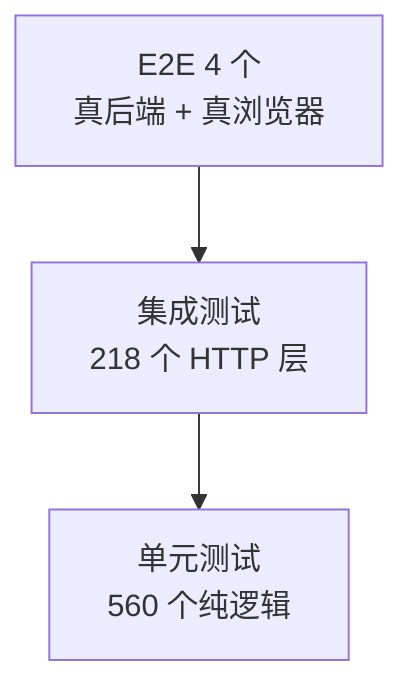

# 09 · 测试指南

> FlamePanel 测试策略、编写规范与运行命令

## 1. 测试概览

当前基线：**后端 952 个（660 单元 + 288 集成 + Agent 3 + 文档测试 1）+ 前端 1491 个 + E2E 4 个，全部通过**，
且**两道量化门禁生效**（覆盖率阈值 lines/statements/branches/functions 70/70/70/65 / 首屏体积预算 200KB，见 §4.6）。

> batch-11（2026-10-02）：前端 vitest **188 个文件 1727 用例**，覆盖率 statements 81.44 / branches 76.82 / functions 72.22 / lines 82.79；Agent `install_policy` 防漂移单测以 `include_str!` 读取内核源码，改 `database/{mod,postgres,mongodb}.rs` 中的脚本常量须同步 Agent。
>
> batch-10（2026-10-02）：前端 vitest **187 个文件 1721 用例**；覆盖率实测 statements 81.41 / branches 76.74 / functions 72.13 / lines 82.7（`lines.total` 6847），地板上调为 70/70/70/65。

> 说明：`cargo test --all --no-fail-fast` 共 41 个测试可执行体 952 用例全绿（**S-17 起以 CNB `backend-gates` 默认特性实测为准**——此前文档沿用的 816 为早期 sqlite 子集口径累加而来，已漂移 70 例，本次一次性校正；S-06 新增 `tests/overview.rs`，S-08 新增 `api/ws_backpressure.rs` 单测，S-04 新增设置迁移回归，S-07 新增 `tests/metrics_history.rs` 与服务 / 仓储单测，S-17 新增 `tests/inspection.rs` 与 `domain/inspection.rs` / `system_probe.rs` / `inspection_service.rs` 单测及 RBAC 升级补授回归；S-12 新增 `tests/toolbox.rs` 5 例与 `domain/toolbox.rs` 9 / `toolbox_service.rs` 5 / handler 2 / `MetricsHub::process_table` 1 单测；S-13 新增 `tests/firewall.rs` 4 例与 `domain/firewall.rs` 8 / `firewall_render.rs` 4 / `firewall_service.rs` 2 单测）；前端 vitest **148 个文件 1491 用例**
> （T2-4 第七步交付后，`components/ui/` 行覆盖率 96.0%，全局地板 60/60/68/62）；Playwright **E2E 4 用例**（真实内核 + 真实产物）。
> 新增：覆盖率与体积门禁（Doc/23 T1-3）——`vitest.config.ts` thresholds（口径由 545 行扩到 4271 行）
> + `frontend/scripts/check-bundle-size.mjs` 及 13 例自测。

| 类型 | 位置 | 数量 | 说明 |
|------|------|------|------|
| 单元测试 | 各模块 `#[cfg(test)]` | 660 | 纯逻辑测试（无需 IO/网络），含分页/缓存/限流/JWT/Outbox/cert/ACME/签名/Procfile/联链等 Stage 专项 |
| 集成测试 | `flame-kernel/tests/`（37 个领域文件 + common） | 288 | 启动完整应用，走 HTTP 层；含文件沙箱 symlink 逃逸 / 写目标穿越否定用例、**真实 SQLite 组合根的 RBAC 种子端到端（`rbac_seed.rs`）** |
| Setup 集成测试 | `flame-kernel/tests/setup_test.rs` | 13（含于上） | Setup 向导全链路（状态/两阶段初始化/无人值守/老库兼容/并发 409） |
| 多节点测试 | `flame-kernel/tests/stage5_nodes_test.rs` | 7（含于上） | Agent 心跳 Bearer 鉴权/远程命令/批量执行/注册引导令牌 |
| Agent Edge 端到端 | `flame-kernel/tests/edge.rs` | 4 | 随机端口起完整面板，伪 Agent / 伪浏览器走**真实 WebSocket**（dev 依赖 `tokio-tungstenite`）：hello 鉴权、请求经 Edge 回放、远程终端双向流与错误码、401 / 4003 / 4004 |
| Agent 测试 | `agent/` | 3 | 节点 Agent 单元测试 |
| 前端测试 | `frontend/`（vitest，148 个文件） | 1491 | API 请求形态 / composables / 工具函数 / **Fp\* 组件契约（`components/ui/__tests__` 28 个文件 228 例，含 PageToolbar `/` 快捷聚焦、LayoutContent 摘要、FpStatePanel 重试等行为规格）** / **FpCard 插槽修复回归（5 例，含视图级）** / **v-permission 还原边界回归（7 例，含视图级）** / **FpCheckbox change 载荷回归（4 例，含视图级）** / 指令与存储单源回归 / 商店描述本地化 / **setup store 状态一致性（3 例，T1-2）** / **体积门禁脚本自测（13 例，T1-3）** / **client 实例装配与拦截器单源化（6 例，T2-1）** / **应用商店拆分（114 例，T2-4：数据层 51 + 展示层 55 + 纯函数 8）** / **网站/证书拆分（160 例，T2-4 第二步：数据层 69 + 展示层 69 + 纯函数 14 + 视图装配 8）** / **Docker 拆分（137 例，T2-4 第三步：数据层 52 + 展示层 65 + 纯函数 13 + 视图装配 7）** / **备份拆分（112 例，T2-4 第四步：数据层 40 + 展示层 41 + 纯函数 20 + 视图装配 11）** / **仪表盘拆分（108 例，T2-4 第五步：数据层 25 + 编排 10 + 展示层 32 + 纯函数 32 + 视图装配 9；另改写既有 C-3 回归 1 例）** / **仪表盘时间范围（16 例，S-16：`useMetricsHistory` 5 + 时间轴纯函数 5 + 视图装配 6）** / **系统体检（24 例，S-17：纯函数 10 + `useInspection` 7 + 仪表盘横幅 3 + 视图装配 4）** / **进程管理（18 例，S-12：纯函数 8 + `useProcesses` 5 + 视图装配 5）** / **防火墙规则表单（15 例，S-13：纯函数 10 + 视图装配 5）** / **项目拆分（113 例，T2-4 第六步：数据层 39 + 展示层 43 + 纯函数 16 + 视图装配 15）** / **节点拆分（117 例，T2-4 第七步：数据层 40 + 展示层 41 + 纯函数 23 + 视图装配 13）** / **i18n key 门禁与语言包结构回归（20 例，T2-5：纯函数 3 + 源码扫描 4 + 结构一致性 2 + key 集合与占位符 3 + 引用存在 3 + CLI 语义 2 + 真实语言包 3）** |
| **E2E** | `frontend/e2e/`（Playwright） | **4** | **真后端（SQLite）+ 真产物 + 真 Chromium**：① 向导六步 → 免二次登录直达面板 → 深链/刷新不被拦回；② 登录 + 指标卡真实数值 + `/ws/metrics` 推送链路；③ 备忘录 CRUD 闭环（含 C-3 勾选语义与刷新后落库校验）。见 §4.5 |

## 2. 运行命令

```bash
# 全部测试
cargo test --package flame-kernel

# 仅集成测试（各域独立文件）
cargo test --test auth
cargo test --test node
cargo test --test docker
# …（26 个领域文件）

# 仅单元测试
cargo test --lib

# 显示输出
cargo test -- --nocapture

# 单个测试
cargo test test_name

# 前端检查
cd frontend && npm run lint
cd frontend && npm run build     # 含 vue-tsc 类型检查
```

一键命令：`just test`、`just lint`、`just check`

## 3. 单元测试规范

### 3.1 位置

放在被测模块内部：

```rust
#[cfg(test)]
mod tests {
    use super::*;

    #[test]
    fn test_something() {
        // arrange
        // act
        // assert
    }
}
```

### 3.2 覆盖重点

- 工具函数：JWT、密码哈希、参数校验
- 枚举转换：`AppFormat::from_str`、`InstallMode::from_str` 等
- 分页工具：`paginate_slice`、`PaginatedResponse::new`
- 领域逻辑：权限角色计算 `role_permissions`、默认种子
- 弹性组件：Circuit Breaker / Retry
- WASM 沙箱：插件加载/执行/指标（`wat` 编译测试字节码）

### 3.3 示例

```rust
#[test]
fn test_paginate_slice() {
    let items = vec![1, 2, 3, 4, 5];
    let params = PaginationParams { page: Some(2), page_size: Some(2) };
    assert_eq!(paginate_slice(&items, &params), vec![3, 4]);
}
```

## 4. 集成测试规范

### 4.1 位置

`flame-kernel/tests/` 下按域拆分的独立文件（auth.rs / node.rs / docker.rs / website.rs … 共 24 个业务域文件 + `setup_test.rs` / `stage5_nodes_test.rs` + `common/` 共享辅助模块）。

### 4.2 启动方式

使用 `axum-test`（dev-dependency）启动应用，默认 InMemory 仓库：

```rust
use axum_test::TestServer;
use flame_kernel::config::AppConfig;
use flame_kernel::FlameKernel;

async fn setup() -> TestServer {
    let config = AppConfig::default();
    let kernel = FlameKernel::new(config);
    let app = flame_kernel::api::routes::create_router(kernel.app_state.clone());
    let app = flame_kernel::api::middleware::add_middleware(app, kernel.app_state);
    TestServer::new(app).unwrap()
}
```

### 4.3 认证测试

```rust
#[tokio::test]
async fn test_auth_flow() {
    let server = setup().await;

    // 登录
    let res = server.post("/api/auth/login")
        .json(&serde_json::json!({"username": "admin", "password": "admin123"}))
        .await;
    assert_eq!(res.status_code(), 200);
    let body: serde_json::Value = res.json();
    let token = body["token"].as_str().unwrap();

    // 带 token 请求
    let res = server.get("/api/users")
        .authorization_bearer(token)
        .await;
    assert_eq!(res.status_code(), 200);
}
```

### 4.4 覆盖重点

- 认证：登录成功/失败、401 未登录、403 无权限、404 全局 JSON
- 各模块 CRUD：用户/节点/网站/数据库/防火墙
- Docker（mock 或 InMemory 降级）
- 应用商店：列表/安装/卸载/404
- WASM：安装与启动恢复
- 错误格式断言：`{code, error, message}` 结构
- 分页响应结构

### 4.5 dev-dependencies

```toml
[dev-dependencies]
axum-test = "14"
tower = { version = "0.4", features = ["util"] }
hyper = { version = "0.14", features = ["full"] }
wat = "1"   # 编译 WASM 测试字节码
```

### 4.5 E2E（Playwright，`frontend/e2e/`）

端到端层跑 **真实内核（SQLite 后端）+ 真实构建产物 + 真实 Chromium**，覆盖三条黄金路径。
存在理由：vitest（jsdom + 桩 API）与 Rust 集成测试（axum-test + InMemory 仓储）**测不到**
「真实进程 + 真实浏览器」——两个已交付的 P0 缺陷（#84 RBAC 种子只在 InMemory 生效、
R-1 表格静默空白）恰好都落在这个双重盲区里。

```bash
# 前置：真实后端二进制
cargo build --package flame-kernel

cd frontend && npm run e2e        # 4 用例，约 22s
cd frontend && npm run e2e:ui     # 交互式调试
```

- 运行期产物（临时库/密钥/证书/报告/trace）一律落在 `.e2e-state/`、`test-results/`、
  `playwright-report/`，均已在 `.gitignore` 中；
- 套件**串行**运行（`workers: 1`）且 `retries: 0`：向导只在**空库**上可走通一次，
  重试必然二次失败、只会掩盖首因（每次运行由 global-setup 重建全新库）；
- 登录次数刻意压缩（后端 `/api/auth/login` 限流 5 次/分钟/IP），新增用例如需已登录态，
  请并入现有用例，勿无节制地登录。

### 4.6 量化护栏（覆盖率 + 首屏体积，`frontend/`）

前四层都是「用例跑没跑过」，本节两道门禁回答的是「**有没有在悄悄退化**」。二者都是
**退出码即结论**（CI 红/绿），无需人工看报告。

```bash
cd frontend && npm run test:coverage   # 覆盖率阈值（vitest thresholds）
cd frontend && npm run bundle:check    # 首屏体积（自研脚本 136 行，零新增依赖）
```

**① 覆盖率门禁**（`vitest.config.ts` → `coverage.thresholds`）

- **口径重塑**：原 `coverage.include` 只列 7 个文件（P2-2「白名单外靠人肉」）。
  T1-3 改为「全量源码减五组排除」，参与行数 **545 → 1689（3.1 倍）**；
- **五组排除项**：`src/views/**`（4.5k 行，由 E2E + 人工评审兜底；T2-4 拆出的
  composable 会自动回到口径内）、`src/api/generated/**`（生成物）、`src/locales/**`
  （静态文案，T2-5 后按业务域拆为模块；其一致性由独立门禁 `npm run locale:check`
  保障而非覆盖率，见 Doc/23 §7.24）、`src/main.ts` / `src/App.vue`（引导与根组件，
  无单测语义）、测试自身；
- **阈值**：全局地板 **lines 70 / statements 70 / branches 70 / functions 65**（batch-10，
  中型视图拆分收尾后；实测 statements 81.41 / branches 76.74 / functions 72.13 / lines 82.7，
  两轮一致，`lines.total` 6847）。上一档 60/60/68/62（T2-4 第七步后，实测 73.83 / 70.37 / 63.96 / 75.10，见 Doc/23 §7.23）。
  口径随 T2-4 逐站拆分从 1689 → 2097 → 2590 → 3032 → 3375 → 3563 → 3845 → **4149 行**
  （`coverage-summary.json` 的 `lines.total`，逐站实测；视图逻辑迁入 `composables/`
  后自动回到统计内）。
  ⚠️ 与 §4.6 旧记录「3141 / 4271」不一致——后者非同一口径，本表以机器可读产物为准；
  另对两处高水位资产单独锁 90/90/84/90 与
  95/95/90/95，**不随全局地板松绑**——组件封装层（全站复用面最大）与权限指令（安全边界）；
- **阶梯历程**：40 →（AppStoreView）45 →（WebsitesView）50 →（DockerView）60 →
  （BackupView）branches 55→58 / functions 50→55 →（DashboardView）branches 58→62 /
  functions 55→57 →（ProjectView）branches 62→66 / functions 57→60 →
  （NodesView，**收尾站**）branches 66→68 / functions 60→62。
  batch-10（Files / Databases 拆分 + 平板 / a11y 巡检）：lines/statements 60→70、
  branches 68→70、functions 62→65。
  `lines`/`statements` 已达 Doc/23 §3.2 的终值 60（此后不再上调）；
  `branches` 与 `functions` 逐站随实测抬升、每级留 2–3 点余量——
  T2-4 七站交付后已无待拆视图，但新增代码的函数密度高于存量均值，
  按实测值顶格设阈值会一次抖动即误红，故末站仍留 2.0 点。

**② 首屏体积门禁**（`frontend/scripts/check-bundle-size.mjs`）

- **口径**：`dist/index.html` 里首屏需加载的**全部资源**——入口脚本 + `modulepreload`
  + 样式表，gzip 求和。含 CSS 而不仅是 JS：首屏总量才是用户真实付出的带宽；
  且 Doc/23 §1.2 已明确判据是「首屏加载总量」而非单 chunk 名义大小
  （R-2 交付后 index chunk 变大属分包结构调整，不是回归）；
- **预算**：`design.md` §11 的 200KB gzip（与文档同源，常量在脚本顶部）；
- **不引 size-limit**：仓库纪律是不新增依赖，需求仅百行量级；脚本自带 13 例单测
  （含「超预算必红」「产物缺失」「解析不到资源」三类防假绿用例）。

## 5. 测试金字塔建议



- **单元测试**数量应最多（纯逻辑快而稳）。
- **集成测试**覆盖关键用户路径（认证、CRUD、错误格式）。
- **E2E** 只放**不能降级到下层**的断言（跨进程/跨浏览器/真实持久化），保持少而稳。
- 核心模块（应用商店、WASM）需同时有单元 + 集成覆盖。

## 6. CI/CD

门禁单一入口 `scripts/ci-local.sh`（组：`installer` / `backend` / `backend-features` / `frontend` / `e2e` / `all` / `quick`；另有按需的 `perf` / `perf-quick`，见 §6.1）。**开发期在 CNB 云原生开发环境执行**（`scripts/cnb-workspace.sh`，Doc/31 §5.3），不消耗构建额度；CNB 流水线日常只跑安装回归，下表重门禁只在 **tag `v*` 推送**或手动 `api_trigger_full_gates` 时运行。GitHub Actions `ci-cd.yml` 为镜像备份：

| 流水线 | 触发 | 内容 |
|---|---|---|
| `installer-regression`（1C） | 任意 push / PR / tag | `bash -n` + `scripts/check-install.sh` 离线回归 + `gen-api-docs.py --check`（Doc/api 与快照一致、无幽灵路由） |
| `backend-gates`（8C） | tag `v*` / 手动 | `cargo fmt --check` → `clippy --all-targets -D warnings` → `cargo test --all`（含 **OpenAPI 快照漂移**单测 `openapi::tests::frontend_snapshot_is_up_to_date`，T-05；本地更新用 `just openapi`） |
| `frontend-gates`（4C） | tag `v*` / 手动 | `npm ci` → `typecheck` → `lint` → **`test:coverage`**（即完整单测 + 地板，见 §4.6；不再另跑 `test:unit`）→ `build` → **`bundle:check`**（首屏 200 KB gzip）→ `locale:check` → `npm audit --audit-level=high` |
| `e2e-playwright`（4C，用 `.ide/Dockerfile` 构建镜像） | tag `v*` / 手动 | `cargo build -p flame-kernel` → Playwright chromium → `npm run e2e`（`E2E_BACKEND_BIN` 指向刚编出的二进制，Vite preview + 真后端） |
| （sqlite 单特性子集） | 开发环境 `ci-local.sh backend-features`（`all` 已含） | `--no-default-features --features sqlite` 的 `check --all-targets` + `test --lib`（Doc/30 S-05） |
| `build-npc-image` | `main` push 且 `.cnb/npc/**` 变更 | 构建并推送 NPC / 门禁共用的 `npc-env` 镜像 |

- cargo registry / target 与 `~/.npm` 挂 `main` 组的 **copy-on-write 卷**：`main` 的构建产物被所有分支复用（增量编译），分支上的写入不污染 `main`；
- PR 需附 `ci-local` 全绿汇总方可合并（Doc/31 §5.3）；tag 构建结果在 CNB「流水线」页查看。

### 6.1 性能 / 稳定性压测（`scripts/perf/`，Doc/32 §8）

不进常规门禁；**发版前**与**性能相关 PR**（连接池、缓存、推送流、日志写线程、调度器等）在云原生开发环境运行，报告贴 PR / 写入 CHANGELOG。

```bash
bash scripts/ci-local.sh perf-quick          # 冒烟 ≈ 5 min（时长 ×0.1，斜率只记录不判定）
bash scripts/ci-local.sh perf                # 完整 ≈ 45 min：idle 5 min → 200 并发 10 min → 50 并发浸泡 30 min
just perf --scenarios idle,load --concurrency 100   # 直接调 run.sh，参数透传 load.py
PERF_BIN=target/release/flame-kernel just perf --quick 0.2   # 复用已编二进制
```

- `run.sh`：release 构建 → 临时状态目录起真实内核（SQLite，`OP_RATE_LIMIT_MAX` 放开——压测来自单 IP，默认 120 次 / 分钟会全变 429）→ `load.py --setup` 经 `/api/setup/initialize` 建管理员（登录档每分钟 5 次，全程只用 2 次）→ 三场景 → 停内核；产物 `perf-out/<quick-系数>/perf-report.{json,md}`、`kernel.log`、`kernel-logs/`；
- `load.py`（纯标准库）：HTTP worker 按权重轮询前端常用只读接口（顶栏徽标、`/api/auth/me`、监控曲线、内核日志统计、列表页…），WS 客户端保持 `/ws/metrics`（首帧鉴权、回 Pong）；每 10 min 用 `flame_refresh` cookie 续期，WS 因 token 复核被断开时按前端方式重连（计 `reconnects`，**不**计错误）；
- 采样：每 5 s 读 `/proc/<pid>` 的 RSS / CPU / fd / 线程；RSS 斜率为稳态段（去掉前 20%）最小二乘，单位 MB / 10 min；
- 判定（任一不达标退出码 1）：idle RSS 峰值 < 80 MB、浸泡 RSS 斜率 < 1 MB / 10 min（浸泡 ≥ 10 min 时才判定）、浸泡 fd 增长 ≤ 20、各场景错误率 0、进程存活、`kernel.log` 无 panic；阈值可用 `--max-*` 覆盖；
- 自测：`python3 -m unittest discover -s scripts/perf -p 'test_*.py'`（mock 内核，覆盖 chunked、续期、Ping/Pong、重连、阈值判定；`perf` 组会先跑）。

本地提交前验证：

```bash
cargo check                    # 零警告
cargo test                     # 全部通过
cargo clippy -- -D warnings    # lint
cd frontend && npm run lint    # ESLint
cd frontend && npm run build   # 类型 + 构建
cd frontend && npm run test:coverage  # 覆盖率门禁（见 §4.6）
cd frontend && npm run bundle:check   # 首屏体积门禁（见 §4.6）
cd frontend && npm run e2e     # E2E（需先 cargo build --package flame-kernel）
```

## 7. 编写测试 checklist

- [ ] 测试命名清晰（`test_<模块>_<行为>`）
- [ ] 覆盖成功路径与失败分支（404/401/403/400）
- [ ] 断言统一错误 JSON 结构
- [ ] 不依赖真实系统服务（Docker/数据库）——用 InMemory 或 mock
- [ ] 测试可并行（无共享可变状态）
- [ ] 运行 `cargo test` 全量通过
