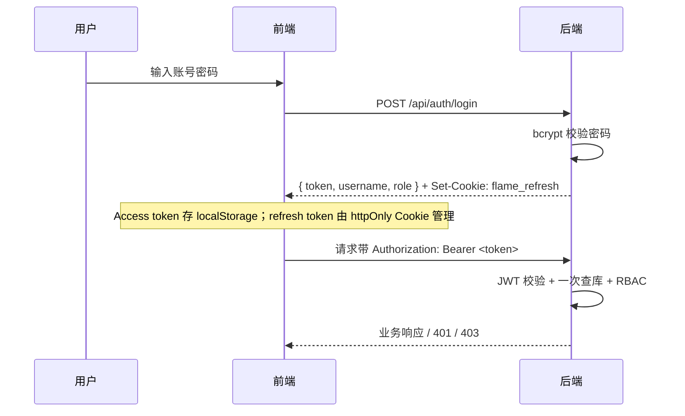
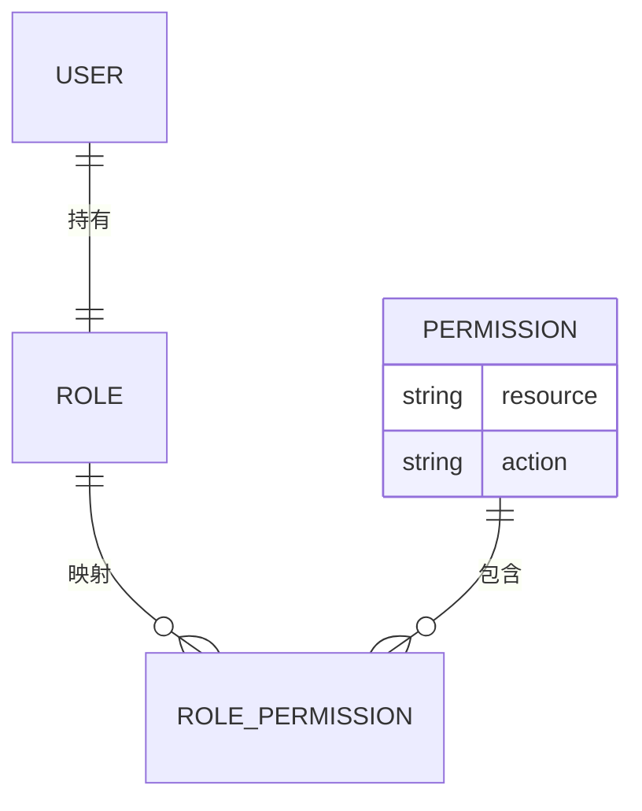
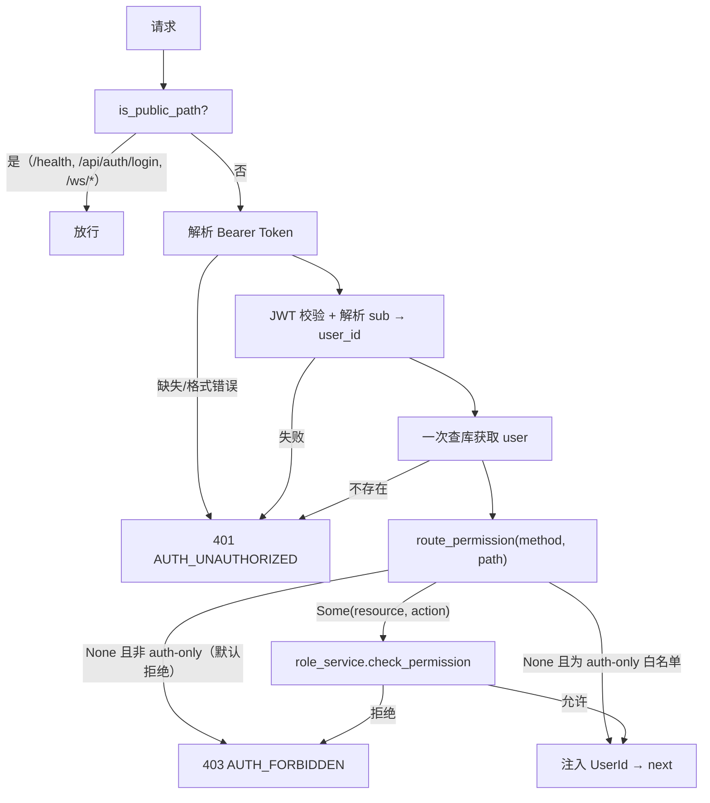

# 07 · 权限体系设计

> FlamePanel JWT 认证 + RBAC 角色权限体系详解

## 1. 认证机制（JWT）

### 1.1 流程



### 1.2 JWT 实现

- 库：`jsonwebtoken` 9
- 密钥：`OP_JWT_SECRET` 环境变量（生产必须修改）
- Access Token 有效期：15 分钟；Refresh Token 有效期：24 小时（滑动过期：剩余 <12h 时重置）
- Claim：`sub` 为用户 ID

### 1.3 Token 存储与传递

- **Access Token**：前端存储于 `localStorage`（key：`token` / `username` / `role`），请求头 `Authorization: Bearer <token>`
- **Refresh Token**：经 `Set-Cookie: flame_refresh=<jwt>; HttpOnly; SameSite=Lax` 下发，JS 无法读取（防 XSS），浏览器自动携带
- 401 响应：前端拦截器自动调用 `/auth/refresh` 重放原请求；刷新失败清除登录态并跳转 `/login`

## 2. RBAC 角色权限模型

### 2.1 模型



三个预置角色：

| 角色 | 权限范围 | 适用场景 |
|------|----------|----------|
| `admin` | 全部权限（含 delete） | 超级管理员 |
| `operator` | 除 delete 外的全部 | 运维操作员 |
| `viewer` | 仅 read | 只读审计 |

### 2.2 权限矩阵（88 项）

> 与 `domain/entity/system.rs::default_permissions()` 一一对应；新增 REST 路由必须在
> `api/permissions.rs::ROUTE_PERMISSIONS` 声明（元数据化默认拒绝）。

| 资源 | read | create | update | delete | 其他 |
|------|:----:|:------:|:------:|:------:|------|
| user | ✅ | ✅ | ✅ | ✅ | — |
| node | ✅ | ✅ | ✅ | ✅ | execute（远程命令/文件） |
| website | ✅ | ✅ | ✅ | ✅ | — |
| docker | ✅ | ✅ | ✅ | ✅ | start/stop |
| plugin | ✅ | ✅ | ✅ | ✅ | execute/config |
| web_server | ✅ | ✅ | ✅ | ✅ | start/stop/reload/configtest |
| database | ✅ | ✅ | ✅ | ✅ | start/stop |
| file | ✅ | — | ✅（write） | — | upload |
| firewall | ✅ | ✅ | ✅ | ✅ | enable/apply |
| app_store | ✅ | ✅ | ✅ | ✅ | — |
| settings | ✅ | — | ✅（含内核日志运行时调级） | — | — |
| operation_log | ✅ | — | — | ✅ | — |
| log | ✅（系统日志、内核日志查看 / 下载） | — | — | ✅（系统日志、内核历史日志文件） | — |
| backup | ✅ | ✅ | ✅（账号/同步） | ✅ | — |
| scheduled_task | ✅ | ✅ | ✅ | ✅ | execute |
| task | ✅ | — | — | ✅ | execute |
| memo | ✅ | ✅ | ✅ | ✅ | — |
| outbox | ✅ | — | — | — | — |
| certificate | ✅ | — | ✅（签发/上传/绑定） | ✅ | — |
| dns_provider | ✅ | ✅ | ✅（修改/测试） | ✅ | — |
| waf | ✅ | ✅ | ✅（修改/清理日志） | ✅ | — |
| project | ✅ | ✅ | ✅ | ✅ | — |
| runtime | ✅ | ✅ | ✅（设默认） | ✅（卸载） | — |
| terminal | — | — | — | — | execute |
| toolbox | ✅（系统体检报告、进程列表、主机详情） | — | — | — | execute（立即体检、结束进程） |
| mcp | ✅（凭证 / 会话 / 调用审计 / 工具目录 / 审批单） | ✅（签发、吊销**本人**凭证） | ✅（批准 / 拒绝 AI 写操作） | ✅（吊销他人凭证；批准高危操作） | — |

> **面板 AI 助手（M-AI-3）**：对话需 `mcp:create`，查看配置需 `mcp:read`，修改配置 / 测试连接需 `settings:update`。
> 助手调用的只读 API 与 MCP 工具均按**当前用户角色**授权；写工具只生成审批单（审批规则同下）。
> 助手使用每用户内置凭证 `panel-assistant`，吊销后下次对话会自动重新签发——禁止某用户使用助手请收回 `mcp:create`。
>
> **MCP 凭证（`fpk_` Bearer）**：只能访问协议端点 `/api/mcp`，面板 JWT 访问该端点返回 401；
> 凭证本身不带权限，每次工具调用按签发者**当前**角色实时鉴权（工具权限由等价 REST 路由推导），
> 角色降级 / 用户删除 / 凭证吊销或过期立即生效。详见 Doc/34。
>
> **写操作（M-AI-2）**：写工具只对 `allow_write` 凭证可见，调用只生成审批单。批准需要**三重**授权：
> 批准者 `mcp:update` + 批准者本人具备该工具权限（如 `docker:stop`）+ 高危工具另需 `mcp:delete`；
> 执行前再复核签发者当前角色。前端「审批」按钮可见性与此同口径。

## 3. 认证 + RBAC 合并中间件

### 3.1 架构改进（v0.3.0）

此前：JWT 校验 + 用户查询 + 权限查询 = **两次查库**。
现在：合并为一个中间件，**一次 JWT 校验 + 一次用户查询**完成认证与鉴权。



### 3.2 白名单路径

| 路径 | 说明 |
|------|------|
| `GET /health` | 健康检查 |
| `POST /api/auth/login` | 登录 |
| `WS /ws/*` | WebSocket（metrics/logs/terminal） |

## 4. 路由权限映射

### 4.1 映射函数

`api/types.rs` 的 `route_permission(method, path)` 通过方法 + 路径模式匹配返回 `(resource, action)`：

```rust
fn route_permission(method: &Method, path: &str) -> Option<(&'static str, &'static str)> {
    match (method.as_str(), path.trim_end_matches('/')) {
        ("GET", "/api/users") => Some(("user", "read")),
        ("POST", "/api/users") => Some(("user", "create")),
        ("PUT", p) if p.starts_with("/api/users/") => Some(("user", "update")),
        ("DELETE", p) if p.starts_with("/api/users/") => Some(("user", "delete")),
        // ... 239 REST 端点 / 86 权限组合
        _ => None,
    }
}
```

### 4.2 映射规则要点

- 列表/详情/日志/统计 → `read`
- 创建/导入/安装/启用 → `create`
- 更新/切换引擎/预设/重排 → `update`
- 删除/卸载 → `delete`
- 特定操作（docker start/stop、web_server reload/configtest、plugin execute/config、firewall enable/apply）→ 细粒度动作
- **能力等价于 root 的动作不得挂在「日常操作」动作上**：`POST /api/docker/compose/deploy`（任意 YAML 可 `privileged` / 挂载 `/`）自 v1.1 起要求 `docker:create`，不再是描述为「启动容器」的 `docker:start`（Doc/33 P-12）
- 规则首个命中生效；`pre_not_contains` 的排除串是对**整条路径**做子串判断，排除串不能是前缀本身的一部分（反例：`/api/databases/` + 排除 `/databases/` 永不命中，Doc/33 P-8）。新增读规则优先用 `prefix`，并在 `permission_table_covers_all_routes` 的路由表里登记；auth-only 白名单只留会话自助类端点，不为规则缺陷兜底

### 4.3 权限校验

```rust
let allowed = state.role_service.check_permission(&user.role, resource, action).await?;
if !allowed {
    return Err(AppError::Forbidden(format!("Missing permission: {}:{}", resource, action)));
}
```

`role_permissions(role_name)` 返回角色权限 ID 集合：

- `admin`：全部
- `operator`：`action != "delete"`
- `viewer`：`action == "read"`

### 4.4 IaC 导出的复合读权限（M-E 首片）

`GET /api/iac/export` 的路由声明复用 `settings:read`，不新增权限项。handler 按角色分别复核 `website:read` / `database:read` / `app_store:read`，应用服务只查询可见区块，并用显式字段白名单投影为 YAML；未授权区块省略而非返回计数 / 空列表。角色上下文缺失时默认全部不可见。权限收回会使角色缓存失效，下次下载立即按新权限裁剪。配置清单不含凭据面，也不提供任何写行为。

## 5. 数据库表

见 [03-数据库设计.md](./03-数据库设计.md)：

- `permissions` — 权限定义（id/resource/action/description）
- `roles` — 角色（id/name/description）
- `role_permissions` — 关联表（role_id/permission_id）

种子数据由 `domain/entity/system.rs` 的 `default_permissions()` / `default_roles()` / `role_permissions()` 提供。

### 5.1 种子写入路径（两种后端各自落库）

| 后端 | 写入时机 | 实现 |
|------|----------|------|
| InMemory（开发/测试） | 仓储构造时 | `InMemoryPermissionRepository::new` / `InMemoryRoleRepository::new` 内存种子 |
| **SQLite（生产/默认）** | 启动迁移后、服务构造前**同步**执行 | `infrastructure/sqlite.rs::seed_rbac(pool)` ← `RepoFactory::new_sqlite()` |

> **历史缺陷（已修复）**：`run_migrations()` 只建表，三表在 SQLite 模式下**没有任何写入路径**
> ——生产模式下三表恒空，`check_permission()` 对任何角色都命中空集合，admin 登录后所有业务接口
> 一律 `403 Missing permission: <资源>:<动作>`，面板除 `/api/auth/*` 外整体不可用（向导模式与
> 无人值守模式同样命中）。修复要点：
>
> 1. **同步执行**——RBAC 未就绪即整体 403，不能像默认设置那样丢给后台任务；
> 2. **不覆盖已有授权**——`role_permissions` 仅在角色尚无任何映射时写入默认集合，
>    已有映射（管理员经角色管理定制的授权）保持不动，重启不重置；
>    **升级补授（S-17 起）**：种子前先记录库内已有的 `(resource, action)` 键，本次新增的内置
>    权限（如 `toolbox:read/execute`）按角色默认集补授给已有映射的内置角色——否则老库升级后
>    新功能对所有人 403；既有权限的显式收回不受影响；
> 3. **不做 id 假设**——`role_permissions()` 返回的是枚举下标 id，落库前先翻译为
>    `(resource, action)` 业务键再回查库内真实 id，兼容 AUTOINCREMENT 与下标错位的库；
> 4. **迁移安全**——配套补建 `UNIQUE INDEX idx_permissions_resource_action`，并对可能存在的
>    重复权限行做一次幂等去重（先清孤儿/重复映射，再裁权限行，避免撞主键与外键）。
>
> 回归保护：`infrastructure/sqlite.rs::rbac_seed_tests`（7 例，仓储级，含升级补授）+
> `tests/rbac_seed.rs`（3 例，真实 SQLite 组合根的 HTTP 级端到端）。

## 6. 前端权限集成

### 6.1 登录态

- `stores/auth.ts`（Pinia）管理登录状态，经 `useStorage` 持久化 token/username/role。
- **角色单一来源（T0-2）**：前端一切角色判定都取自 `useAuthStore().role`（响应式）；
  指令/守卫/菜单不得各自裸读 `localStorage`。底层模块（如 `api/client.ts` 的 401 刷新
  回写）因被 store 反向依赖不能 import store，统一经 `utils/storage.ts::writeStorage`
  写盘并**广播同文档变更**，保证订阅方（store）即时同步。
- 路由守卫 `beforeEach`：非登录状态重定向 `/login`。

### 6.2 403 处理

- 后端返回 `AUTH_FORBIDDEN`，前端 `client.ts` 规范化为 `{code, message, status}`。
- `utils/error.ts` 按错误码显示 i18n 文案："没有操作权限"。

### 6.3 角色相关 UI

- **侧栏 / ⌘K 菜单**：按角色过滤（`directives/permission.ts::isRouteVisibleInMenu`）——viewer/operator 隐藏 `/users`，viewer 另隐藏 `/settings`、`/terminal`（写能力面）。
- **页面级守卫（T0-1）**：`menuRoutes.meta.perm` 声明页面所需权限点，路由守卫 `checkPagePermission` 在登录检查后判定，无权限重定向 `/dashboard` 并提示（历史缺口：判定只作用于侧栏，直接输入 URL 可绕过）。
- **按钮级（T0-2）**：`v-permission` 指令（`mode: 'view'` 隐藏 / `manage` 置灰）——角色取自 `useAuthStore()`（单一来源），每个绑定元素持 `effectScope` + `watchEffect`，角色或绑定值变化即重算（历史缺口：指令内裸读 `localStorage`，且仅 `mounted`/`updated` 判定，角色变更后已挂载按钮不更新）。无 Pinia 时降级为空角色（fail-closed）。
- **还原边界（C 系列）**：指令的放行/还原分支**只撤销自己写入的项**（写入账本 + 元素自持基线），元素自身的 `disabled` / `aria-disabled` / 内联样式一律保留。历史缺口：`restore()` 无条件 `removeAttribute('disabled')`、清空 `opacity`/`pointer-events`/`display`，使 `:disabled="…"` 与 `v-permission` 同元素的组合在放行时丢失禁用态（全站 20 处消费点受影响，RuntimeView 的「安装」按钮为典型）。

上述前端判定均只作用于**观感层**——真正的安全边界是 §3 的服务端 RBAC（未声明权限的路由默认 403/404）。

## 7. 扩展新权限的步骤

1. **权限定义**：`domain/entity/system.rs` 的 `default_permissions()` 添加 `(resource, action, description)`。
2. **路由映射**：`api/types.rs` 的 `route_permission()` 为新端点添加匹配分支。
3. **种子更新**：确认 `default_permissions()` ID 顺序，`role_permissions()` 自动按角色过滤。
4. **前端文案**：`locales/*` 的 `common.error` 如需新增错误码再补充。
5. **测试**：集成测试覆盖 401/403 分支。

## 8. 安全建议

- JWT 密钥使用强随机值：`openssl rand -hex 32`
- 首次安装通过 Setup 向导创建管理员（或配置 `OP_ADMIN_PASSWORD` 无人值守初始化），新装账号强制首次登录改密
- 2FA（TOTP，Doc/33 已实现）：用户在「设置 → 安全」自助启用（需当前密码 + 验证码，返回 10 个一次性恢复码）；登录时密码通过后凭 5 分钟挑战令牌走 `POST /api/auth/login/2fa`。面板设置 `two_factor_enabled=true` 为**强制**：未绑定用户除绑定 / 会话维持端点外一律 `403 TWO_FACTOR_SETUP_REQUIRED`，且不可自行停用。自助端点 `/api/auth/2fa*` 为 auth-only；管理员重置 `PUT /api/users/{id}/2fa/reset` 需 `user:update` **且 admin 角色**（operator 虽有 `user:update` 也不能摘除他人第二因子）；离线兜底 `fpctl reset-2fa`
- WebSocket 会话：60 s 复核令牌，失效发 `4001`、失去通道权限发 `4003`（Doc/02 §24），支持带内续期
- 会话超时：`session_timeout_minutes`（默认 1440 分钟）
- 速率限制：分级限流（分片结构，Login 5/min、Api 120/min、Health 600/min，`rate_limiter.rs`）
