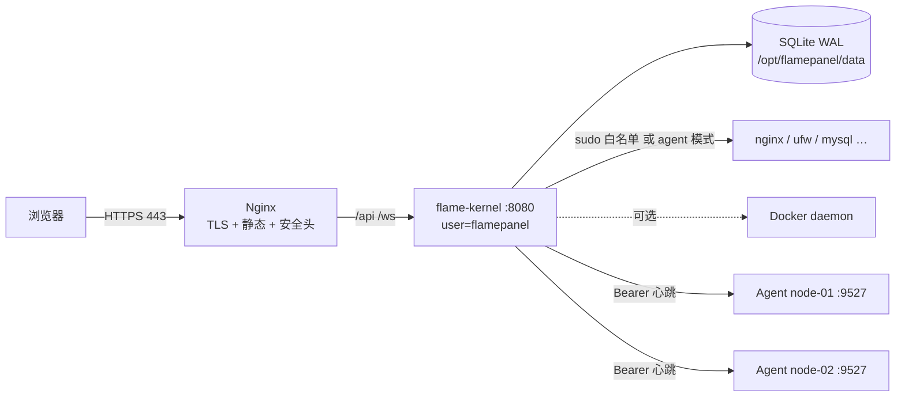

# 10 · 部署运维指南

> 面向**运维人员**：从零部署、配置、升级、备份、卸载。开发环境搭建见 [Doc/05](./05-后端开发指南.md) / [Doc/04](./04-前端开发指南.md)；安全验收清单见 [Doc/12](./12-安全基线与兼容矩阵.md)；排障见 [Doc/13](./13-故障排查手册.md)。
> 适用版本：v1.0.x（版本化布局与 `fpctl upgrade` 自 1.0 起）。

---

## 1. 选择部署方式（30 秒决策）

```text
有公网 Linux 服务器，想要生产可用？        → §2 一键安装（systemd · 非 root · 可选 TLS）      ★推荐
已经全容器化 / 想先试用？                  → §3 Docker Compose（默认 profile 不挂 docker.sock）
已有 Nginx + 证书体系，要自己接管入口？     → §4 手动部署（二进制 + systemd + 自定义反代）
要纳管第二台机器？                         → §6 Agent 节点
```

| 要求 | 最低 | 推荐 |
|---|---|---|
| OS | Debian 12 / Ubuntu 22.04（完整支持矩阵见 Doc/12 §1） | Debian 12 / Ubuntu 24.04 |
| 架构 | amd64 / arm64 / armv7 | amd64 / arm64 |
| 内存 / 磁盘 | 512 MB / 1 GB | 1 GB+ / 5 GB+ |
| Docker Engine | 可选（容器管理、商店容器模式需要） | ≥ 20.10 |
| 端口 | 80（或自定义） | 80 + 443 |

---

## 2. 方式一：一键安装（install.sh）

```bash
git clone https://cnb.cool/yin0410/Flamepanel.git && cd Flamepanel
sudo bash install.sh                 # 交互式
sudo bash install.sh -n              # 全默认静默
sudo bash install.sh -t -P 9090      # 启用 HTTPS（自签，80 自动跳转 443），后端改用 9090
sudo bash install.sh -t --cert /etc/letsencrypt/live/panel.example.com/fullchain.pem \
                        --key  /etc/letsencrypt/live/panel.example.com/privkey.pem
```

| 参数 | 说明 | 默认 |
|---|---|---|
| `-u` / `-p` | 管理员用户名 / 密码。**给了 `-p` 即无人值守模式**（跳过向导，首次登录强制改密） | admin / 空（走向导） |
| `-P` | 后端监听端口（1024–65535；配置 nginx 时仅绑定 127.0.0.1，对外入口固定为 nginx 的 80 / 443） | 8080 |
| `-s` | JWT 密钥（≥ 32 字节） | 随机生成 |
| `-t` | 启用 HTTPS（443）；未给 `--cert/--key` 则生成 10 年自签证书 | 关 |
| `--cert` / `--key` | 自备证书路径（配合 `-t`） | 自签 |
| `-n` | 静默 | — |

**脚本做了什么**（幂等，可重复执行用于升级）：

1. 识别发行版族（os-release `ID` / `ID_LIKE`：debian / rhel / suse / arch），检查 systemd；按族安装 `curl openssl nginx`（apt / dnf·yum / zypper / pacman），失败时打印日志尾部；
2. 创建系统用户 `flamepanel`（nologin，路径自动探测）与目录 `/opt/flamepanel`：根目录 711、`frontend/` 755（nginx worker 需可读）、`data/ logs/` 750；
3. 部署二进制：优先本地 `target/release/flame-kernel`，否则从 Release 下载对应架构包（仅 amd64 / arm64，其它架构提前报错）；HTTP 失败会尝试既有镜像源，下载及解包成功且产物非空后才复制；
4. 生成 Nginx 站点：自动选择 `conf.d` / `http.d`（Arch 主配置无 include 时补一行带 `# flamepanel` 标记的 include）；Debian/Ubuntu 原装默认站点会被禁用（否则按 IP 只见 nginx 欢迎页）。站点包含静态资源 + `/api` `/ws` `/health` `/metrics` 反代、上传上限 2 GB、API 600 s / WS 3600 s 超时、`index.html` 不缓存、server 级安全响应头与 CSP（见 §5.3）；`-t` 时 80 → 301 跳转 HTTPS，自签证书带 SAN；存在 IPv6 时同时监听；
5. SELinux Enforcing 时设置 `httpd_can_network_connect` 并为前端 / 证书目录打标签；`nginx -t` 通过后重启并在 firewalld / ufw 已启用时放行端口；校验失败则把站点配置移为 `.bak` 并打印错误，不破坏现有 nginx；
6. 写 `/opt/flamepanel/flamepanel.env`（600，含 JWT 密钥）与 systemd 单元（`NoNewPrivileges` / `ProtectSystem=strict` / `ReadWritePaths` 白名单）；**配置了 nginx 时后端只监听 `127.0.0.1`**，避免绕过 nginx 的安全头直连；
7. 把对系统的改动记入 `/opt/flamepanel/.install-state`（600），供 `uninstall.sh` 精确回滚；
8. `systemctl enable --now flamepanel nginx`。

**下载失败行为**：二进制或前端下载失败、空响应、解包失败、缺少有效的 `flamepanel` / `index.html` 时，脚本以非零状态退出，不继续配置或启动服务。临时下载与解包位于私有目录，退出时清理；前端包通过检查前不会删除现有 `dist`。这不是整次安装的事务回滚：已执行的依赖安装、用户/目录创建，以及已成功替换的二进制不会自动撤销。

> **发布包完整性**：`install.sh` 从 GitHub Releases 下载时**固定到具体版本**（`--release X.Y.Z` / `FLAMEPANEL_VERSION`，缺省把 `releases/latest` 的重定向解析成具体 tag），下载该 tag 的 `flamepanel-<版本>-checksums.txt`，**解包前**逐个比对 SHA-256（`sha256sum` → `shasum` → `openssl` 依次回退）；清单缺失、未列出该资源或摘要不符均**终止安装且不触碰现有文件**。清单优先 GitHub 直连获取——资源走镜像、清单走直连时可发现镜像篡改；清单也只能从镜像取得时脚本会告警（此时只能发现传输损坏 / 版本错配）。`--insecure-skip-verify`（`FLAMEPANEL_SKIP_VERIFY=1`）可显式跳过，会逐项告警。`fpctl upgrade` 同样强制校验（§7.3）。
>
> **仍未覆盖**：发布**签名**（GPG / minisign）尚未实现——校验清单与资源同源，GitHub 仓库或发布流程本身被攻破时无法发现。对来源有更高要求时请在可信环境核对 tag 对应的 CI 构建记录。

安装下载逻辑的隔离回归（只需 Python 3、Bash、tar 和常见 GNU 命令，不执行真实安装、不联网、不安装依赖）：

```bash
# 可从任意目录调用；CI 与本地使用同一入口
bash scripts/check-install.sh
```

共 **65 项**：32 项下载/部署片段回归（含空响应、镜像回退、符号链接、复制/权限失败、临时文件清理与权限、含空格路径）+ 10 项发布包校验回归（固定 tag、摘要不符 / 清单缺失 / 未列出即终止且保留现有文件、镜像清单告警、显式跳过、latest 解析与解析失败、非法版本参数）+ 6 项 CI 入口回归（工作目录、语法错误、测试失败退出码、缺失测试文件）+ 17 项平台适配回归（13 份 os-release 归族、分族包管理分派、nginx 目录布局与 include 幂等、**真实 `nginx -t` 校验生成的 HTTP / TLS 配置**、卸载回滚；本机无 nginx 时相应 2 项跳过）。测试用临时目录和命令桩，不运行完整 `install.sh`。

**CI 接入**：

- GitHub `.github/workflows/ci-cd.yml` 新增 `installer-regression` job，沿用该 workflow 既有 push/tag/PR 触发范围；该 workflow 的 Docker 发布 job 必须等待安装回归通过。未改变独立的 `release.yml` 发布流程。
- CNB `.cnb.yml` 在 `main` 与 `$` 兜底分支的 `push` / `pull_request` 事件中加入同名轻量流水线，固定 Python 镜像版本、1 CPU、测试命令 120 秒超时；没有修改既有云开发和 NPC 流程。
- 两个平台均调用 `bash scripts/check-install.sh`，不允许失败；仓库“合并前必须通过哪些状态检查”仍需维护者单独配置分支保护，本次不修改账号或仓库权限。
- 配置解析通过和云开发环境中测试通过，不等于修改后的托管 CI 已执行成功；提交/推送后还需核对实际流水线记录。

**首次访问**：浏览器打开 `http://<ip>` → 6 步 Setup 向导（管理员 / 数据库 / 端口 / 主题 / 语言）。向导会以访问域名为 SAN 自动签发 `data/certs/panel.{crt,key}`。

**验证**：

```bash
curl -s http://127.0.0.1/health            # {"status":"ok","version":"..."}
systemctl status flamepanel
ps -o user,cmd -p "$(pgrep -f flame-kernel)"   # 应为 flamepanel，不是 root
```

> **非 root 与特权操作**：安装脚本以 `flamepanel` 用户运行面板，systemd 单元启用 `NoNewPrivileges=true` + `ProtectSystem=strict`，可写目录仅限数据 / 日志 / 工作区，`sudo` 不可用。脚本**不会**写入 `/etc/sudoers.d/flamepanel`（早期文档有误）。
>
> **Web 引擎配置**（站点 vhost 读写、`nginx -t` 类校验、reload、引擎服务启停）由同时安装的 **本机特权助手** `flamepanel-helper.service` 代办（Doc/32 W3-b）：同一二进制的 root 子命令 `flamepanel helper --allow-user flamepanel`，socket `/run/flamepanel-helper/helper.sock`（`0660 root:flamepanel`），只接受面板用户（`SO_PEERCRED`）发来的请求，路径限定 Web 引擎配置根、命令为精确 argv 白名单（v1.1 起**防火墙**命令也经助手代办：ufw / firewall-cmd / iptables 的规则 argv 必须能被解析并按面板渲染器逐字节重渲染一致才执行，外加少量固定命令如 `ufw status`、`firewall-cmd --reload`；携带环境变量或工作目录的请求一律拒绝），所有写入 / 命令记入 `journalctl -u flamepanel-helper`。面板在「非 root 且 socket 存在」时自动启用，无需配置；`fpctl doctor` 的 `priv-helper` 项显示其状态。
>
> **升级提示**：防火墙代办需要助手单元放开 `AF_NETLINK`（ufw / iptables 通过 netlink 与内核交互），v1.1 的 `install.sh` 已写入；**从旧版本升级的主机需重新运行 `install.sh`（或手动在 `flamepanel-helper.service` 的 `RestrictAddressFamilies=` 追加 `AF_NETLINK` 后 `systemctl daemon-reload`）**，否则防火墙操作会退回 `sudo -n` 路径。ufw 在 `ProtectKernelTunables=yes` 下写 sysctl 的行为尚未在真机验证，遇到 `ufw enable` 报错请在 `journalctl -u flamepanel-helper` 中查看。
>
> **其它**需要 root 的动作（防火墙改规则、安装数据库 / 运行时）在默认安装下仍不可用。需要时：① 以 root 运行面板（去掉单元中的 `User=` 与沙箱项，自行评估风险）；② 使用 Docker 部署。**永远不要给 `flamepanel` 用户 `sudo ALL`。** 需要 Docker 管理时 `usermod -aG docker flamepanel` 而非授予 `CAP_SYS_ADMIN`。
>
> **自定义 sudoers 与凭据**（Doc/33 P-1）：面板对需要 root 的命令使用 `sudo -n`；命令携带口令环境变量（`MYSQL_PWD` / `PGPASSWORD`）时追加 `--preserve-env=<键>`，对应 sudoers 条目须含 `SETENV:` 标签，否则 sudo 会直接拒绝（不会以无口令身份误执行）。
>
> **Agent 升级**：面板经结构化 `exec` 动作下发命令（参数 / 环境变量 / stdin 分字段传递，Agent 不经 shell 执行）。旧版 Agent 仍可执行简单命令；数据库等需要口令或 stdin 的操作会提示「flame-agent 版本过旧」，升级 Agent 即可。

---

## 3. 方式二：Docker Compose

```bash
git clone https://cnb.cool/yin0410/Flamepanel.git && cd Flamepanel
echo "OP_JWT_SECRET=$(openssl rand -hex 32)" > .env      # 生产务必设置
docker compose up -d                                     # 访问 http://<ip>:8080
docker compose ps                                        # healthcheck 状态
docker compose logs -f
```

两套 profile：

| profile | 服务 | 端口 | docker.sock | 能力 | 用途 |
|---|---|---|---|---|---|
| 默认 | `flamepanel` | 8080 | **不挂载** | `cap_drop: ALL` + `NET_BIND_SERVICE/SETUID/SETGID`，`no-new-privileges` | 生产 |
| `dev` | `flamepanel-dev` | 8090 | 只读挂载 | 宽松 | **仅本地开发** |

> ⚠️ 镜像内进程为 root（Nginx 需绑 80）。**root 容器 + 可写 docker.sock = 宿主机 root**。生产不要用 `--profile dev`；需要管理宿主 Docker 时，在宿主机跑 Agent（§6）并设 `OP_EXECUTION_MODE=agent`。

数据在命名卷 `flamepanel-data`（SQLite + 证书 + 应用落盘）与 `flamepanel-workspace`（文件/终端沙箱根）。升级：`docker compose pull && docker compose up -d`。

镜像来源：`ghcr.io/<org>/flamepanel:<tag>`（release 流水线推送，tag 与 git tag 一致；**不要用 `:latest` 部署生产**）。

---

## 4. 方式三：手动部署（二进制 + systemd + 自定义反代）

```bash
# 1. 构建（或从 Release 下载 flamepanel-<ver>-linux-<arch>.tar.gz 解压）
cd flame-kernel && cargo build --release && cd ..
cd frontend && npm ci && npm run build && cd ..

# 2. 目录与用户
sudo useradd --system --shell /usr/sbin/nologin --home-dir /opt/flamepanel flamepanel
sudo mkdir -p /opt/flamepanel/{data,logs,workspace,frontend}
sudo install -m 755 flame-kernel/target/release/flame-kernel /usr/local/bin/flamepanel
sudo cp -r frontend/dist /opt/flamepanel/frontend/
sudo chown -R flamepanel:flamepanel /opt/flamepanel && sudo chmod 750 /opt/flamepanel/{,data,logs,workspace}

# 3. 环境文件（600）
sudo tee /opt/flamepanel/flamepanel.env >/dev/null <<EOF
OP_HOST=127.0.0.1
OP_PORT=8080
OP_DATABASE_URL=sqlite:/opt/flamepanel/data/flamepanel.db?mode=rwc
OP_JWT_SECRET=$(openssl rand -hex 32)
OP_FILE_ROOT=/opt/flamepanel/workspace
OP_TERMINAL_CWD=/opt/flamepanel/workspace
EOF
sudo chmod 600 /opt/flamepanel/flamepanel.env

# 4. systemd
sudo tee /etc/systemd/system/flamepanel.service >/dev/null <<'EOF'
[Unit]
Description=FlamePanel
After=network-online.target
Wants=network-online.target

[Service]
Type=simple
User=flamepanel
Group=flamepanel
ExecStart=/usr/local/bin/flamepanel
WorkingDirectory=/opt/flamepanel
EnvironmentFile=/opt/flamepanel/flamepanel.env
Restart=always
RestartSec=5
LimitNOFILE=65535
NoNewPrivileges=true
ProtectSystem=strict
ProtectHome=true
PrivateTmp=true
ReadWritePaths=/opt/flamepanel/data /opt/flamepanel/logs /opt/flamepanel/workspace

[Install]
WantedBy=multi-user.target
EOF
sudo systemctl daemon-reload && sudo systemctl enable --now flamepanel

# 5. Nginx：复制仓库 nginx.conf 到 /etc/nginx/conf.d/flamepanel.conf，改 server_name / 证书路径后 reload
```

反代要点（`nginx.conf` 已包含）：`/api/` 与 `/ws/` 反代到 `127.0.0.1:8080`，`/ws/` 需 `proxy_http_version 1.1` + `Upgrade` 头；静态资源 `try_files $uri /index.html`；安全响应头见 §5.3。

---

## 5. 配置参考

### 5.1 环境变量（优先级高于 TOML）

| 变量 | 默认 | 说明 |
|---|---|---|
| `OP_HOST` / `OP_PORT` | `0.0.0.0` / `8080` | 监听地址与端口（有反代时建议 `127.0.0.1`） |
| `OP_DATABASE_BACKEND` | `sqlite` | `sqlite` \| `memory`（演示/测试，重启丢数据） |
| `OP_DATABASE_URL` | `sqlite:data/app.db?mode=rwc` | SQLite 连接串（WAL + 读写双池自动启用） |
| `OP_JWT_SECRET` | 首启随机生成并持久化 | ≥ 32 字节，否则拒绝启动 |
| `OP_ADMIN_USERNAME` / `OP_ADMIN_PASSWORD` | `admin` / 空 | **密码非空 = 无人值守**：跳过向导、创建管理员、首登强制改密 |
| `OP_FILE_ROOT` | 当前目录 | 文件管理 / 终端沙箱根（白名单 + `O_NOFOLLOW`） |
| `OP_TERMINAL_CWD` | 当前目录 | 终端初始目录，必须在 `OP_FILE_ROOT` 内 |
| `OP_EXECUTION_MODE` | `embedded` | 特权命令执行：`embedded`（本机）\| `agent`（委托 Agent 白名单） |
| `OP_PRIV_HELPER` | `auto` | Web 引擎配置经特权助手：`auto`（非 root 且 socket 存在时启用）\| `on` \| `off`（强制本机直写） |
| `OP_PRIV_HELPER_SOCKET` | `/run/flamepanel-helper/helper.sock` | 特权助手 socket 路径（面板与 `flamepanel helper` 共用） |
| `OP_WAF_SYNC_SECS` | `10` | WAF 后台同步间隔（秒）：Nginx / OpenResty 命中日志回灌到「拦截日志」+ 网站变化时重新下发；`0` 关闭 |
| `FLAMEPANEL_NODE_MIRROR` | `https://nodejs.org/dist` | Node.js 发行包镜像（仅 https，非法值回落默认） |
| `FLAMEPANEL_PYTHON_MIRROR` | `https://www.python.org/ftp/python` | Python 源码包镜像（仅 https）；源码编译所需依赖由包管理器逐个安装，失败不阻断，以装后自检为准 |
| `FLAMEPANEL_GO_MIRROR` / `FLAMEPANEL_GO_INDEX` | `https://go.dev/dl` | Go 发行包镜像 / 版本索引（`?mode=json&include=all`）；仅 https |
| `FLAMEPANEL_GOPROXY` | — | Go 项目构建时的 `GOPROXY`（如 `https://goproxy.cn,direct`）；未设置沿用 Go 默认 |
| `FLAMEPANEL_JDK_API` / `FLAMEPANEL_JDK_MIRROR` | `https://api.adoptium.net` / — | JDK 版本信息 API / 发行包镜像（按 `{镜像}/{大版本}/jdk/{arch}/linux/{文件名}` 取包，SHA-256 仍以 API 为准） |
| `OP_BOOTSTRAP_TOKEN` | 随机生成 | Agent 注册引导令牌（`X-Bootstrap-Token`） |
| `OP_METRICS_TOKEN` | 空 | 非空时 `/metrics` 需 Bearer |
| `OP_RATE_LIMIT_MAX` / `OP_RATE_LIMIT_WINDOW` | `100` / `60` | 每 IP 每窗口（秒）请求上限（登录等敏感端点另有更严限额） |
| `OP_MYSQL_CONFIG` / `OP_REDIS_CONFIG` | 系统默认路径 | 原生数据库配置文件路径覆盖（agent 模式下只放行发行版标准路径，见 Doc/23） |
| `MONGODB_ADMIN_PASSWORD` | 空 | 项目联链 MongoDB 时生成 `MONGODB_URI` 所用的 `admin` 密码（与安装时填写的一致；未设置则生成无凭据连接串，仅适用于未开启鉴权的本机实例） |
| `OP_SMTP_HOST/PORT/USERNAME/PASSWORD/FROM/TLS` | `localhost/25/–/–/noreply@flamepanel.local/false` | 邮件通知 |
| `OP_LOG_LEVEL` | `info` | 内核日志五级之一：`trace` / `debug` / `info` / `warn` / `error`（面板「日志中心 → 内核日志」可运行时调整，重启回到此值） |
| `RUST_LOG` | 空 | 高级：完整 EnvFilter 指令（如 `flame_kernel=debug,sqlx=warn`），设置后覆盖 `OP_LOG_LEVEL` |
| `OP_LOG_DIR` | `./logs`（Docker `/app/logs`） | 文件日志目录，文件名 `flamepanel.YYYY-MM-DD.log`，单文件超限滚动为 `.log.1`… |
| `OP_LOG_FILE` | `true` | `false` / `off` 关闭文件日志（仅控制台，如容器内只要 stdout） |
| `OP_LOG_RETENTION_DAYS` | `14` | 保留天数（启动时与每日切分时清理过期文件；`0` = 不清理） |
| `OP_LOG_MAX_FILE_MB` | `64` | 单文件大小上限（MB），超限滚动 |
| `RUST_LOG_FORMAT` | `text` | 控制台格式；`json` 便于采集。**文件日志恒为 JSON Lines** |

### 5.2 TOML（`config/app.toml`，可选）

```toml
[server]
host = "127.0.0.1"
port = 8080
[database]
url = "sqlite://data/app.db?mode=rwc"
jwt_secret = "..."
admin_password = ""            # 空 = 向导
bootstrap_token = "..."
file_root = "/opt/flamepanel/workspace"
terminal_cwd = "/opt/flamepanel/workspace"
execution_mode = "embedded"
[notifications]
smtp_host = "smtp.example.com"
smtp_port = 587
smtp_tls = true
```

配置解析失败（类型错、密钥过短、`terminal_cwd` 不在 `file_root` 内）**直接拒绝启动**并打印原因，不会带病运行。

### 5.3 安全响应头（自建反代必须保留）

`install.sh` 与 `nginx.conf` 默认下发：`Content-Security-Policy`（`script-src 'self'` + 首屏脚本 sha256 白名单，无 `unsafe-inline/eval`）、`X-Content-Type-Options: nosniff`、`X-Frame-Options: DENY`、`Referrer-Policy: strict-origin-when-cross-origin`。

- CSP 哈希与 `frontend/index.html` 的 `<meta>` **三处同源**（index.html / nginx.conf / install.sh），前端改首屏脚本后由 `csp.spec.ts` 护栏拦截不一致；
- Nginx `add_header` 在子 `location` 出现时**不继承**——自定义 location 里加了别的头，要把 CSP 重复一遍；
- 验证：`curl -sI https://<面板>/ | grep -i content-security`。

---

## 6. Agent 节点部署

在被纳管机器上运行 `flamepanel-agent`（协议细节见 [Doc/23](./23-Agent节点通信协议.md)）：

```bash
# 二进制来自 Release 包 flamepanel-agent-<ver>-linux-<arch>，或 cd agent && cargo build --release
sudo install -m 755 flamepanel-agent /usr/local/bin/
sudo tee /etc/systemd/system/flamepanel-agent.service >/dev/null <<'EOF'
[Unit]
Description=FlamePanel Agent
After=network-online.target
[Service]
Environment=PANEL_URL=https://panel.example.com
Environment=NODE_NAME=node-01
Environment=AGENT_PORT=9527
Environment=AUTH_TOKEN=<openssl rand -hex 32>
Environment=BOOTSTRAP_TOKEN=<与面板 OP_BOOTSTRAP_TOKEN 一致>
ExecStart=/usr/local/bin/flamepanel-agent
Restart=always
RestartSec=5
[Install]
WantedBy=multi-user.target
EOF
sudo systemctl daemon-reload && sudo systemctl enable --now flamepanel-agent
```

- Agent 启动时携带 `X-Bootstrap-Token` 向面板注册，之后以 `AUTH_TOKEN` Bearer 心跳；
- `AGENT_PORT` 仅对面板 IP 开放（防火墙），当前版本 Agent 是**入站**模型，NAT 后机器需端口映射（出站模式在 M-D 路线图）；
- 面板同机部署 Agent 并设 `OP_EXECUTION_MODE=agent`，可让面板进程完全不需要 sudo 白名单。

验证：`curl -s http://127.0.0.1:9527/action -H "Authorization: $AUTH_TOKEN" -H 'Content-Type: application/json' -d '{"action":"whitelisted_command","params":{"command":"hostname","timeout_secs":5}}'`。

---

## 7. 日常运维

### 7.1 服务与日志

```bash
fpctl status                       # 服务状态 + 健康检查 + 占用（未运行时退出码 3）
sudo fpctl restart                 # 重启并等待健康检查通过；失败时打印最近错误日志
fpctl logs -f --level warn,error   # 直读内核日志文件，面板宕机时同样可用
fpctl doctor                       # 一键诊断（配置 / 密钥 / 数据库 / 磁盘 / 特权助手 / 端口 / nginx / 时钟）
docker exec flamepanel fpctl status   # Docker（镜像内已设 FP_HOME=/app）
```

没有 `fpctl` 的旧安装：`sudo systemctl restart flamepanel && journalctl -u flamepanel -f`；Docker 用 `docker compose logs -f`。

面板内：「系统日志」页（实时 WS 流）、「操作审计」页（可导出）、`/metrics`（Prometheus 格式）、`/health`。

### 7.2 备份与恢复

| 对象 | 位置 | 方法 |
|---|---|---|
| 面板数据库 | `/opt/flamepanel/data/flamepanel.db` | 面板「备份」页一键快照（WAL 一致性）；或 `sqlite3 <db> ".backup '/backup/fp-$(date +%F).db'"` |
| 应用数据 | `/opt/flamepanel/data/apps/<app>/` | 面板「备份任务」（cron + retention + S3/SFTP/本地账号） |
| Compose 项目（面板直接部署） | `/opt/flamepanel/data/compose/<project>/docker-compose.yml`（`FLAME_COMPOSE_DIR` 可改） | 随面板数据目录备份；相对挂载的数据也在此目录下 |
| 证书 | `/opt/flamepanel/data/certs/` | 随数据库备份目录一起复制 |
| 恢复 | — | 停服务 → `.restore` → 起服务；云端恢复在「备份账号」页操作 |

### 7.3 升级与回滚

**目录布局（1.0 起，版本化）**：每个版本独立一个目录，稳定路径都是符号链接，数据与版本无关。

```text
/opt/flamepanel/
├── releases/<版本>/bin/{flamepanel,fpctl}   # 不可变的版本目录
├── releases/<版本>/frontend/dist/
├── current  -> releases/<版本>               # 原子切换
├── frontend -> current/frontend              # nginx root 不变
├── data/ logs/ workspace/ backups/ flamepanel.env   # 与版本无关
/usr/local/bin/{flamepanel,fpctl} -> /opt/flamepanel/current/bin/*   # systemd ExecStart 不变
```

`install.sh` 首次安装后自动执行 `fpctl adopt` 收编为此布局；1.0 之前的旧安装（二进制是普通文件）执行一次 `sudo fpctl adopt` 即可，或直接 `fpctl upgrade`（会先自动收编）。

```bash
fpctl releases                               # 已安装版本、current / previous
sudo fpctl upgrade --dry-run                 # 预演：解析最新版本、下载并校验，但不改动
sudo fpctl upgrade --yes                     # 升级到最新 Release
sudo fpctl upgrade --version 1.1.0 --yes     # 指定版本
sudo fpctl upgrade --from-dir ./release-assets --yes   # 离线：本地发布包（just release 产物）
sudo fpctl rollback --yes                    # 回到上一个版本（或 --to <版本>）
```

`upgrade` 流程：下载（GitHub 直连失败自动走与 install.sh 相同的镜像；`--source` 可指定兼容站点）→ **强制校验 SHA-256**（`--from-dir` 目录内有 `*checksums.txt` 时同样强制）→ 安全解包到暂存目录（拒绝链接 / 绝对路径 / `..`）→ 执行新二进制 `--version` 核对版本 → 数据库 `VACUUM INTO backups/pre-upgrade-<旧>-to-<新>-<时间>.db` → 原子切换 `current` → `systemctl restart` → 60 s 内健康检查且版本号一致，否则**自动切回并重启旧版本** → 保留最近 `--keep N`（默认 3）个版本，当前与上一个版本永不清理。同版本默认不操作（`--force` 重装）；没有 systemd 时需 `--no-restart` 后自行重启。

- **数据库不随回滚还原**：迁移只向前（幂等加表 / 加列），旧版本通常可读新库；如需完全回到升级前状态，停服务后用对应的 `backups/pre-upgrade-*.db` 覆盖 `data/flamepanel.db`。
- **源码部署**：`git pull && sudo bash install.sh -n` 仍可用（幂等，保留数据与 env）；检测到版本化布局时先摘掉链接、写入新文件，再自动收编为新版本。
- **Docker**：`docker compose pull && docker compose up -d`（镜像自身即版本，回滚改 tag）。

### 7.4 命令行 fpctl（脚本与 AI）

`install.sh` 把 `fpctl` 与 `flamepanel` 一起部署（同版本、同一个 release 包，`/usr/local/bin/` 下为指向 `current/bin/` 的链接）。它按内核相同的规则找配置：安装目录 `--dir` > `$FP_HOME` > `/opt/flamepanel`；变量取进程环境 > `flamepanel.env` > `config/app.toml`；JWT 密钥取 `data/jwt_secret.key` > `OP_JWT_SECRET`。

| 命令 | 用途 | 需面板运行 |
|---|---|---|
| `status` / `version` / `info` | 状态、版本、访问地址与管理员用户名（从不输出密码） | 否 |
| `start` / `stop` / `restart` | 经 systemd 启停，`start`/`restart` 等待健康检查（需 root） | 否 |
| `doctor` | 诊断，有失败项时退出码 1 | 否 |
| `logs [-f] [-n N] [--level L] [--grep S] [--target T] [--file F]` / `logs files` | 读内核日志文件（与面板「内核日志」页同一过滤语义） | 否 |
| `user list` | 列出用户 | 否 |
| `reset-password [--user U] [--password-stdin] [--no-force-change] --yes` | 忘记密码：写新密码（缺省随机生成并只显示一次），吊销该用户 refresh token / WebSocket 会话；新密码立即可用，运行中面板对「强制改密」标记的变更 15 s 内生效（鉴权缓存） | 否 |
| `reset-2fa [--user U] --yes` | 认证器与恢复码都丢失：删除该用户的 TOTP 密钥与恢复码，之后仅凭密码登录（运行中面板缓存 2FA 状态，执行后 `fpctl restart` 生效；面板仍在线时优先让管理员在「用户」页重置） | 否 |
| `port set <N> [--restart]` | 改后端端口：同时改 env 文件与 nginx `proxy_pass`，`nginx -t` 失败整体回滚（需 root） | 否 |
| `log-level get` / `log-level set <级别>` | 查看 / 运行时调整日志级别（重启回到 `OP_LOG_LEVEL`） | set 需要 |
| `api <METHOD> <PATH> [-d JSON\|@文件\|-]` | 以管理员身份调任意 REST API（现签 60 s 令牌，全程走鉴权与审计） | 是 |
| `backup list` / `backup create` | 面板备份 | 是 |
| `openapi` | 输出本版本内置的 OpenAPI 文档 | 否 |
| `releases` | 已安装版本与布局状态（legacy / versioned） | 否 |
| `adopt [--version V]` | 旧布局收编为版本化布局（幂等） | 否 |
| `upgrade [--version V] [--from-dir D] [--source URL] [--keep N] [--no-restart] [--force] --yes` | 校验 → 备份 → 切换 → 重启 → 健康检查，失败自动回滚（见 §7.3） | 否 |
| `rollback [--to V] [--no-restart] --yes` | 切回上一个 / 指定版本并重启 | 否 |
| `commands` | 机器可读命令目录（参数、是否写操作、是否需 root） | 否 |

**给脚本 / AI 的契约**：加 `--json` 后 stdout 恰好一个 JSON 文档 `{ok, command, exit, data | error, warnings?}`（`logs -f` 为逐行 NDJSON）；退出码 `0` 成功 · `1` 一般错误 · `2` 参数错误 · `3` 面板未运行 · `4` 权限不足 · `5` 资源不存在，1.x 内不变；写操作都支持 `--dry-run` 预演，`stop` / `reset-password` / `upgrade` / `rollback` 这类危险操作必须带 `--yes`。先跑 `fpctl commands --json` 自我发现，再按目录调用。

```bash
sudo fpctl reset-password --user admin --yes               # 打印一次性新密码，下次登录强制修改
sudo fpctl reset-2fa --user admin --yes && sudo fpctl restart   # 丢失认证器时移除两步验证
fpctl api GET '/api/websites?page=1' --json | jq '.data'
echo '{"level":"debug"}' | fpctl api PUT /api/kernel-logs/level -d -
sudo fpctl port set 9090 --dry-run                         # 先看会改哪些文件
```

#### 7.4.1 面板访问控制与自救

「面板设置 → 安全」可配置 **授权 IP**（`allowed_ips`，IP / CIDR，逗号或换行分隔）与 **绑定域名**（`bind_domains`，支持 `*.` 通配），两者为空表示不限制；另有会话超时（`session_timeout_minutes`，5–43200 分钟，同时决定 refresh token 有效期）与登录失败锁定（`login_max_failures` 3–20 次 / `login_lockout_minutes` 1–1440 分钟）。保存后立即生效，无需重启。

- 不满足规则的请求返回 `403`，错误码 `ACCESS_DENIED`；`/health` 探针不受限。
- 真实客户端 IP 取自 `X-Forwarded-For` / `X-Real-IP`，**仅当 TCP 对端是回环地址**（即本机反代）时才信任这些头；`X-Forwarded-Host` 同理。
- **自救通道**：来自本机回环、且没有任何转发头的请求始终放行。把自己锁在外面时，在服务器上执行：

```bash
fpctl api PUT /api/settings -d '{"key":"allowed_ips","value":""}'
fpctl api PUT /api/settings -d '{"key":"bind_domains","value":""}'
```

「轮换签名密钥」（`POST /api/auth/rotate-secret`）会让旧 access token 立即失效（客户端经 refresh token 换新或重新登录）。签名密钥不再经通用设置接口读写（`jwt_secret` 等为保留键：列表中不出现、读取返回 404、写入返回 400）。


### 7.5 AI 客户端接入（`flamepanel mcp`）

面板内置 MCP Server（Doc/34）：在「系统 → AI 接入中心」签发 `fpk_` 凭证，Cursor / Claude Code 直接配置
`https://<面板地址>/api/mcp`。只能启动本地进程的客户端（Claude Desktop）用同一二进制的 stdio 桥：

```bash
FLAMEPANEL_MCP_TOKEN=fpk_... flamepanel mcp --url https://panel.example.com/api/mcp   # 自签证书加 --insecure
```

令牌只从环境变量读取（不接受 `--token`，避免出现在进程列表）。写操作凭证（`allow_write`）发起的变更必须在
面板「审批」页签批准后才执行。反向代理无需额外配置（端点位于 `/api/` 下）。

### 7.5 发布（维护者）

```bash
just check-full                       # fmt + test + lint + typecheck + build
scripts/bump-version.sh 0.9.1         # Cargo.toml × 2 + package.json（T-06 交付后可用）
git tag v0.9.1 && git push origin v0.9.1
```

**面板站点 nginx 缓存与压缩**（install.sh 生成 / Docker `nginx.conf`，v1.1 起）：`/assets/`（Vite 产物，文件名含内容哈希）`Cache-Control: public, max-age=31536000, immutable`；`/index.html` `no-cache`；静态文件 ETag 为 nginx 默认。gzip 覆盖 JS / CSS / SVG / JSON（含 `/api/` 代理响应，`gzip_proxied any`），`/api/auth/` 单独 `gzip off`（响应含令牌且回显用户输入，规避 BREACH 类侧信道）。已有安装重新运行 `install.sh` 即更新站点配置。

`release.yml`：tag `v*` → cargo-zigbuild 交叉编译 5 目标（amd64/arm64 gnu + musl、armv7）→ 前端产物 → `SHA256SUMS` → GitHub Release + ghcr 镜像。本地打包：`just release`（输出 `release-assets/`），校验 `just release-verify`。

---

## 8. 卸载

```bash
sudo bash uninstall.sh                 # 保留 /opt/flamepanel/data
sudo bash uninstall.sh --keep-apps     # 零锁定：卸载面板，data/apps 下的 compose 应用继续运行
sudo bash uninstall.sh -p              # 彻底删除全部数据
sudo bash uninstall.sh -f              # 静默
docker compose down -v                 # Docker（-v 连数据卷一起删）
```

`uninstall.sh` 读取 `.install-state` 回滚安装时对 nginx 的改动：删除站点配置（含 `http.d` 与 `.bak`）、恢复 Debian 默认站点链接、移除为 Arch 补的 include 行，`nginx -t` 通过后重启 nginx。

---

## 9. 上线前 10 项检查

1. 已通过向导或无人值守创建管理员并**已改密**
2. `OP_JWT_SECRET` 为强随机（非脚本默认、非示例值）
3. 后端以 `flamepanel` 用户运行，8080 **只监听 127.0.0.1**
4. Nginx 启用 HTTPS（自签仅限内网）
5. `curl -sI` 能看到 CSP 等安全头
6. 防火墙仅放行 80/443（+ Agent 端口仅对面板 IP）
7. `OP_FILE_ROOT` 指向专用工作区，不是 `/`
8. Docker 部署未使用 `--profile dev`
9. 已配置至少一个备份任务并成功跑过一次
10. Agent 的 `AUTH_TOKEN` / `BOOTSTRAP_TOKEN` 为强随机且未提交到任何仓库

完整安全验收（含否定用例）见 [Doc/12](./12-安全基线与兼容矩阵.md)。

---

## 10. 生产拓扑



