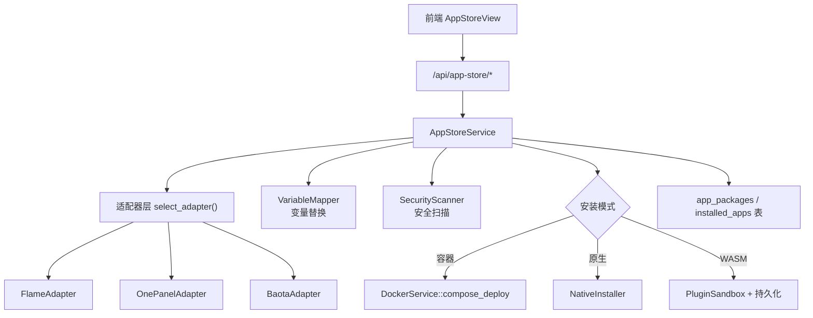
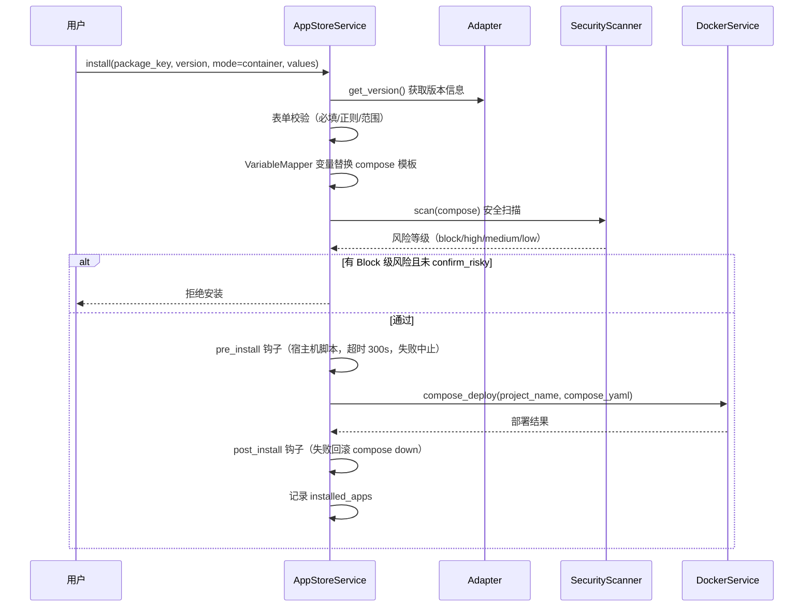
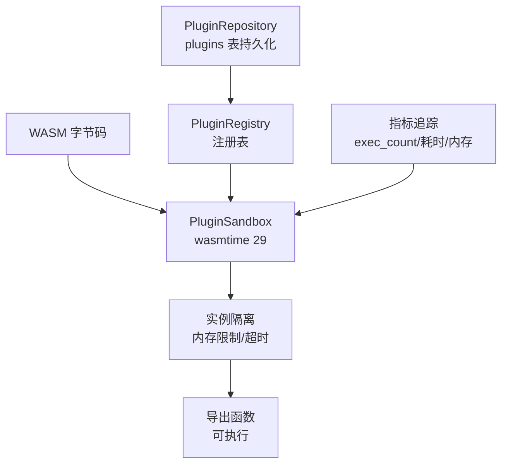

# 08 · 应用商店与插件系统

> FlamePanel 应用商店（三格式/三模式）与 WASM 插件系统详解

## 1. 应用商店概述

应用商店统一支持三种应用包格式和三种安装模式，实现"一次发布，多环境安装"。

### 1.1 应用包格式

| 格式 | 标识 | 来源 | 元数据 |
|------|------|------|--------|
| Flame 内置 | `flame` | 官方内置/导入 | `app.json` + `docker-compose.yml` / `install.sh` / `app.wasm` |
| 1Panel | `onepanel` | 1Panel 生态 | 根 `data.yml` + 版本目录 `data.yml` + `docker-compose.yml` |
| 宝塔 | `baota` | 宝塔生态 | `app.json` + `latest/` 版本目录 + compose |

### 1.2 安装模式

| 模式 | 标识 | 说明 | 编排 |
|------|------|------|------|
| 容器 | `container` | Docker Compose 部署 | compose 模板 → 变量替换 → 安全扫描 → compose_deploy |
| 原生 | `native` | 宿主机安装 | 按分类分派 NativeInstaller（数据库/Web 引擎/通用脚本） |
| WASM | `wasm` | 沙箱插件 | 沙箱加载 → 注册 → 持久化 |

### 1.3 架构



## 2. 核心概念

### 2.1 AppMetadata（应用元数据）

| 字段 | 说明 |
|------|------|
| key | 应用唯一键（如 `wordpress`） |
| name | 应用名称 |
| category | 分类（CMS/DevOps/Web/缓存/监控） |
| short_desc_zh / short_desc_en | 中英文简介 |
| format | 格式（flame/onepanel/baota） |
| modes | 支持的安装模式列表 |
| versions | 可用版本列表 |
| default_version | 默认版本 |
| min_memory_mb | 最低内存要求 |
| architectures | 支持的架构 |

### 2.2 FormField（安装表单字段）

用于前端动态生成安装向导：

| 字段 | 说明 |
|------|------|
| env_key | 环境变量键 |
| label_zh / label_en | 标签 |
| field_type | 类型（text/number/password/select/port/switch/path） |
| default | 默认值 |
| required | 是否必填 |
| pattern / min / max / min_length / max_length | 校验规则 |
| options | 下拉选项 |
| group | 分组 |

### 2.3 AppVersionInfo（版本信息）

| 字段 | 说明 |
|------|------|
| version | 版本号 |
| mode | 安装模式 |
| default_port | 默认端口 |
| form_fields | 表单字段列表 |
| compose_template | Compose 模板 |
| native_scripts | 原生安装脚本步骤（bash 命令） |
| hooks | 生命周期钩子（Doc/20 §4.3）：pre_install / post_install / pre_upgrade / post_upgrade / pre_uninstall（相对包根路径） |
| wasm_base64 | WASM 字节码 |
| min_memory_mb | 最低内存 |
| architectures | 架构 |

## 3. 安装流程详解

### 3.1 容器模式



#### 3.1.1 生命周期钩子（Doc/20 §4.3）

容器模式支持宿主机钩子脚本（1Panel 包 `scripts/` 自动映射，Flame 包经 `app.json` 的 `hooks` 字段显式声明或 `scripts/` 目录标准命名探测）：

| 钩子 | 时机 | 失败语义 |
|------|------|----------|
| pre_install | compose up 前 | 中止安装 |
| post_install | compose up 成功后 | 回滚 compose down，中止安装 |
| pre_upgrade | 换镜像 compose up 前 | 中止升级 |
| post_upgrade | 升级成功后 | 仅告警（容器已运行新版，不回滚） |
| pre_uninstall | compose down 前 | 仅告警（不阻断卸载） |

安全约束：脚本静态扫描（`rm -rf /`、`curl|sh`、写系统关键文件、反弹 shell、fork 炸弹 → Block；`mkfs`/`dd of=/dev/*` → High 告警）；路径白名单字符校验 + 规范化路径必须位于包根内；脚本禁止符号链接（`O_NOFOLLOW` 等效）；执行超时 300s；经统一特权命令端口执行；含钩子的应用安装须 `acknowledge_scripts=true` 显式确认。

#### 3.1.2 升级：compose 三方合并（Doc/30 M-C）

旧实现升级时直接用新版本模板覆盖 `docker-compose.yml`，用户手改的端口、卷、环境变量会静默丢失。现在升级涉及三份 compose：

| 名称 | 来源 |
|------|------|
| base | 上次安装 / 升级时面板渲染的版本，保存在 `<安装目录>/.flamepanel/compose.base.yml`（0600） |
| local | 当前磁盘上的 `docker-compose.yml` |
| upstream | 目标版本模板按同一组安装参数渲染的结果 |

合并规则（按 YAML 结构逐键）：只有一方相对 base 有改动 → 取改动方；两方改成同一值 → 取该值；两方都是映射 → 递归；其余（两方改成不同值、序列被两方各自修改、类型不同、删除与修改并存）→ **冲突**。`ports` / `volumes` / `command` 等序列整体视为一个值。local 与 base 一致时原样采用 upstream，upstream 与 base 一致时原样保留 local；只有真正需要合并时才重新序列化（注释与格式不保留，结果 `reformatted = true`）。早于本功能安装的应用没有 base：每一处本地与上游的差异都记为冲突，由用户决定。

| 端点 | 说明 |
|------|------|
| `GET /api/app-store/installed/:id/upgrade-preview?target_version=` | 只读预览：版本、是否有基线、冲突（路径 + 本地 / 上游值，截断）、保留的本地修改、生效的上游修改、合并结果；`app_store:read` |
| `POST /api/app-store/installed/:id/upgrade?target_version=&conflict_strategy=` | `abort`（默认）有冲突返回 **409**，在执行 `pre_upgrade` 钩子与任何文件改动之前；`local` 冲突处保留本地；`upstream` 冲突处采用新版本 |

升级成功路径：备份旧文件为 `.flamepanel/docker-compose.<旧版本>.yml` → 写入合并结果并 `compose up` → 以 upstream 刷新 base（下一次升级的基线）。前端「已安装 → 升级」先拉预览，有冲突时必须选择处理方式。

### 3.2 原生模式

按应用分类分派：

| 分类 | 安装器 | 说明 |
|------|--------|------|
| 数据库 | NativeDbManager | 复用 database 模块（MySQL/MariaDB/Redis） |
| Web 引擎 | WebServerService | 复用 webserver 模块（Nginx/Apache/Caddy/OLS/OpenResty） |
| 通用 | install.sh 脚本 | 按 `native_scripts` 顺序执行 bash |

### 3.3 WASM 模式

1. 上传 WASM 字节码（base64）
2. `PluginSandbox` 沙箱加载
3. `PluginRegistry` 注册
4. `PluginRepository` 持久化（`plugins` 表）
5. 内置 WASM 工具从 `wasm-builtins` 端点获取

## 4. 变量映射（VariableMapper）

支持三种占位语法，兼容 1Panel/宝塔：

| 语法 | 示例 |
|------|------|
| `${VAR}` | `${CONTAINER_NAME}` |
| `$VAR` | `$HOST_IP` |
| `{var}` | `{port}` |

内置变量：

| 变量 | 说明 |
|------|------|
| `CONTAINER_NAME` | 容器名 |
| `PANEL_APP_PORT_HTTP` | HTTP 端口 |
| `PANEL_APP_PORT_HTTPS` | HTTPS 端口 |
| `HOST_IP` | 主机 IP |
| `name` / `port` / `data_dir` | 用户输入值 |

未识别变量保留并警告。

## 5. 安全扫描（SecurityScanner）

安装前对**解析后的** compose 结构（`serde_yaml` + 合并键 `<<:` 展开，逐服务）进行风险分级（Doc/33 B-1；旧版文本子串匹配可被多空格、引号、锚点、流式写法绕过）：

| 级别 | 检查项 | 处理 |
|------|--------|------|
| Block（始终） | compose 无法解析、多文档 YAML | 拒绝（docker compose 同样无法部署，且无法审计） |
| Block → High | `privileged`（任意真值写法）；宿主敏感路径 bind 挂载（`/`、`/etc`、`/root`、`/boot`、`/proc`、`/sys`、`/dev`、`/run`、`/var/lib/docker`、`/usr`、`/home`、`~` 等，短 / 长语法）与 `docker.sock`；`network_mode` / `pid` / `ipc` / `uts` / `userns_mode: host`；危险 capability（`ALL`、`SYS_ADMIN`、`SYS_MODULE`、`SYS_PTRACE`、`NET_ADMIN`、`DAC_READ_SEARCH` 等）；`devices` 直通；`seccomp` / `apparmor:unconfined`、`label:disable`；跨文件 `extends` | 未勾选 `confirm_risky` **拒绝**；勾选后降为 High 告警，消息带 `【关键】` 前缀 |
| Low | 非白名单镜像仓库、`:latest` | 警告 |
| Info | 未固定 tag、缺 `restart` | 提示 / 自动补充 |

表单值在代入模板前还会校验（`validate_fields`）：键名 `[A-Za-z0-9_]{1,64}`，值拒绝控制字符——防止用换行向 compose 注入 `privileged: true` 等键而绕过扫描（Doc/33 B-2）。远程应用包解包时拒绝一切符号链接 / 硬链接条目（Doc/33 A-9）。

其他强制措施：
- `ensure_restart_policy`：确保 compose 有 `restart` 策略
- 失败自动回滚（compose down + 清理）

## 6. WASM 插件系统

### 6.1 沙箱架构



### 6.2 插件生命周期

| 状态 | 操作 | 说明 |
|------|------|------|
| 加载 | `POST /api/plugins` | 上传 WASM → 沙箱加载 → 注册 → 持久化 |
| 执行 | `POST /api/plugins/:id/execute/:function` | 调用导出函数 |
| 启用/禁用 | `POST /api/plugins/:id/enable\|disable` | 切换状态 |
| 热重载 | `POST /api/plugins/:id/reload` | 更新字节码 |
| 卸载 | `POST /api/plugins/:id` | 从沙箱 + 注册表移除 |
| 启动恢复 | `restore_wasm_plugins` | 启动时从 DB 恢复 |

### 6.3 插件指标

| 指标 | 说明 |
|------|------|
| total_executions | 总执行次数 |
| successful_executions | 成功次数 |
| failed_executions | 失败次数 |
| avg/max/min/last_execution_ms | 执行耗时统计 |
| peak_memory_bytes | 峰值内存 |

### 6.4 内置 WASM 工具

`GET /api/app-store/wasm-builtins` 返回内置工具元数据。示例 `wasm-hello`：真实 WASM 字节码，`run()` 返回 42。

### 6.5 开发一个 WASM 插件

```bash
# 1. 用 Rust/Wat 编写插件，编译为 WASM
# 2. 导出需要执行的函数（如 run(args: Vec<i32>) -> Vec<i32>）
# 3. 将字节码 base64 编码
# 4. 通过 POST /api/plugins 加载
```

> 沙箱支持内存限制（`memory_limit_bytes`）与超时（`timeout_ms`）配置。

## 7. 内置应用

`domain/entity/app.rs` 的 `builtin_apps()` 提供 6 个内置应用（Compose 模板）：

| key | 名称 | 分类 | 默认端口 |
|-----|------|------|----------|
| wordpress | WordPress | CMS / 博客 | 8081 |
| portainer | Portainer | DevOps / 工具 | 9443 |
| nginx | Nginx | Web / 反向代理 | 8083 |
| redis | Redis 缓存 | 缓存 / 消息队列 | 6379 |
| uptime-kuma | Uptime Kuma | 监控 / 告警 | 8084 |
| ollama | Ollama | AI / 大模型 | 11434（仅绑定 `127.0.0.1`，Ollama 无鉴权；供 M-AI-3 面板助手使用） |

启动时 `seed_builtin_apps()` 幂等写入 `app_packages` 表。

## 8. API 端点

| 端点 | 说明 |
|------|------|
| `GET /api/app-store/packages` | 应用包列表（`?category=`） |
| `GET /api/app-store/packages/:key` | 应用详情 |
| `GET /api/app-store/packages/:key/versions/:version` | 版本详情（表单字段） |
| `POST /api/app-store/packages/:key/install` | 安装 |
| `POST /api/app-store/packages/import` | 导入本地包 |
| `GET /api/app-store/installed` | 已安装列表 |
| `GET /api/app-store/installed/:id` | 已安装详情 |
| `GET /api/app-store/installed/:id/upgrade-preview` | 升级预览（compose 三方合并，§3.1.2） |
| `POST /api/app-store/installed/:id/upgrade` | 升级（`?conflict_strategy=abort\|local\|upstream`） |
| `POST /api/app-store/installed/:id/uninstall` | 卸载 |
| `GET /api/app-store/installed/:id/logs` | 应用日志 |
| `GET /api/app-store/wasm-builtins` | WASM 内置工具 |

权限：`app_store:read` / `app_store:create` / `app_store:update` / `app_store:delete`

## 9. 前端集成

`AppStoreView.vue` 三个 Tab：

| Tab | 说明 |
|-----|------|
| 商店 | 应用卡片 + 分类筛选 + 安装向导（选版本 → 动态表单 → 安全扫描 → 确认） |
| 已安装 | 应用列表（状态/日志/升级/卸载） |
| WASM 工具 | 内置 WASM 工具展示 |

`api/appStore.ts` 封装全部端点，`types/index.ts` 定义接口。

## 10. 数据库表

| 表 | 说明 |
|----|------|
| `app_packages` | 应用包元数据 |
| `installed_apps` | 已安装应用记录 |
| `plugins` | WASM 插件持久化 |

详见 [03-数据库设计.md](./03-数据库设计.md)。

## 11. 开发一个新应用包

1. **创建目录**（Flame 格式）：

```
apps/myapp/
├── app.json          # key/name/category/desc/version/mode/icon
├── docker-compose.yml  # 或 install.sh / app.wasm
└── versions/
    └── 1.0.0/
        └── data.yml  # formFields 定义
```

2. **导入**：`POST /api/app-store/packages/import` body `{"path": "/path/to/apps/myapp"}`
3. **验证**：商店 Tab 可见 → 安装测试

## 12. Web 引擎统一（关联）

应用商店与 Web 引擎系统协同：

- **性能预设**：`low` / `medium` / `high` / `ultra`，按 CPU/内存自动推荐
- **引擎切换**：网站与 Web 服务器实例支持 `switch-engine` 端点
- **预设应用**：`POST /api/web-servers/:id/preset` 重新生成全局配置

> 详见 [02-API接口文档.md](./02-API接口文档.md) Web 服务器章节。

### 12.1 站点配置流水线

站点（`/api/websites`）的 vhost 由统一流水线落盘（`webserver::layout` + `WebServerManager::deploy_site / remove_site / set_site_enabled`）：

| 引擎 | 站点文件 | 主配置接入（幂等，首次部署自动插入） |
|---|---|---|
| Nginx | `/etc/nginx/flamepanel/sites/<域名>.conf` | `/etc/nginx/nginx.conf` 首个 `http {` 行后 `include …/*.conf;` |
| OpenResty | `/usr/local/openresty/nginx/conf/flamepanel/sites/<域名>.conf` | 同上（`<base>/nginx.conf`） |
| Apache（Debian / Ubuntu） | `/etc/apache2/flamepanel/sites/<域名>.conf` | `apache2.conf` 末尾 `IncludeOptional …/*.conf` |
| Apache（RHEL 系） | `/etc/httpd/flamepanel/sites/<域名>.conf` | `/etc/httpd/conf/httpd.conf` 末尾 `IncludeOptional …/*.conf` |
| Caddy | `/etc/caddy/flamepanel/sites/<域名>.caddy` | `/etc/caddy/Caddyfile` 末尾 `import …/*.caddy` |
| OpenLiteSpeed | `/usr/local/lsws/conf/vhosts/<域名>/vhconf.conf` | `httpd_config.conf` 中带标记的 `virtualHost` 块 + 每个非 SSL listener 的 `map <域名> <域名>` |

- **面板自有目录**：不依赖 `sites-enabled` / `a2ensite` 等发行版约定；停用 = 重命名为 `<file>.disabled`。旧版本写入的位置（`sites-available/<域名>`、`conf.d/<域名>`、`/etc/caddy/<域名>`、OLS `vhosts/<域名>` 文件）在部署 / 删除时自动清理。
- **事务**：同一引擎的「写 → 校验（`nginx -t` 类）→ reload」由进程级互斥锁串行；多文件改动（站点文件、主配置、旧位置）失败时逆序恢复。reload 失败但引擎未运行时保留已通过校验的配置（`reloaded = false`）。
- **完整渲染**：站点已绑定证书时带上证书文件路径生成 HTTPS；证书文件缺失则拒绝写入（不静默降级为 HTTP）。Caddy 支持显式证书（`tls <cert> <key>`）；OLS 暂不支持显式证书绑定。
- **生命周期**：创建 / 更新 / 绑定运行时 / 切换引擎 / 删除自动联动（引擎未安装或面板无写权限时跳过并记日志）；`POST /api/websites/:id/deploy` 为严格模式，前端网站列表「部署配置」按钮调用。
- **OLS 注意**：若 `httpd_config.conf` 已有同名但非面板管理的 `virtualHost`（如在 WebAdmin 手工创建），部署返回 409，需先在 WebAdmin 删除。
- **Caddy 全局配置**：不再生成 `admin off`——`caddy reload` 依赖本机 admin API（`localhost:2019`）。
- **权限**：写 `/etc` 需要 root。root / Docker 部署由面板直写；默认 systemd 非 root 部署经本机特权助手（§12.2）。两者都不可用时联动跳过、手动部署返回无权限原因。测试 / 容器可用 `OP_WEBSERVER_ROOT` 把逻辑路径映射到其他根目录。

### 12.2 本机特权助手（`flamepanel helper`）

`WebServerManager::new_with_runner` 经 `webserver::helper::engine_access` 选择文件宿主与命令执行器：面板**非 root 且助手 socket 存在**（或 `OP_PRIV_HELPER=on`）时使用 `HelperEngineHost` + `HelperCommandRunner`，否则本机直写。上层（网站服务、证书绑定、引擎管理）无感知。

| 层 | 约束 |
|---|---|
| 进程 | 同一二进制的 root 子命令，`flamepanel-helper.service`（`RuntimeDirectory=flamepanel-helper`，`NoNewPrivileges` / `ProtectHome` / `ProtectKernel*`）；非 root 启动直接退出 |
| 传输 | Unix socket `0660 root:<面板组>`；每连接 `SO_PEERCRED` 校验 uid ∈ {0, 面板用户}；一连接一请求、单行 JSON ≤ 4 MiB、读超时 10 s、并发 ≤ 16 |
| 协议 | `{"v":1,"op":"ping|read|write|remove|exists|writable|read_log|run",…}` → `{"ok":true,"data":…}` / `{"ok":false,"kind":"forbidden|not_found|bad_request|conflict|unavailable|internal","message":…}`；`kind` 与 `AppError` 变体一一对应，面板侧还原后 HTTP 状态码不变；版本不符返回 400 |
| 路径 | `policy::ENGINE_CONFIG_ROOTS`（`/etc/nginx`、`/usr/local/openresty/nginx/conf`、`/etc/apache2`、`/etc/httpd`、`/etc/caddy`、`/usr/local/lsws/conf`）之下的规范逻辑路径；助手侧再对真实路径 canonicalize，符号链接指向根外一律 403 |
| 日志 | `read_log`（增量、只读）仅限 `policy::log_files()` 精确列表（由 `waf_nginx::log_path` 派生：`/var/log/nginx/flamepanel-waf.log`、`/usr/local/openresty/nginx/logs/flamepanel-waf.log`）；`O_NOFOLLOW` + 普通文件校验，日志被替换为符号链接一律 403；单次 ≤ 512 KiB 且只返回完整行；这些文件不能经 `read` / `write` 访问 |
| 命令 | 由 `WebServerEngine` 声明按「引擎 × 发行版族」展开的精确 argv（配置校验 / reload / `systemctl <verb> <引擎服务>` / `killall <引擎进程>` / `lswsctrl <verb>`），外加 `caddy <verb> --config <白名单路径>`、Nginx / OpenResty 默认二进制 `-c <白名单路径>`；不接受环境变量 / 工作目录。白名单外命令（`pgrep`、实例自定义二进制）面板侧仍走原执行器 |
| 审计 | 写入 / 删除 / 命令记 info，拒绝与失败记 warn（journald） |

- **不可用时**：socket 连接失败 → 503「privileged helper unavailable」并提示 `systemctl status flamepanel-helper`；`exists` / `writable` 探测失败按 false 处理（建站联动跳过而不回滚）。
- **升级**：`fpctl restart / upgrade / rollback` 重启面板前 `systemctl try-restart flamepanel-helper`，保证两端同版本；`fpctl doctor` 的 `priv-helper` 项 ping 助手并比对版本。
- **真机冒烟**：`sudo bash scripts/helper-smoke.sh [二进制]`（仅限一次性环境）。
- **范围**：本轮只覆盖 Web 引擎；防火墙 / 数据库等复用同一通道需逐项扩展白名单（Doc/30 W3-b 后续）。

### 12.3 WAF → Nginx / OpenResty 原生下发（Doc/32 W3-c）

此前 WAF 规则只作用于面板进程内引擎（`WafService::inspect`），生产流量并不经过面板——**规则事实上不保护任何站点**。W3-c 把规则编译为引擎原生配置（`webserver/waf_nginx.rs`，纯函数），由 `WebServerManager::deploy_waf` 与站点配置同一事务模型落盘（引擎锁 + 多文件回滚 + `nginx -t` + reload；非 root 经 §12.2 助手）。

| 产物 | Nginx | OpenResty |
|---|---|---|
| 目录 | `/etc/nginx/flamepanel/waf/` | `/usr/local/openresty/nginx/conf/flamepanel/waf/` |
| http 级（主配置 `http {` 后幂等 include `…/http*.conf`） | `http.conf`：`geo` / `map` 判定变量、CC 的 `limit_req_zone`、`log_format fp_waf` + 命中日志 | 同左 |
| server 级（站点模板 include `…/server*.conf`，glob 缺失不报错） | `server.conf`：`if ($fp_waf_block) { return 403; }` + CC `limit_req` | 同左 |
| 命中日志（JSON Lines，含 `rules` 命中标记） | `/var/log/nginx/flamepanel-waf.log` | `/usr/local/openresty/nginx/logs/flamepanel-waf.log` |

- **规则映射**：IP 黑白名单 → `geo`（IPv4 / CIDR，网站级规则再以 `$host` 组合 `map`）；UA → `map $host|$http_user_agent`（`~*` 子串）；路径封禁 → `map $host|$uri`（前缀）；SQLi / XSS → 内置特征 `map $host|$request_method $request_uri`（容忍 `%HH` 编码，空格同时匹配 `+` / `%20`）；白名单命中则屏蔽全部阻断 / 告警 / CC。
- **注入防护**：所有用户输入（匹配值、域名）逐字节转为 PCRE `\xHH` 写在双引号内，无法跳出配置语法；分隔符 `|` 写作 `\x7c`。
- **作用域**：`website_id = 0` 全局；网站级规则按该网站在该引擎上的域名（小写）限定。进程内引擎同步修正为 `evaluate_for_site`，此前网站级规则会误伤其它网站。
- **与进程内引擎的语义差异**：① Nginx 按「阻断优先于告警」统一判定，不是「首条命中」；② CC 只下发 `action=block`（`limit_req` 无按规则的仅告警模式），超限返回 **429**，`action=log` 的 CC 规则在报告中列为跳过；③ `limit_req` 为漏桶（`rate = ⌈threshold×60/window⌉ r/m`，`burst = threshold nodelay`），与进程内固定窗口近似而非逐请求一致。
- **CC 的阶段限制**：`limit_req` 在 preaccess 阶段计数，`location` 内以 `return` 结束的请求（如仅做跳转的块）不经过该阶段、不计入 CC；403 判定位于 server 级 `if`（rewrite 阶段），不受此影响。CC 拒绝同时记在引擎 error log（`limiting requests`）与 WAF 命中日志（W3-d）。
- **真机验证**（CNB 开发环境，nginx 1.22.1）：`waf_nginx::tests::real_nginx_accepts_compiled_config` 以真实 `nginx -t` 校验含注入样例的完整规则集；一次性冒烟以三站点实际请求验证 11 / 11：全局 UA 阻断、UA 白名单豁免、路径封禁只作用于所属网站、SQLi（`%20` / `+` 编码）、XSS 仅告警放行、网站级 IP 黑名单、CC 第 7 个请求起 429、命中日志 JSON 含规则标记。
- **触发**：规则创建 / 更新 / 删除后尽力下发（失败记 warn，规则已落库）；`POST /api/waf/apply` 手动下发并返回逐引擎报告（未安装 / 无写权限 → `applied=false` + 原因；校验失败 → `error`，已回滚）；网站集合变化由后台同步自动重新下发（见下）。
- **旧站点**：W3-c 之前渲染的站点文件缺少 server 级 include，下发时自动重新部署一次（共享证书仓储，不丢 HTTPS），报告列出 `redeployed_sites`。
- **主配置**：面板生成的 Nginx / OpenResty 全局配置显式声明 `access_log`——http 级 WAF 命中日志与之并存继承，避免替换掉隐式默认访问日志。
- **命中日志回灌**（W3-d，`infrastructure/waf_sync.rs`，默认每 10 s，`OP_WAF_SYNC_SECS=0` 关闭）：增量读取各引擎的 `flamepanel-waf.log`（非 root 经助手 `read_log`），每个命中规则写一条拦截日志（白名单命中不记；网站级规则记在规则所属网站，全局规则按 `$host` 匹配网站；已删除规则记为 `#<id>`），阻断命中走既有拦截通知（按规则 300 s 节流）。读取位置 `inode:offset` 存面板设置 `waf.ingest.<engine>`——重启不重复导入，轮转（inode 变化）/ 截断自动从头读；先写库再推进位置（至少一次）。状态见 `GET /api/waf/status` 的 `ingest` 与 WAF 页「拦截日志」页签。
- **CC 拒绝入日志**：存在 CC 规则时，命中条件加入 `$limit_req_status`（nginx ≥ 1.17.6），每条 CC 规则输出作用域标记 `cN`，429 请求归因到作用域内的 CC 规则（同一请求同时处于多条 CC 规则作用域时都会记录）。
- **网站变化自动重新下发**：同步任务比较网站集合指纹（引擎 × ID × 域名），变化且存在启用的网站级规则时重新下发（覆盖建站 / 删站 / 改域名 / 切换引擎）；面板启动后的第一次检查只建立基线。
- **范围**：v1.1 起扩展到 Apache / Caddy / OpenLiteSpeed，见 §12.3a。

### 12.3a WAF → Apache / Caddy / OpenLiteSpeed 原生下发（Doc/30 v1.1）

分发入口 `webserver/waf_engines.rs`（`supports` / `compile` / 路径 / 钩子 / 日志解析），各引擎编译器均为纯函数，**只用引擎自带能力**（不依赖 ModSecurity / Lua / xcaddy 插件 / 企业版特性），落盘仍走 `WebServerManager::deploy_waf` 同一事务（引擎锁 + 多文件回滚 + 配置校验 + reload）。规则语义与 §12.3 相同（白名单优先、IPv4 / CIDR、UA 子串不区分大小写、路径前缀按**解码后**路径、SQLi / XSS 内置特征容忍 `%HH`、网站级规则只作用于该网站域名）。

| | Apache 2.4（`waf_apache.rs`） | Caddy 2（`waf_caddy.rs`） | OpenLiteSpeed（`waf_ols.rs`） |
|---|---|---|---|
| 目录 | `/etc/apache2/flamepanel/waf/`（RHEL `/etc/httpd/…`） | `/etc/caddy/flamepanel/waf/` | `/usr/local/lsws/conf/flamepanel/waf/` |
| 主配置级 | `http.conf`（主配置末尾幂等 `IncludeOptional …/http*.conf`）：`LogFormat fp_waf` + `GlobalLog … env=fp_waf_hit` | 无 | 无 |
| 站点级 | `vhost.conf`（站点 `<VirtualHost>` 内 `IncludeOptional`，Debian / RHEL 两个位置都写）：`SetEnvIfExpr` → `<If>` `Require all denied` | `site.caddy`（站点块内 `import …/site*.caddy`）：命名匹配器 + `vars` → `respond 403` | `vhost.rules` 分段规则库，部署时拼接进 `vhconf.conf` 的 `rewrite` 规则最前（`# >>> / <<< flamepanel:waf` 标记） |
| 匹配时机 | post-read-request（伪静态之前）；路径用 `unescape(%{REQUEST_URI})` | `vars` 早于 `rewrite` / `try_files`，匹配原始请求 | vhost 级 rewrite，先于站点伪静态 |
| 阻断 | 403 | 403 | 403（`RewriteRule ^ - [F]`） |
| 仅告警规则 | ✅ 记命中日志 | ✅ 记命中日志 | ❌ 跳过（无原生条件日志） |
| CC | ❌ 跳过（无原生按客户端限频） | ❌ 跳过（限频需第三方插件） | ❌ 跳过 |
| 命中日志 | `/var/log/apache2/flamepanel-waf.log`（RHEL `/var/log/httpd/…`），JSON，`rules` 标记 `rN:1` / `rN:-` | `/var/log/caddy/flamepanel-waf.log`，Caddy JSON 访问日志 + `skip_log`（未命中 / 白名单不记）；规则标记经 `map … {http.auth.user.id}` 写入 `user_id`（`fpwaf b:1 r3:1`） | 无（不回灌） |

- **白名单优先**：Apache `fp_waf_wl` 屏蔽阻断 / 告警汇总；Caddy `not vars fp_waf_wl 1`；OLS 每条阻断规则追加全部适用白名单的取反 `RewriteCond … !…`（OLS 遇 `[L]` / `[F]` 即结束规则处理，不能用「白名单 `[L]` 先行」否则会跳过站点伪静态）。
- **OLS 的 IP 匹配**：OLS 不支持 `RewriteCond expr "-R …"`（仅 LSWS 企业版），CIDR 编译为精确的 `%{REMOTE_ADDR}` 正则（按八位组展开范围，单测以 `regex` 校验边界）。
- **OLS 拼接**：vhost 配置不支持 include，`deploy_waf` 逐站点（规则库 `# @site <domain>` 段；启用 / 停用两种文件）替换标记块；站点重新渲染（改站点 / 套伪静态）时 `deploy_site` 从规则库补回，避免静默丢失；规则清空后 vhconf 恢复原样。站点已有 `rules <<<…` 时插入 heredoc 首行之后，否则新建 `rewrite {}` 块。
- **注入防护**：字面量一律 `\xHH`。Apache 放在 `/…/` 正则内、IP 经解析后才进入 `-R '…'`；Caddy 放在反引号令牌与 CEL 原始字符串 `r'…'` 内；OLS 一行一条指令（正则内无空格）。单测覆盖含引号 / 反引号 / 花括号 / 换行的恶意样例。
- **Caddy `user_id` 说明**：站点启用 `basicauth` 时 `user_id` 为真实用户名，该请求的规则标记丢失（拦截不受影响，回灌忽略无标记行）。
- **旧站点**：Apache / Caddy 站点文件缺少 WAF include 时下发自动重新部署一次（同 §12.3）；OLS 由拼接覆盖，无需重部署。
- **特权助手**：`read_log` 白名单由 `waf_engines::all_log_paths()` 派生（Nginx / OpenResty / Apache 各发行版 / Caddy）。
- **真机验证**（沙箱 Debian 13：Apache 2.4.68 / Caddy 2.6.2，编译器实际产物）：全局 IP / CIDR、UA、网站级路径（含大小写主机 + 端口）、`/%61dmin` 编码绕过、SQLi（`+` 编码）、XSS 仅告警放行并记日志、IP / UA 白名单豁免、含 `" ' \` { } $` 的恶意路径字面量均符合预期；Apache / Caddy 命中日志 JSON 与解析器一致。OLS 规则文本在 Apache mod_rewrite 上验证同样结果（OLS 真机待补）。
