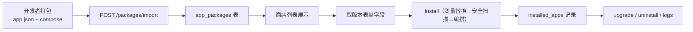
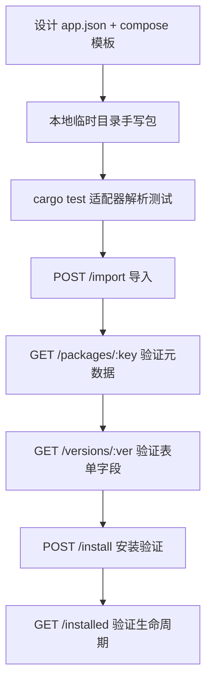

# 15 · 应用商店 SDK 开发指南

> 面向应用开发者与插件开发者的完整 SDK 文档：应用包格式规范、清单 Schema、SDK 工具链、WASM 插件 SDK、API 对接与最佳实践。

## 1. SDK 概览

FlamePanel 应用商店提供**"一次打包、多模式安装"**的应用分发体系。开发者只需按本指南规范打包应用，即可让应用被商店识别、导入、安装与升级。

### 1.1 支持的格式与模式

| 维度 | 选项 | 说明 |
|------|------|------|
| 应用包格式 | `flame` / `onepanel` / `baota` | 三种生态格式，导入时自动识别（`select_adapter`） |
| 安装模式 | `container` / `native` / `wasm` | 容器 Compose / 宿主原生 / WASM 沙箱 |

### 1.2 一个应用包的生命周期



## 2. 应用包格式规范（Flame 格式）

Flame 格式是商店的**原生格式**，同时兼容 1Panel / 宝塔包（见 [16-兼容性开发指导](./22-1Panel与原生软件兼容性.md)）。

### 2.1 目录结构

```
apps/<app-key>/
├── app.json                 # 应用元数据（必填）
├── icon.png                 # 图标（可选）
├── readme.md                # 说明文档（可选）
└── <version>/               # 版本目录（如 1.0.0 / 6.7 / latest）
    ├── docker-compose.yml   # 容器模式模板（与 install.sh 二选一或并存）
    ├── install.sh           # 原生模式安装脚本
    ├── app.wasm             # WASM 模式字节码
    └── data.yml             # 该版本表单字段（可选，也可写在 app.json 的 form_fields）
```

> 版本目录名必须**不含 `v` 前缀**（`v2.1` 会被跳过），且需包含数字或 `beta`/`rc` 特征；`logo`/`readme`/`data`/`scripts` 等目录名会被忽略。

### 2.2 `app.json` Schema

```json
{
  "key": "gitea",
  "name": "Gitea",
  "category": "devops",
  "short_desc_zh": "轻量 Git 服务",
  "short_desc_en": "Lightweight Git hosting",
  "tags": ["git", "devops"],
  "mode": "container",
  "default_port": 3000,
  "icon": "icon.png",
  "versions": ["1.21.0", "1.20.0"],
  "form_fields": [
    {
      "env_key": "PORT",
      "label_zh": "服务端口",
      "label_en": "Port",
      "field_type": "port",
      "default": "3000",
      "required": true
    }
  ],
  "readme": "readme.md"
}
```

字段说明：

| 字段 | 类型 | 必填 | 说明 |
|------|------|------|------|
| `key` | string | ✅ | 应用唯一键，全小写字母数字与 `-`，与目录名一致 |
| `name` | string | ✅ | 展示名称 |
| `category` | string | 推荐 | 分类（CMS / DevOps / Web / 缓存 / 监控…） |
| `short_desc_zh` / `short_desc_en` | string | 推荐 | 中英文简介 |
| `tags` | string[] | 否 | 标签，用于检索 |
| `mode` | string | 推荐 | `container` / `native` / `wasm`，默认 `container` |
| `default_port` | int | 推荐 | 默认端口（容器模式预填 `PORT` 字段） |
| `icon` | string | 否 | 图标文件路径 |
| `versions` | string[] | 否 | 版本列表；缺省时自动扫描版本目录 |
| `form_fields` | FormField[] | 否 | 全局表单字段；容器模式无字段时自动补 `PORT` |
| `readme` | string | 否 | README 文件路径 |

### 2.3 FormField 表单字段定义

| 字段 | 类型 | 说明 |
|------|------|------|
| `env_key` | string | 环境变量键（Compose 中通过 `${ENV_KEY}` 引用） |
| `label_zh` / `label_en` | string | 标签（中/英） |
| `field_type` | string | `text` / `number` / `password` / `select` / `port` / `switch` / `path` |
| `default` | string | 默认值 |
| `required` | bool | 是否必填 |
| `pattern` | string | 正则校验（仅 `app.json` 的 Flame 全局字段支持；1Panel 的 `regex` 会映射到此） |
| `min` / `max` | number | 数值范围 |
| `min_length` / `max_length` | number | 字符串长度范围 |
| `options` | `[{label, value}]` | `select` 类型的下拉选项 |
| `description` | string | 帮助说明（宝塔的 `placeholder` 会映射到此） |
| `group` | string | 表单分组 |

> 源码对应：`domain/entity/app.rs` 的 `FormField` 结构体。前端根据这些字段动态渲染安装向导。

### 2.4 Compose 模板变量

容器模式模板支持三种占位符，由 `VariableMapper` 统一渲染：

| 语法 | 示例 | 说明 |
|------|------|------|
| `${VAR}` | `${PANEL_APP_PORT_HTTP}` | 推荐，标准形式 |
| `$VAR` | `$HOST_IP` | 兼容形式 |
| `{var}` | `{port}` | 遗留形式（内置应用模板在用） |

**内置可用变量**（由安装编排自动注入）：

| 变量 | 说明 |
|------|------|
| `CONTAINER_NAME` | 生成的容器名（`<key>-<8位随机>` 或用户指定） |
| `NAME` | 实例名称 |
| `PORT` | 端口（用户输入或 default_port） |
| `PANEL_APP_PORT_HTTP` | = PORT |
| `PANEL_APP_PORT_HTTPS` | = PORT+1 |
| `HOST_IP` | 默认 `0.0.0.0` |
| `APP_PATH` | 安装目录绝对路径（`data/apps/<key>/<container>`） |

**用户表单值**优先级最高（`values` 覆盖内置变量）。未识别变量会**保留原样并告警**，不会导致安装失败。

**系统变量**（安装时自动注入，用户表单值优先；M-M1 CasaOS 同构）：

| 变量 | 默认值 | 说明 |
|------|--------|------|
| `PUID` / `PGID` | `1000` / `1000` | 运行用户/组 ID，数据卷权限开箱即对 |
| `TZ` | 宿主机时区 | 容器时区自动对齐 |
| `APP_ID` | 应用 key | 实例标识 |

**端口变量约定**（适配器 `known_port_vars()`，前端据此预填端口字段）：

| 格式 | 端口变量 |
|------|----------|
| Flame | `PORT` |
| 1Panel | `PANEL_APP_PORT_HTTP` / `_HTTPS` / `_API` / `_ADMIN` / `_PROXY` / `_DB` |
| 宝塔 | `HOST_IP` / `CPUS` / `MEMORY_LIMIT` / `APP_PATH` / `CONTAINER_NAME` |

### 2.5 x-flame 扩展字段（推荐，M-M1）

Flame 原生包的 `docker-compose.yml` 可采用标准 Compose Specification extension 规范的
`x-flame` 顶层扩展字段声明元数据（CasaOS `x-casaos` 同构路线）——**表单即元数据，
商店页面零额外维护**：

```yaml
# apps/<key>/<version>/docker-compose.yml
x-flame:
  app:
    category: website            # 分类（app.json 未声明时补充）
    arch: [amd64, arm64]        # 架构适配
  services:
    app:
      env:
        PANEL_APP_PORT_HTTP: 网站对外端口    # 每个变量的人类可读说明 → 补充表单字段
      ports:
        "8080:80": 网站端口                 # 端口/卷映射说明（预留展示）
      volumes:
        "${APP_PATH}/data:/var/www/html": 站点数据

services:
  app:
    image: docker.io/library/wordpress:6.7   # 禁用 :latest（扫描器 Low 告警）
    networks: [flamepanel-network]
```

合并规则：`app.json` 已显式声明的元数据/表单字段**优先**，`x-flame` 仅补充缺省项，
两种声明方式可共存；env 说明生成的补充字段为 `text` 类型、非必填。

### 2.6 网络兼容

- 1Panel 包中的 `1panel-network` → 自动替换为 `flamepanel-network`
- 宝塔包中的 `baota_net` → 自动替换为 `flamepanel-network`
- 应用应使用独立 compose project（`-p <container_name>`）部署，网络隔离、互不干扰

### 2.7 安全扫描要求

所有容器包安装前都会过 `SecurityScanner`：

| 风险 | 触发条件 | 处理 |
|------|----------|------|
| Block | compose 无法解析 / 多文档 YAML | 始终拒绝 |
| Block → High | `privileged`；挂载 `/` `/etc` `/root` `/boot` `/proc` `/sys` `/dev` `/run` `/var/lib/docker` `~` 等宿主敏感路径或 `docker.sock`；`network_mode` / `pid` / `ipc` / `uts` / `userns_mode: host`；危险 `cap_add`（`ALL` / `SYS_ADMIN` / `NET_ADMIN` …）；`devices`；`seccomp` / `apparmor` unconfined；跨文件 `extends` | 默认**拒绝安装**；`confirm_risky=true` 才放行（降为 High） |
| Low | 镜像来自非白名单仓库 | 警告 |
| Info | 无 `restart:` 策略 | 自动补充 `restart: unless-stopped` |

> 扫描基于解析后的 YAML 结构，写法差异（多空格、引号、锚点合并、流式映射）不影响判定。包内**不允许**符号链接或硬链接（远程源解包与签名摘要均会拒绝）；表单字段 `env_key` 只能是 `[A-Za-z0-9_]`，用户输入的值不能含换行等控制字符。
> 白名单仓库：`docker.io` `ghcr.io` `quay.io` `registry.cn-hangzhou.aliyuncs.com`。请优先使用这些仓库，否则出现 Low 级警告。
> 质量规约（M-M1）：禁用 `:latest` 标签（显式 `:latest` → Low 告警，未声明 tag → Info 提示）——可回滚可复现。

## 3. 安装模式详解

### 3.1 容器模式（container）

Compose 模板 → 变量替换 → 安全扫描 → 写入安装目录 `docker-compose.yml` → `docker compose -p <name> up -d`。

**安装目录**：`data/apps/<key>/<container_name>/`

### 3.2 原生模式（native）

按 `package_key` 分派：

| key | 分派目标 | 说明 |
|-----|----------|------|
| `mysql` / `mariadb` | `DatabaseService::install_mysql` | apt/dnf/apk 原生安装 |
| `redis` | `DatabaseService::install_redis` | 原生安装 + requirepass |
| `nginx` / `apache` / `openlitespeed` / `openresty` / `caddy` | `WebServerService` | 包安装 + 引擎注册 |
| 其他 | `install.sh` 逐行执行 | 见下方原生脚本规范 |

**原生脚本规范（install.sh）**：每行是一条 bash 命令，按序执行，任一失败即中止并报错（源码按行过滤空行与 `#` 注释后 `sh -c` 逐行执行）。

```
apt-get install -y php-fpm
systemctl enable php-fpm
systemctl start php-fpm
```

> 注意：面板按**行**执行，不支持多行块；复杂逻辑建议写成单行脚本或拆分为多步。

### 3.3 WASM 模式（wasm）

1. 版本目录包含 `app.wasm`（或请求 `values.wasm_base64` 直接传字节码）
2. 后端 base64 解码 → SHA-256 指纹
3. `PluginSandbox` 沙箱加载（wasmtime，fuel 计量 + 超时）
4. `PluginRegistry` 注册 + `PluginRepository` 持久化（`plugins` 表）
5. 面板重启后 `restore_wasm_plugins` 自动恢复

WASM SDK 详见第 5 节。

## 4. SDK 工具链

### 4.1 本地开发包验证

```bash
# 1. 在仓库根目录放置应用包
mkdir -p apps/gitea/1.21.0
cat > apps/gitea/app.json <<'EOF'
{ "key": "gitea", "name": "Gitea", "category": "devops", "mode": "container", "default_port": 3000, "versions": ["1.21.0"] }
EOF
cat > apps/gitea/1.21.0/docker-compose.yml <<'EOF'
services:
  gitea:
    image: gitea/gitea:1.21.0
    ports:
      - "${PANEL_APP_PORT_HTTP}:3000"
    restart: unless-stopped
EOF

# 2. 启动面板，导入
curl -X POST http://localhost:8080/api/app-store/packages/import \
  -H "Authorization: Bearer $TOKEN" -H "Content-Type: application/json" \
  -d '{"path": "/abs/path/to/apps/gitea"}'
```

### 4.2 推荐开发流程（TDD 参照）



新增适配器或修改解析逻辑时，参照 `flame-kernel/src/infrastructure/app_store/adapter/*.rs` 中 `#[cfg(test)]` 的 29 个单元测试写法（`temp_dir` + 手写包 → `parse_metadata`/`parse_version` 断言）。

## 5. WASM 插件 SDK

### 5.1 支持的导出函数签名

当前沙箱支持以下签名（`WasmSandbox::execute_with`）。需要传入数据 / 返回文本的插件请用 §5.7 宿主 API（`flame.input_read` / `flame.output`），返回值只作状态码：

| 签名 | 说明 |
|------|------|
| `() -> i32` | 返回 32 位整数（内置 `wasm-hello` 采用） |
| `() -> ()` | 无返回值 |
| `(i32, i32) -> i32` | 两个 i32 参数（当前参数固定传 `(0,0)`，**建议优先用无参或仅用返回值**） |

执行结果：插件调用过 `flame.output` 时 `output` 为该字节串，否则为返回值的 4 字节小端编码（兼容旧插件）。

### 5.2 生命周期钩子

沙箱在以下时机调用同名导出函数（可选，缺失不影响加载）：

| 钩子 | 时机 |
|------|------|
| `on_load` | 插件加载后 |
| `on_reload` | 热重载时（`reload_plugin`，失败自动回滚旧字节码） |
| `on_enable` / `on_disable` | 启用/禁用时 |
| `on_unload` | 卸载前 |

钩子同样可调用宿主 API（按已授予能力鉴权，fuel 100,000），但钩子内的 `setting_set` 不持久化。

### 5.3 用 Rust 编写 WASM 插件

```bash
# Cargo.toml
# [lib]
# crate-type = ["cdylib"]
# 目标: wasm32-wasip1（或 wasm32-unknown-unknown）
```

```rust
// src/lib.rs — 编译为 WASM
#[no_mangle]
pub extern "C" fn run() -> i32 {
    42
}

#[no_mangle]
pub extern "C" fn on_load() {}

#[no_mangle]
pub extern "C" fn on_unload() {}
```

```bash
cargo build --target wasm32-wasip1 --release
# 编码 base64 后经 API 加载
base64 -w0 target/wasm32-wasip1/release/my_plugin.wasm
```

### 5.4 直接用 WAT 编写（无编译环境）

```wat
;; hello.wat
(module
  (func (export "run") (result i32)
    i32.const 42)
  (func (export "on_load"))
  (func (export "on_unload"))
  (memory (export "memory") 1))
```

```bash
wat2wasm hello.wat -o hello.wasm
base64 -w0 hello.wasm
```

### 5.5 沙箱限制

| 项 | 默认值 | 可配置 |
|----|--------|--------|
| 内存限制 | 64 MB | `memory_limit_bytes`（1 MiB – 256 MiB） |
| 执行超时（墙钟） | 30 s | `timeout_ms`（1 – 300000）；epoch interruption 强制，超时报 `WASM execution timed out after N ms` |
| 燃料（fuel） | 每次执行 1,000,000（钩子 100,000） | 源码固定；耗尽报 `exceeded its fuel budget` |
| 栈大小 | 1 MB | `max_stack_size` |

> batch-14 之前 `timeout_ms` 只被校验、从未在执行中生效（仅靠 fuel 兜底）；现由看门狗线程在超时时递增 engine epoch 打断执行，执行结束立即唤醒退出，不残留线程。

导入 deny-by-default：只能导入 §5.7 列出的 `flame.*` 函数，其他任何导入（含 WASI）在实例化时失败；无网络、无进程、无环境变量。资源类宿主函数还要求管理员显式授予的**能力**。

### 5.7 宿主 API 与能力（batch-14）

插件从导入模块 `flame` 调用宿主函数。字符串 / 字节一律以 `(ptr, len)` 指向插件**导出的 `memory`**，越界返回 `-2`。需要回传数据的函数采用「调用方给缓冲区」约定 `(…, out_ptr, out_cap) -> i32`：返回值 ≥ 0 为**完整长度**，宿主写入 `min(长度, out_cap)` 字节；返回值大于 `out_cap` 时可扩容后重调。

| 函数 | 签名 | 所需能力 | 说明 |
|------|------|----------|------|
| `log` | `(level, ptr, len)` | — | 0 trace … 4 error，写入内核日志（target `plugin`）并随执行结果返回；每次执行 ≤ 100 条、每条 ≤ 1 KiB |
| `input_len` / `input_read` | `() -> i32` / `(out, cap) -> i32` | — | 本次调用的输入（执行 API 的 `input`，≤ 1 MiB） |
| `output` | `(ptr, len) -> i32` | — | 设置本次调用的输出（覆盖式，≤ 1 MiB） |
| `setting_get` | `(kp, kl, out, cap) -> i32` | — | 读自身设置 |
| `setting_set` | `(kp, kl, vp, vl) -> i32` | `settings:write` | 写自身设置（键 `[A-Za-z0-9._-]{1,128}`、值 ≤ 4 KiB、≤ 256 项），执行结束后持久化 |
| `fs_read` | `(pp, pl, out, cap) -> i32` | `fs:read:<dir>` | 读文件（≤ 1 MiB）；相对路径基于第一个读能力根 |
| `fs_list` | `(pp, pl, out, cap) -> i32` | `fs:read:<dir>` | 列目录，JSON `[{"name","is_dir","size"}]`，按名称排序，≤ 1000 项 |
| `fs_write` | `(pp, pl, dp, dl) -> i32` | `fs:write:<dir>` | 覆盖写文件（≤ 1 MiB），父目录须已存在 |
| `metrics` | `(out, cap) -> i32` | `metrics:read` | 面板本机最新指标快照 JSON（`MetricsSnapshot`） |

错误码：`-1` 无能力 / 路径不在能力根内，`-2` 参数非法，`-3` 不存在，`-4` IO 失败，`-5` 超过上限，`-6` 宿主暂无数据（如指标尚未采样）。

**能力**（`plugin::capability`）在授予时与每次访问时双重校验：

- 授予：目录须为绝对路径、不含 `..`；读写都拒绝 `/`、`/proc`、`/sys`、`/dev`、`/boot`、`/root` 及其子树和祖先；写能力另拒 `/etc`、`/usr`、`/bin`、`/sbin`、`/lib*`、`/var/lib`、`/var/spool`（同样包括祖先，如 `fs:write:/var`）；凭据文件 `/etc/shadow`、`/etc/gshadow`、`/etc/sudoers(.d)`、`/etc/ssh` 不可授予。每个插件最多 16 项。
- 已存在的能力根在授予时同时校验其 canonical 路径，符号链接别名不能间接授予系统保护目录；尚未创建的安全目录仍可预先授予。恢复持久化能力时，不再合法的条目丢弃。
- 访问：目标 canonicalize（写目标 canonicalize 父目录，已存在的符号链接再按实际指向判定）后必须仍在能力根内，并按读 / 写模式复核完整系统目录与凭据黑名单。能力根本身也重新 canonicalize 并复核授予策略，防止授予后根被重定向；无法解析实际根时拒绝访问。根目录内指向根外（或保护目录）的符号链接会被拒绝。
- 这是路径策略校验，不提供对有宿主目录写权限的本机进程并发改链的原子隔离；描述符级 IO / TOCTOU 加固属于后续独立切片。
- 能力随插件持久化（`plugins.capabilities`），重启后恢复；`reload` 只替换字节码与资源限制，不改变已授予的能力。

```wat
;; 读取输入，输出问候语（简化版：省略了输入长度钳制与日志，完整版见 plugin/market.rs 的 HELLO_WAT）
(module
  (import "flame" "input_len" (func $input_len (result i32)))
  (import "flame" "input_read" (func $input_read (param i32 i32) (result i32)))
  (import "flame" "output" (func $output (param i32 i32) (result i32)))
  (memory (export "memory") 1)
  (data (i32.const 0) "Hello, ")
  (func (export "run") (result i32)
    (local $n i32)
    (local.set $n (call $input_len))
    (drop (call $input_read (i32.const 7) (i32.const 256)))
    (call $output (i32.const 0) (i32.add (i32.const 7) (local.get $n)))))
```

Rust 插件以 `#[link(wasm_import_module = "flame")] extern "C" { fn output(ptr: *const u8, len: i32) -> i32; … }` 声明导入。

### 5.8 插件市场（雏形）

- **内置目录**：`flame-hello`（无能力，演示 log / input / output）、`flame-metrics-snapshot`（`metrics:read`）、`flame-log-viewer`（`fs:read:/var/log`；输入为空列出目录，否则读取相对路径的文件）。以 WAT 源码内嵌、安装时编译，单测断言编译产物哈希与目录一致。
- **远程索引**（可选）：面板设置项 `plugin_market_url` 指向 JSON 索引 `{"plugins":[{id,name,version,author,description,capabilities,tags,homepage,license,entry,wasm_url,wasm_sha256}]}`。只接受 http(s)；索引 ≤ 1 MiB、包体 ≤ 8 MiB（流式计数，不信任 Content-Length）；**包体 SHA-256 必须与索引一致**。非法条目被跳过：哈希格式错误、非 http(s) 包体地址、能力非法、ID 非法或与内置条目同名。拉取失败时内置目录仍可用，错误在 `remote_error` 返回。
- **安装**：插件申请了能力时须 `accept_capabilities: true`（前端为授权确认弹窗，列出能力的人话描述与包体哈希），否则 400；同 ID 已安装 409。安装后与手动加载的插件完全一致，可随时在「能力」中修改或撤销授予。

### 5.9 WASM 插件 API

| 端点 | 说明 |
|------|------|
| `POST /api/plugins` | 加载插件（body: `id, name, wasm_base64, memory_limit_bytes, timeout_ms, capabilities`）；同 ID 已存在 409 |
| `GET /api/plugins` | 插件列表（状态 / 指标 / `capabilities`） |
| `POST /api/plugins/:id/execute/:function` | 执行导出函数（body: `input`）；返回 `output_string` / `output_hex` / `logs` / `execution_ms` |
| `PUT /api/plugins/:id/capabilities` | 整体替换能力授予（`plugin:create`） |
| `GET /api/plugins/market` | 市场目录（内置 + 远程，含 `installed`；`plugin:read`） |
| `POST /api/plugins/market/:id/install` | 从市场安装（body: `accept_capabilities`；`plugin:create`） |
| `POST /api/plugins/:id/reload` | 热重载 |
| `POST /api/plugins/:id/enable` / `disable` | 启用/禁用 |
| `GET /api/plugins/:id/metrics` | 执行指标 |
| `GET/POST /api/plugins/:id/settings` | KV 设置 |
| `POST /api/plugins/:id` | 卸载（同时删除持久化记录） |

权限：`plugin:read/create/execute/config/delete`。插件 ID `market` 为保留字。

持久化：插件记录（字节码、哈希、启停状态、能力、设置）存于 `plugins` 表，启动时校验哈希后恢复到沙箱**与注册表**。batch-14 修复了此前的四处不一致：重启后插件不进注册表（列表为空、执行 404）、设置只存内存、启停状态不落库、卸载不删库（重启后复活）。

## 6. 对接面板 API（SDK 集成）

应用商店完整端点（权限 `app_store:*`）：

| 方法 | 路径 | 说明 |
|------|------|------|
| GET | `/api/app-store/packages?category=` | 应用列表 |
| POST | `/api/app-store/packages/import` | 导入本地包 `{path}` |
| GET | `/api/app-store/packages/:key` | 应用详情 |
| GET | `/api/app-store/packages/:key/versions/:version` | 版本详情（表单字段/模板） |
| POST | `/api/app-store/packages/:key/install` | 安装 |
| GET | `/api/app-store/installed` | 已安装列表 |
| GET | `/api/app-store/installed/:id` | 已安装详情 |
| POST | `/api/app-store/installed/:id/upgrade?target_version=` | 升级 |
| POST | `/api/app-store/installed/:id/uninstall` | 卸载 |
| GET | `/api/app-store/installed/:id/logs?tail=` | 日志 |
| GET | `/api/app-store/wasm-builtins` | WASM 内置工具 |

**install 请求体完整字段**：

```json
{
  "package_key": "wordpress",
  "version": "6.7",
  "mode": "container",
  "name": "my-wp",
  "port": 8081,
  "container_name": "wp-01",
  "values": {
    "PANEL_APP_PORT_HTTP": "8081",
    "DB_PASSWORD": "secret"
  },
  "confirm_risky": false
}
```

**升级语义**：
- 容器模式：按新版本模板重新渲染（保留 `params_json` 与端口）→ `compose down` → `compose up -d`
- 原生模式：卸载旧版 → 重新安装（`values.force_reinstall=true`）
- WASM 模式：`reload_plugin` 更新字节码

## 7. 最佳实践与 FAQ

### 7.1 最佳实践

1. **key 命名**：全小写 + 连字符（`gitea`、`php-fpm`），与目录名一致，避免与内置应用冲突（wordpress/portainer/nginx/redis/uptime-kuma/ollama）。
2. **版本目录**：语义化版本号，不加 `v` 前缀；`latest` 目录（宝塔风格）会被识别但 `default_version` 优先取非 latest 的第一个。
3. **表单字段下沉**：容器模式的字段建议放 `app.json.form_fields`（全局）；1Panel 放版本目录 `data.yml.additionalProperties.formFields`。
4. **端口可配置**：模板用 `${PANEL_APP_PORT_HTTP}`，避免硬编码端口冲突。
5. **声明 restart**：模板显式写 `restart: unless-stopped`（否则自动补充，建议显式声明）。
6. **镜像仓库**：优先 docker.io / ghcr.io / quay.io / 阿里云镜像。
7. **原生脚本幂等**：install.sh 应可重复执行（先卸载残留、`|| true` 容错）。
8. **升级兼容**：Compose 模板中服务名保持不变，环境变量键不轻易变更，避免升级后配置丢失。

### 7.2 FAQ

**Q1：导入报"无法识别的应用包格式"？**
A：确认目录含 `app.json`（Flame/宝塔）或 `data.yml`（1Panel）；宝塔 `app.json` 需含 `appname`/`apptitle`/`apptype` 之一，否则会被当作 Flame。

**Q2：安装时提示"字段 [xx] 为必填项"？**
A：该字段 `required=true` 且 `values` 未传值。查看 `GET /packages/:key/versions/:version` 返回的 `form_fields` 逐一补齐。

**Q3：Compose 中 `${PANEL_APP_PORT_HTTP}` 没被替换？**
A：检查拼写（变量名大小写不敏感但需在 `values` 或内置变量中存在）；未识别变量保留原样并打警告日志，可查看后端日志确认。

**Q4：安装失败提示"安全扫描未通过"？**
A：模板含上表「Block → High」中的任一项（错误信息会列出具体项）。能去掉就去掉（例如用具名卷代替宿主目录挂载、用具体 capability 代替 `privileged`）；确需保留时由用户勾选「确认风险」（API 带 `confirm_risky: true`）。

**Q5：WASM 插件执行报"Function not found or unsupported signature"？**
A：导出函数签名必须是 `()->i32` / `()->()` / `(i32,i32)->i32` 之一；检查编译目标与 `#[no_mangle]`。

**Q6：如何让 1Panel 应用原样跑在 FlamePanel？**
A：见 [16-兼容性开发指导](./22-1Panel与原生软件兼容性.md) —— 面板已内置 `data.yml` 解析、`1panel-network` 替换、表单字段映射；需重点检查安全扫描与变量。

## 8. 相关源码索引

| 功能 | 源码位置 |
|------|----------|
| 领域实体（FormField/AppMetadata/AppVersionInfo） | `flame-kernel/src/domain/entity/app.rs` |
| 适配器 trait 与格式识别 | `flame-kernel/src/infrastructure/app_store/adapter/mod.rs` |
| Flame 格式解析 | `flame-kernel/src/infrastructure/app_store/adapter/flame.rs` |
| 1Panel 格式解析 | `flame-kernel/src/infrastructure/app_store/adapter/onepanel.rs` |
| 宝塔格式解析 | `flame-kernel/src/infrastructure/app_store/adapter/baota.rs` |
| 变量映射 | `flame-kernel/src/infrastructure/app_store/variable_mapper.rs` |
| 安全扫描 | `flame-kernel/src/infrastructure/app_store/security_scanner.rs` |
| 安装编排（三模式/升级/卸载） | `flame-kernel/src/application/app_store_service/`（`install.rs` 安装、`lifecycle.rs` 升级 / 卸载、`hooks.rs` 钩子、`sources.rs` 远程源） |
| 商店 API | `flame-kernel/src/api/handler/app_store/mod.rs` |
| 权限映射 | `flame-kernel/src/api/types.rs` |
| WASM 沙箱 | `flame-kernel/src/plugin/sandbox.rs` |
| 插件注册表/持久化 | `flame-kernel/src/plugin/registry.rs`、`plugins` 表 |
| 前端封装 | `frontend/src/api/appStore.ts` |
| 前端商店视图 | `frontend/src/views/AppStoreView.vue` |
