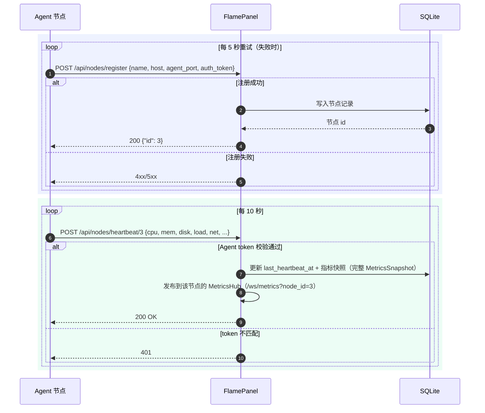

# 11 · Agent 节点通信协议

> FlamePanel Agent（`flamepanel-agent`）与面板核心之间的完整通信协议、安全模型与扩展指南

## 1. 概述

`agent/` 是 FlamePanel 的轻量节点代理（Rust + Axum 0.8 + reqwest 0.12 + sysinfo 0.39），部署在被纳管的服务器节点上，负责：

1. **注册与心跳**：启动时向面板注册节点，随后每 10 秒上报一次系统指标。
2. **命令执行**：面板侧可通过 Agent HTTP 接口在节点上执行**白名单命令**（`/action` → `whitelisted_command`）。
3. **文件访问**：提供节点文件系统列表、下载、上传能力。

```
┌──────────────┐   REST(HTTPS)    ┌────────────────┐
│  FlamePanel  │◄────────────────►│ flamepanel-agent │
│  面板核心     │  注册/心跳/命令   │ 节点 Agent (9527) │
│  :8080       │                  │  :9527          │
└──────────────┘                  └────────────────┘
```

> 连接模式（`AGENT_MODE`）：`direct`（默认，面板直连 Agent 的 9527）、`edge`（Agent 主动以 WebSocket 连面板，**零入站端口**，见 §8）、`both`（迁移期两者并存，面板优先走 Edge）。交互式远程终端只经 Edge 通道提供，且须节点侧 `AGENT_TERMINAL=1` 显式开启。

## 2. Agent 配置

Agent 全部配置通过环境变量注入：

| 环境变量 | 默认值 | 说明 |
|----------|--------|------|
| `PANEL_URL` | `http://127.0.0.1:8080` | 面板地址（注册/心跳目标） |
| `NODE_NAME` | 系统主机名 | 节点显示名称 |
| `NODE_HOST` | 本机内网 IP（探测） | 节点地址，上报给面板 |
| `AGENT_PORT` | `9527` | Agent HTTP 服务监听端口 |
| `AUTH_TOKEN` | 随机生成 | Agent 接口鉴权令牌（`/action`、`/files/*`；Edge `hello` 亦用它鉴权）。面板发送 `Authorization: Bearer <token>`，Agent 兼容裸 token |
| `AGENT_MODE` | `direct` | `direct` / `edge` / `both`；`edge` 不监听任何端口，非法值按 `direct` 运行并告警 |
| `AGENT_TERMINAL` | 关闭 | `1/true/yes/on` 开启交互式远程终端（shell 以 Agent 身份运行、cwd 为 `FILE_ROOT`，**绕过 `/action` 白名单**，仅在信任面板管理员时开启） |

启动命令：

```bash
PANEL_URL=http://your-panel:8080 \
NODE_NAME=node-01 \
NODE_HOST=10.0.0.2 \
AGENT_PORT=9527 \
AUTH_TOKEN=your-secret-token \
cargo run --manifest-path agent/Cargo.toml
```

> ⚠️ **安全提醒**：`AUTH_TOKEN` 默认随机生成，但在生产环境务必显式指定强随机令牌，且 Agent 与面板之间应通过 HTTPS（Nginx/TLS）或内网隔离保护，避免令牌明文泄露。

## 3. 与面板的通信流程



### 3.1 注册（启动时）

Agent 启动后**循环重试**（间隔 5 秒）向面板注册：

```
POST {PANEL_URL}/api/nodes/register
Content-Type: application/json
X-Bootstrap-Token: <面板引导令牌>       # 可选但建议：与面板 OP_BOOTSTRAP_TOKEN 一致
Authorization: Bearer <AUTH_TOKEN>

{
  "name": "node-01",
  "host": "10.0.0.2",
  "agent_port": 9527,
  "auth_token": "your-secret-token"
}
```

- 成功：返回 `200`，响应体为节点 `id`（`{"id": 3}`），Agent 保存该 ID 用于后续心跳。
- 失败：打印错误日志，5 秒后重试，直到注册成功才进入后续流程。

> 对应面板实现：`POST /api/nodes/register`（公开路由但受 **Bootstrap Token 防护**——需携带 `X-Bootstrap-Token` 头且与面板 `OP_BOOTSTRAP_TOKEN`/配置 `bootstrap_token` 常量时间比较一致，缺失或错误返回 `401`；未配置时面板启动生成随机令牌并打印一次）。Agent 通过环境变量 `BOOTSTRAP_TOKEN` 配置该令牌（留空则不携带，适用于未启用引导令牌的旧面板）。
> Stage5 已落地：Agent 注册时携带的 `auth_token` 与 `agent_port` 会持久化到 `nodes` 表（幂等迁移补列），面板后续远程调用携带 `Authorization: Bearer <auth_token>` 完成 Agent 侧鉴权。

### 3.2 心跳（周期上报）

注册成功后，Agent 每 10 秒上报一次系统指标：

```
POST {PANEL_URL}/api/nodes/heartbeat/{node_id}
Content-Type: application/json

{
  "cpu_usage": 12.3,
  "memory_usage_percent": 45.6,
  "disk_usage_percent": 67.8,
  "load_one": 0.45,
  "load_five": 0.40,
  "load_fifteen": 0.31,
  "cpu_cores": 8,
  "memory_total_mb": 16000,
  "memory_used_mb": 7296,
  "disk_total_gb": 100.0,
  "disk_used_gb": 67.8,
  "network_rx_mbps": 1.2,
  "network_tx_mbps": 0.3
}
```

> 前 4 项为旧协议字段；其余字段为 batch-12 新增（Doc/30 M-P），面板侧 `#[serde(default)]`，旧 Agent 只发 4 项照常工作（缺省记 0）。网络速率由 Agent 按非回环网卡累计字节数在两次心跳之间的**实际间隔**计算（MB/s）；首个心跳没有基准记 0，计数回绕 / 网卡重建记 0。采集只刷新 CPU 与内存（不再每 10 s 全量扫进程表）。

> 对应面板实现：`POST /api/nodes/heartbeat/{id}`（公开白名单免 JWT，但校验 Agent token——`Authorization: Bearer <auth_token>` 与库中节点 token 常量时间比较，无效返回 401；兼容旧 Agent：库中无 token 时放行）。心跳记录 `last_heartbeat_at` 与最新指标快照，节点在线状态由前端惰性判定。

### 3.3 指标采集逻辑（Agent 侧）

`collect_metrics(&mut sys)` 使用 `sysinfo` 采集：

| 指标 | 来源 | 说明 |
|------|------|------|
| `cpu_usage` | `sys.global_cpu_usage()` | 全核平均 CPU 使用率（0-100） |
| `memory_usage_percent` | 内存 used/total | 百分比 |
| `disk_usage_percent` | 所有磁盘总和 used/total | 跨磁盘聚合 |
| `load_one` | `System::load_average()` | 1 分钟负载 |

## 4. Agent 本地 HTTP 接口（供面板调用）

Agent 监听 `0.0.0.0:{AGENT_PORT}`，所有接口均需 `Authorization` 头携带与 `AUTH_TOKEN` 一致的令牌，否则返回 `401`。

### 4.1 `POST /action` — 动作分发（统一命令/探测入口）

> S4：原始 `/exec` 任意命令端点已删除，远程命令统一走 `/action` 动作枚举（`whitelisted_command`）。
> Agent 侧只接受**白名单命令**，非白名单命令返回 `ACTION_NOT_ALLOWED`（功能降级，禁止任意 Shell）。

**请求**（执行白名单命令）：

```json
{
  "action": "whitelisted_command",
  "params": { "command": "uptime", "timeout_secs": 30 }
}
```

| 字段 | 类型 | 默认 | 说明 |
|------|------|------|------|
| `action` | string | 必填 | 动作枚举，如 `whitelisted_command`/`ping`/`system_info` 等 |
| `params.command` | string | 必填 | 白名单命令（POSIX `sh -c`）；非白名单被拒 |
| `params.timeout_secs` | uint | 30 | 超时秒数，超时返回 `Command timed out` |

**响应 200（成功）**：

```json
{
  "status": "ok",
  "data": { "output": " 10:20:30 up 3 days...", "exit_code": 0 }
}
```

**响应（非白名单拒绝）**：

```json
{
  "status": "err",
  "data": { "code": "ACTION_NOT_ALLOWED", "message": "command not in whitelist: rm -rf /" }
}
```

- `output`：stdout + stderr 合并输出（UTF-8 丢失转义处理）。
- `exit_code`：进程退出码；执行错误为 `-1`，超时为 `-1`（output 为 `Command timed out`）。
- 仅允许**白名单命令**，禁止 `;`、`|`、`&`、`$()`、重定向等危险元字符。

**结构化执行 `exec`（Doc/33 P-1，面板优先使用）**：

```json
{
  "action": "exec",
  "params": {
    "program": "mysql",
    "args": ["-u", "root"],
    "env": { "MYSQL_PWD": "…" },
    "stdin": "SELECT 1;",
    "timeout_secs": 30
  }
}
```

| 字段 | 类型 | 默认 | 说明 |
|------|------|------|------|
| `params.program` | string | 必填 | 程序名；`program + args` 须匹配白名单（按 token 与 argv 对齐，不经 shell） |
| `params.args` | string[] | `[]` | 参数逐项传递，含空格 / 引号的参数不会被拆分 |
| `params.env` | object | `{}` | 仅允许 `MYSQL_PWD` / `PGPASSWORD` / `REDISCLI_AUTH` / `DEBIAN_FRONTEND` |
| `params.stdin` | string | — | 仅限精确 argv：`mysql -u root`、`psql -X -U postgres -At -v ON_ERROR_STOP=1`、`mongosh --quiet --nodb`、LiteSpeed / MongoDB 仓库文件 `tee`；上限 1 MiB |
| `params.timeout_secs` | uint | 30 | 超时秒数 |

成功返回 `{"status":"ok","data":{"output","stdout","stderr","exit_code"}}`；策略拒绝为 `ACTION_NOT_ALLOWED`（只回显程序名与原因，不回显参数 / stdin），执行失败为 `EXEC_FAILED`。
**数据库 / 运行时安装的逐项白名单**（`agent/src/install_policy.rs`，Doc/30 M-C）：

- `sh` **只能**经结构化判定放行，永不落入前缀匹配：`-c` 后的脚本必须与内核常量逐字节相等、`$0` 名称匹配——`flame-append`（追加配置行：目标文件限 Redis / MySQL / MariaDB / MongoDB 配置清单，内容必须单行，唯一多行例外是 `mongod.conf` 的鉴权常量片段）与 `flame-pg-port`（端口必须是 1–65535 数字，候选文件限发行版 `postgresql.conf`）。
- `sed` 同样只走结构化判定：`sed -i s/^port .*/port N/ <redis.conf>`、`sed -i -E s/^(\s*port:\s*)[0-9]+/\1N/ /etc/mongod.conf`。
- 前缀补齐：`dnf` / `yum` / `zypper --non-interactive` / `pacman` 的安装卸载与查询、`dpkg-query -W`、`rpm -q`、`apk list --installed` / `apk info -e`、`pg_isready`、`psql --version`、`postgresql-setup --initdb`、`runuser -u postgres -- initdb -D /var/lib/postgres/data`、`mongod --version`、MongoDB 签名密钥的精确 `wget`、`uname -m`。
- 运行时编译（`configure` / `make` / `go build` / `npm`…）**不**进白名单：内核以 `LocalUnlessRootRunner` 包装运行时与项目服务，只有 `prefer_root` 步骤经 Agent，其余以面板用户本机执行。
- 脚本常量由单测 `include_str!` 对照内核源码，任何一侧改动而另一侧未同步都会让测试失败。
- 通过 `OP_MYSQL_CONFIG` / `OP_REDIS_CONFIG` 指向非标准路径时，agent 模式下的配置追加会被拒（只放行发行版标准路径）。

**兼容**：旧版 Agent 不认识 `exec` 会返回 HTTP 400，面板自动回退 `whitelisted_command`——仅限无 env / stdin 且参数不含空白与引号的命令，其余命令提示升级 Agent。

**鉴权失败**：

```json
{ "error": "Unauthorized" }   // HTTP 401
```

### 4.2 `GET /files/list?path=/tmp` — 列目录

**请求**：`GET /files/list?path=<绝对路径>`（`path` 缺省为 `.`）

**响应 200**：

```json
[
  { "name": "test.log", "is_dir": false, "size": 1024, "modified": "1750000000" },
  { "name": "app",      "is_dir": true,  "size": 4096, "modified": "1750000100" }
]
```

- 目录排在文件前，同类型按名称字典序。
- `modified` 为 Unix 秒级时间戳字符串。

### 4.3 `GET /files/download?path=/etc/hosts` — 下载文件

**请求**：`GET /files/download?path=<绝对路径>`

**响应**：
- `200`：文件原始字节流（`application/octet-stream`）。
- `404`：路径不是文件 → `{ "error": "File not found" }`。
- `500`：读取失败 → `{ "error": "Read error: ..." }`。

### 4.4 `POST /files/upload?path=/tmp/x.txt` — 上传文件

**请求**：`POST /files/upload?path=<目标绝对路径>`，body 为原始文件字节（`application/octet-stream`）。

**响应 200**：

```json
{ "message": "ok", "size": 12345 }
```

- 会自动创建目标父目录。

## 5. 安全模型

| 层面 | 现状 | 风险与建议 |
|------|------|------------|
| 面板 → Agent 鉴权 | 单一 `AUTH_TOKEN`，`Authorization: Bearer <token>` 常量时间比对（batch-13 修复：此前 Agent 拿整个头值比对，面板的 Bearer 调用在真实 Agent 上一律 401） | 建议升级为 JWT / mTLS；令牌经 `PANEL_URL` 所在内网分发 |
| Edge 通道 | `hello` 帧 token 校验（失败延迟 500 ms 后 4001 关闭）；`req` 帧**不携带 token**，Agent 用自身 token 在进程内回放 | 面板须走 HTTPS（`wss://`），Agent 内置 webpki 根证书校验 |
| 远程终端 | 默认关闭；`terminal:execute` + `node:execute` 双权限，开 / 关审计 `OPEN_REMOTE_TERMINAL` / `CLOSE_REMOTE_TERMINAL` | 等价于以 Agent 身份的 shell，生产建议 Agent 以非 root 运行 |
| Agent 注册令牌 | Stage5 已持久化到 `nodes.auth_token`（注册时落库），面板远程调用携带 `Bearer <auth_token>` 校验；建议后续补充注册时令牌唯一性校验 |
| 命令执行 | 任意 shell 命令 | **高危**。建议增加命令白名单/黑名单、审计日志、操作人绑定 |
| 传输加密 | 明文 HTTP | 生产必须走 HTTPS / VPN / WireGuard 内网 |
| 端口暴露 | `0.0.0.0:9527` | 建议仅监听内网地址 `127.0.0.1` 或指定网卡 |
| 文件访问 | 任意路径读写 | 建议限制在节点 `allowed_paths` 配置内（防目录穿越） |

## 6. 与现有面板模块的关系

| 面板模块 | 与 Agent 的关系 |
|----------|-----------------|
| `node` handler | `POST /api/nodes/register` 承接 Agent 注册（`CreateNodeRequest` 平铺格式 + auth_token + agent_port）；`/api/nodes/{id}/execute`、`/api/nodes/{id}/files*` 远程调用（Stage5） |
| `file` handler | 面板本地文件操作；Agent `/files/*` 是**远程节点**文件操作的对应能力（Stage5 已在面板前端集成：节点文件弹窗） |
| `terminal` | 面板本地 bash WebSocket 终端；Agent `/action`（`whitelisted_command`）可视为远程命令的同步、白名单受限版本 |
| `ws/metrics` | 缺省为面板**本机**指标；`?node_id=` 订阅节点指标——心跳经 `snapshot_from_heartbeat` 规整后发布到每节点 `MetricsHub`（`infrastructure/node_metrics.rs`，120 点内存窗口），帧格式与本机一致；仪表盘右上角切换节点，节点列表「监控」直达 |
| `event` 总线 | 建议在 Agent 注册/心跳/掉线时发布 `DomainEvent`，驱动通知（见 12 文档） |

## 7. 扩展指南

### 7.1 新增 Agent 能力端点

标准步骤（与后端六步流程对齐）：

1. **协议定义**：在 `agent/src/executor.rs`（动作）或 `agent/src/files.rs`（文件接口）增加 `#[derive(Deserialize)]` 请求结构体 + `#[derive(Serialize)]` 响应结构体。
2. **实现 handler**：参考 `exec_endpoint`，先做 `check_auth(headers)` 鉴权。
3. **注册路由**：`agent_routes()` 中 `.route("/xxx", post/ get(xxx_endpoint))`。
4. **面板侧调用**：面板 `application` 新增 Service 方法（reqwest 调用 `http://{node.host}:{node.agent_port}/xxx`，携带 `Authorization: AUTH_TOKEN`）。
5. **超时与重试**：复用 `resilience/retry.rs` + `circuit_breaker.rs` 包裹远程调用，避免面板阻塞。
6. **权限映射**：`api/types.rs` 的 `route_permission()` 增加对应资源/动作。

### 7.2 建议的能力矩阵（路线图）

| 能力 | 接口 | 优先级 |
|------|------|--------|
| 节点在线状态 | 面板心跳落库 + 超时判定 | P0 |
| 远程命令审计 | `/action`（`whitelisted_command`）操作日志 + 操作人 | P0 |
| 远程终端（WS） | ✅ Agent Edge 通道 `pty_*` 帧（§8.4） | P1 |
| 节点文件管理 | 面板前端集成 `/files/*` | P1 |
| 批量命令 | 多节点并行 `/action` | P2 |
| 节点进程/服务管理 | `/process/list`、`/service/restart` | P2 |

## 8. Agent Edge 出站反向通道（batch-13）

NAT / 防火墙后的节点无需开放任何入站端口：Agent 以 WebSocket 主动连接面板，面板的所有远程调用复用这条连接。

```
┌──────────────┐  wss://panel/ws/agent/edge  ┌──────────────────┐
│  FlamePanel  │◄────────────────────────────│ flamepanel-agent │
│  EdgeHub     │   req/resp · pty_* 帧        │ AGENT_MODE=edge  │
└──────────────┘   （面板每 20 s Ping）        └──────────────────┘
```

### 8.1 建链

1. Agent 将 `PANEL_URL` 换算为 `ws(s)://<host>/ws/agent/edge`（http→ws，https→wss），帧上限 64 MiB。
2. 首帧（10 s 内）：`{"type":"hello","node_id":1,"token":"<AUTH_TOKEN>","version":"1.0.0","terminal":false}`。
3. 面板比对节点 `auth_token`（常量时间）：失败 → 延迟 500 ms 以 **4001** 关闭；成功 → `{"type":"welcome","node_id":1}`，审计 `EDGE_CONNECT`（actor `agent:<id>`）。
4. 同一节点重连**顶替**旧连接，旧连接上未完成的请求立即以 503 失败；90 s 无任何入站帧视为半开连接断开。Agent 断线后指数退避（1 → 60 s）重连，稳定运行 > 120 s 的连接断开后从 1 s 重新退避。
5. 节点被删除时面板主动断开（`EdgeHub::remove_node`）。

### 8.2 请求回放（面板 → Agent）

面板 `AgentClient` 发现节点 Edge 在线时，`agent_base_url` 返回 `edge://<id>`，`/action`、`/files/*` 不再走 HTTP：

```json
{"type":"req","id":7,"method":"POST","path":"/action","content_type":"application/json","body":"<base64>"}
{"type":"resp","id":7,"status":200,"content_type":"application/json","body":"<base64>"}
```

- `path` 含 query（如 `/files/list?path=%2F`）；只允许 `GET` / `POST`，其余回 405。
- **帧内不携带 token**：Agent 在进程内把请求交给自身 `agent_routes()`（`tower::ServiceExt::oneshot`），注入 `Authorization: Bearer <自身 token>` 与回环 `ConnectInfo`——与直连模式同一套白名单、文件根目录与限流逻辑。
- 每个 `req` 独立任务处理，慢请求不阻塞其他请求与终端。超时 / 断路器 / 重试沿用 `AgentClient::send` 的统一策略，非 2xx 映射为 `agent returned HTTP <status>`。

### 8.3 节点状态

`GET /api/nodes/{id}/status` 增加 `edge` 字段：`{connected, terminal, version, connected_at}`。前端节点列表在 Edge 在线时显示「Edge」徽标，Agent 开启终端时出现「远程终端」入口。

### 8.4 交互式远程终端

浏览器连接 `/ws/terminal?node_id=<id>`，与本机终端**同一套**首帧鉴权与消息协议（`input` / `resize` / `auth` → `output`），额外帧：

| 帧 | 含义 |
|----|------|
| `{"type":"exit","code":0}` | shell 退出，会话结束（前端停止自动重连，「重连」开启新 shell） |
| `{"type":"error","code":"TERMINAL_DISABLED"}` | Agent 未开启 `AGENT_TERMINAL`（停止重连） |
| `{"type":"error","code":"TOO_MANY_TERMINALS"}` | 单节点并发终端已达 8 个（停止重连） |
| `{"type":"error","code":"EDGE_OFFLINE"}` | 节点 Edge 未在线 / 中途断开（前端退避重连等待上线） |

关闭码：4001 未认证、4003 缺 `terminal:execute` 或 `node:execute`（admin 豁免）、4004 节点不存在。会话空闲 10 分钟（无输入）、token 失效或权限被收回时关闭。

面板 ↔ Agent 帧：`pty_open{sid,cols,rows}`、`pty_in{sid,data(b64)}`、`pty_resize`、`pty_close`；Agent 回 `pty_out{sid,data(b64)}`、`pty_exit{sid,code}`、`pty_error{sid,message}`。Agent 侧 portable-pty（与内核本机终端同实现）：shell 取 `$SHELL`（绝对路径且存在）→ `/bin/bash` → `/bin/sh`，清理 `LD_*` 注入变量；Edge 断线时关闭全部 PTY。面板对多字节 UTF-8 跨帧做流式拼接（`utf8_stream_decode`）。

### 8.5 实现位置

| 侧 | 文件 |
|----|------|
| 面板 | `infrastructure/edge.rs`（`EdgeHub`、帧定义、PTY 路由）、`infrastructure/agent_client.rs`（`send` 统一传输）、`api/handler/ws/edge.rs`（`/ws/agent/edge`、节点终端） |
| Agent | `agent/src/edge.rs`（连接 / 回放 / 重连）、`agent/src/pty.rs`（PTY 管理）、`config.rs`（`AGENT_MODE` / `AGENT_TERMINAL`） |
| 测试 | `flame-kernel/tests/edge.rs`（真实 WebSocket 端到端：hello 4001、远程命令 / 文件经 Edge、状态透出、终端双向流 / UTF-8 跨帧 / exit、TERMINAL_DISABLED / EDGE_OFFLINE、401 / 4003 / 4004、删除节点断开）；`infrastructure::edge` 单测 9 项；Agent `edge` / `pty` 单测 |

### CPU 核数的启动探测回退（#187）

Agent `cpu_cores` 优先取 sysinfo 的逻辑 CPU 列表长度。启动采样时列表暂不可用则取标准库 `available_parallelism`（受容器 / 亲和性限制的可用并发度，不承诺完整主机拓扑）；探测仍不可用时保守取 1。既有字段类型、CPU 差分采样、百分比 / 网络速率与心跳周期不变；不以睡眠或全进程刷新掩盖缺失。
