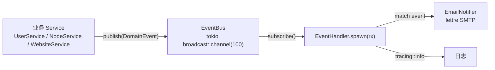

# 12 · 事件与通知系统

> FlamePanel 事件驱动架构（EventBus + EventHandler + 邮件通知）的实现细节与扩展指南

## 1. 架构总览

FlamePanel 内置一个轻量**进程内事件总线**，用于解耦"业务动作"与"副作用处理"（如发通知、审计、联动）。



- **EventBus**：`tokio::sync::broadcast` 多播通道，容量 100。
- **EventHandler**：订阅者任务，`tokio::spawn` 常驻，逐条消费事件。
- **EmailNotifier**：`lettre 0.11` 异步 SMTP 客户端。

## 2. 事件定义（DomainEvent）

`flame-kernel/src/domain/entity/event.rs`：

```rust
#[derive(Debug, Clone, Serialize, Deserialize)]
pub enum DomainEvent {
    UserCreated    { user_id: i64, username: String },
    NodeRegistered { node_id: i64, node_name: String },
    WebsiteCreated { website_id: i64, domain: String },
}
```

新增事件步骤：

1. `DomainEvent` 枚举新增变体（携带结构化字段，而非字符串拼接）。
2. 业务 Service 在对应操作成功后 `event_bus.publish(event).await`。
3. `EmailChannel::render` 增加 `match` 分支（静默事件返回 `None`）。

> **演进说明**：本节示例为初始 3 事件形态；当前事件族已扩展至用户/节点/网站/应用
> 安装卸载升级/防火墙/备份（含计划任务成败）/证书（签发、到期预警，30/7 天两级去重）
> /零停机切换失败/WAF 拦截（`WafBlocked`，按规则节流聚合）/审计补偿等 20+ 变体。
> 所有事件统一经 Outbox 落库存档（`/api/outbox-events`），邮件映射见 `EmailChannel::render`。

## 3. EventBus 实现

```rust
pub struct EventBus {
    tx: broadcast::Sender<DomainEvent>,
}

impl EventBus {
    pub fn new(capacity: usize) -> Self { ... }         // 容量 100
    pub async fn publish(&self, event: DomainEvent) -> Result<(), AppError> { ... }
    pub fn subscribe(&self) -> broadcast::Receiver<DomainEvent> { ... }
}
```

要点：

- **多播**：多个订阅者均可收到同一事件（`broadcast` 特性，未来可扩展多消费者）。
- **背压**：若订阅者消费慢于生产，`broadcast` 会按容量丢最旧事件（Lagged 错误），消费端需容错。
- **不阻塞**：`publish` 为异步发送，不等待订阅者处理完成。

## 4. EventHandler（订阅消费端）

```rust
pub struct EventHandler {
    notifier: Option<Arc<EmailNotifier>>,
}

impl EventHandler {
    pub fn new() -> Self { Self { notifier: None } }
    pub fn with_email(mut self, notifier: Arc<EmailNotifier>) -> Self { ... }
    pub fn spawn(self, mut rx: broadcast::Receiver<DomainEvent>) {
        tokio::spawn(async move {
            while let Ok(event) = rx.recv().await {
                tracing::info!("Event received: {:?}", event);
                if let Some(ref notifier) = self.notifier {
                    if let Err(e) = Self::handle_notification(notifier, &event).await {
                        tracing::error!("Notification failed ...");
                    }
                }
            }
        });
    }
}
```

通知规则（`EmailChannel::render` 的当前映射；未列出的事件静默不发邮件）：

| 事件 | 通知行为 |
|------|----------|
| `UserCreated` / `UserLoggedIn` / `PasswordChanged` | 发邮件给 `admin@flamepanel.local` |
| `NodeRegistered` / `NodeHeartbeat` / `NodeOffline` | 节点注册、心跳与离线告警邮件 |
| `AppInstalled` / `AppUninstalled` / `AppUpgraded` | 应用生命周期邮件 |
| `BackupCreated` / `BackupSucceeded` / `BackupFailed` | 备份产生与计划任务成败邮件 |
| `CertificateIssued` / `CertificateExpiring` | 证书签发与到期预警（30/7 天两级）邮件 |
| `CertificateRenewed` / `CertificateRenewalFailed` | 证书自动续签成功与失败通知（主线三 §6.1 Stage 3 · T-08）邮件 |
| `ProjectZeroDowntimeFailed` | 零停机切换失败回滚邮件 |
| `WafBlocked` | **WAF 拦截通知**：主题 `WAF Blocked: {rule_name}`，正文含规则类型、来源 IP、请求行摘要与本次通知窗口累计拦截次数（按规则 300s 节流聚合，防告警风暴） |
| `WebsiteCreated` / `FirewallRulesApplied` / `SetupCompleted` | 邮件 |
| `AuditEvent`（审计补偿） | 静默（仅日志 / Outbox 存档） |

## 5. 邮件通知（EmailNotifier）

`flame-kernel/src/notification/mod.rs`，基于 `lettre 0.11`：

- `SmtpConfig`：`host` / `port` / `username` / `password` / `from` / `use_tls`。
- 使用 `AsyncSmtpTransport::<Tokio1Executor>::relay(host)` + credentials + port 构建。
- 邮件为 `TEXT_PLAIN`，发送失败返回 `AppError::internal`。

**SMTP 配置来源**（`config/app.toml` + 环境变量覆盖）：

| 环境变量 | 默认 |
|----------|------|
| `OP_SMTP_HOST` | `localhost` |
| `OP_SMTP_PORT` | `25` |
| `OP_SMTP_USERNAME` | 空 |
| `OP_SMTP_PASSWORD` | 空 |
| `OP_SMTP_FROM` | `noreply@flamepanel.local` |
| `OP_SMTP_TLS` | `false` |

配置示例（`config/app.toml`）：

```toml
[notifications]
smtp_host = "smtp.example.com"
smtp_port = 465
smtp_username = "panel@example.com"
smtp_password = "xxxx"
smtp_from = "panel@example.com"
smtp_tls = true
```

## 6. 组合根接线（lib.rs）

```rust
let event_bus = EventBus::new(100);
let rx = event_bus.subscribe();
let notifier = Arc::new(EmailNotifier::new(smtp_config));
EventHandler::new().with_email(notifier).spawn(rx);
// ...
Self { config, event_bus, plugin_registry, app_state }
```

`event_bus` 存入 `FlameKernel`，业务 Service 通过 `FlameKernel` 持有引用发布事件。

> ⚠️ **当前实现说明**：事件总线已接线并在组合根创建订阅者，但业务 Service 中**尚未有实际 publish 调用**（`grep publish` 仅在 `event/bus.rs` 命中）。即"通道已就绪、发布端未接入"，是明确的深化切入点。

## 7. 扩展指南

### 7.1 发布事件的标准姿势

在业务 Service 成功操作后发布（不要放在失败路径）：

```rust
pub async fn create_user(&self, username: &str, hash: &str, role: &str) -> Result<i64, AppError> {
    let id = self.user_repo.create(...).await?;
    self.event_bus.publish(DomainEvent::UserCreated { user_id: id, username: username.into() }).await?;
    Ok(id)
}
```

> 注意：当前 Service 结构未注入 `event_bus`。建议通过 `Services` 聚合或构造函数注入，避免 Handler 直接发布。

### 7.2 新增事件类型模板

```rust
// 1. domain/entity/event.rs
pub enum DomainEvent {
    // ...
    AppInstalled { app_key: String, mode: String, user_id: i64 },
}

// 2. application/app_store_service/install.rs 安装成功后
self.event_bus.publish(DomainEvent::AppInstalled { ... }).await?;

// 3. event/handler.rs
DomainEvent::AppInstalled { app_key, mode, .. } => {
    notifier.send(recipient, &format!("App Installed: {app_key}"), &format!("{app_key} installed via {mode}")).await?
}
```

### 7.3 建议的事件集（路线图）

| 事件 | 触发点 | 建议消费者 |
|------|--------|------------|
| `AppInstalled` | 应用商店安装成功 | 邮件、操作审计 |
| `AppUninstalled` | 卸载成功 | 操作审计 |
| `WebsiteEngineSwitched` | 引擎切换 | 审计、告警 |
| `FirewallRuleApplied` | 防火墙规则生效 | 审计、告警 |
| `NodeHeartbeatTimeout` | 心跳超时（需先实现心跳） | 邮件告警、状态标记 |
| `BackupCompleted/Failed` | 备份任务（未来功能） | 邮件、审计 |
| `CertificateExpiring` | 证书即将过期（未来功能） | 邮件告警 |

### 7.4 幂等与可靠性建议

- `broadcast` 在进程重启后丢失未消费事件 → 对**审计类**需求建议同时落库 `operation_logs`（当前操作日志已独立实现）。
- 邮件发送失败已在 `EventHandler` 捕获并 `tracing::error`，不会影响主流程。
- 未来若需持久化事件，可引入 Outbox 模式：业务事务内写 `event_outbox` 表 + 后台投递。


## 8. 统一任务中心：确认式持久化（B02b）

`TaskTracker` 与事件 `broadcast` 是不同的机制。应用安装、源同步、Web 引擎切换及批量节点的任务记录共享组合根注入的 tracker；这不是事件 Outbox，也不是外部操作事务。

- `with_store` 创建的 tracker 必须先成功 `load_from_store().await`；成功恢复前不会执行变更；尚未发起恢复或恢复失败时，变更报错；正在恢复时排队等待恢复结果。纯内存 `new()` 无此初始化要求。
- `create`、状态/进度更新、删除及终态清理都是异步 `Result` API。恢复与变更共用 FIFO 写入屏障：取得屏障后才创建持有屏障的工作任务；存储返回成功后才发布内存快照。同步查询只读取最后一次确认提交的快照。
- 排队等待屏障时请求断开，不产生写入；取得屏障后的已接纳写入即使请求 future 被丢弃，仍继续到存储返回并完成内存发布。存储错误返回仍在等待的调用方，同时写入错误日志。进程强杀不在此保证内。
- 创建失败在本 tracker 生命周期中保留 ID 空洞，不复用已尝试的 ID；检查整数范围，拒绝生成启动恢复无法接受的 ID。SQLite / InMemory 的 `update` 只能更新已有行，缺失行报错，不允许 upsert 复活已删除任务。
- `remove` 缺失记录时幂等；终态清理按 ID 顺序逐条删除，**不是批量事务**。中途失败会保留尚未删除的记录，内部错误包含此前成功删除的数量；不会返回虚假的成功计数，也不会回滚已成功删除的行。
- 原有 `POST /api/tasks/{id}/cancel`、`POST /api/tasks/prune` 在持久化失败时返回既有 `AppError` 的 HTTP 500 / `INTERNAL_ERROR`。取消的 404 / 409、认证的 401 / 403 和成功响应结构保持原样；没有新增路由、字段或数据库迁移。
- 安装包互斥锁通过 RAII 释放，覆盖创建/启动任务失败与请求 future 被丢弃；正常停机先停止后台生产者，再等待已接纳写入排空。排空等待最多 5 秒，超时向上报错，不宣称完整优雅退出；等待超时本身不取消正在执行的存储 future。

**边界**：任务记录中的 `Cancelled` 仍然只表示状态迁移，不保证停止安装命令、引擎操作或已派发的节点执行。业务操作可能已经完成后才发生最终任务记录写入失败；不能据此认定业务回滚或自动重试。重启仍沿用 B02a：未完成任务标记为中断失败，不自动重放。SQLite 文件重开测试不等同于断电、磁盘损坏或真实安装验收。
